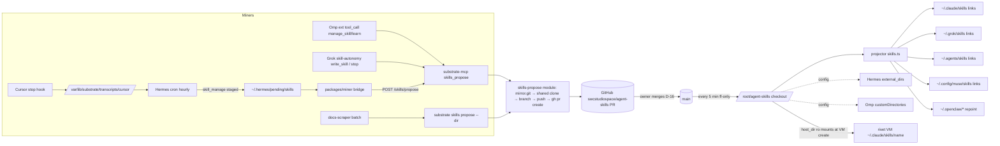

# Phase 4: Skills - Research

**Researched:** 2026-09-25
**Domain:** git-backed skills library, per-agent projection, miner → PR bridges (bun/TS monorepo + Python)
**Confidence:** HIGH for the agent loaders, gh, Hermes, Omp, Muse and rivet; MEDIUM for live reload timing and Cursor's user-dir symlink walk; LOW for VM copy latency (not measured).

Builds on `local://p4-scout-facts.md`, the four scout reports. This file only repeats a scout fact when a plan needs it, and corrects it where the scouts were wrong.

## Summary

Every locked decision is implementable with what is already installed. Nothing new needs to be installed from npm or pip. The probes turned up **five facts the planner must act on**. Each one changes a plan and is not visible from CONTEXT.md:

1. **The omp-ultrathink extension is not loaded.** `~/.omp/plugins/omp-plugins.lock.json` has `"omp-ultrathink": {"enabled": false}` (mtime 2026-09-24 22:46). The loader skips any disabled plugin (`pi-coding-agent/src/extensibility/plugins/loader.ts:188-191`). The live Omp extensions are `ultrathink` (→ `/root/src/repos/claude-ultrathink`, `src/host/omp.ts`) and `omp-all-in-one` (→ `/root/src/repos/plugin`). As written, a `tool_call` handler added to omp-ultrathink under D-11 would never run. Recommended fix, consistent with D-11's intent: a standalone extension file owned by agent-substrate, symlinked into `~/.omp/agent/extensions/`. That directory is auto-discovered, and symlinks are accepted (`extensions/loader.ts:547`). See Open Question 1.
2. **Running the existing redactor unchanged over skill content would damage real skills.** `redact()` changes **298 of 2,420** library files, including working auth instructions such as `parallel-common/SKILL.md:35` (`Authorization: Bearer $PARALLEL_API_KEY` → `Authorization: [REDACTED]`). A strict "reject on any secret-like match" would also reject 5 docs files that contain documentation-example PEM blocks and JWTs: docs-nextjs, docs-greptile, docs-kubernetes and docs-fastapi. D-09 needs a skill-content variant of the redactor. See Pattern 3 and Open Question 2.
3. **The Omp `tool_call` handler has a 30 s fail-closed budget** (`extensionHandlers.toolCallTimeoutMs`, default 30,000, `runner.ts:1560-1615`, `settings.ts:151-160`). The propose git path must finish well under 30 s, or the handler must queue and return. That favours a local bare mirror with shared clones over a fresh 47 MB clone per propose.
4. **The `cursor-agent` CLI bundled on the VPS is not signed in.** `cursor-agent status` → `Not logged in`. Upstream reports also say the CLI fires no `hooks.json` hooks in `--print` mode. The D-15 proof therefore takes the **owner-session checkpoint route** (checkpoint:human-action) from the start.
5. **Hermes cron scripts must be real files inside `~/.hermes/scripts/`.** A symlink that escapes that directory is blocked (`cron/scheduler_script.py:280-289`). The monitor/precheck script has to be a real shim file in that directory that execs the repo script.

Answers to all 13 questions are below, each with evidence.

**Primary recommendation:** tracer-first. (a) Migrate the library. (b) Build one shared TS module `skills-propose` (a bare mirror under `/var/lib/substrate/skills/`, a shared clone per propose, `gh pr create`), used by the MCP tool, the HTTP route and the CLI. (c) Add the sync timer and the projector (Claude and Grok links first). (d) Tracer: propose a small real skill (the Hermes miner's own skill) → owner merges → sync → `grok inspect` and the Claude init list show it. Then fan out: remaining projections, VM mounts, the three miners, docs-scraper and Cursor capture. The proof comes last.

## Architectural Responsibility Map

| Capability | Primary tier | Secondary tier | Rationale |
|---|---|---|---|
| Library storage and review | GitHub `swcstudiospace/agent-skills` | `/root/agent-skills` read-only checkout | D-01, D-04, D-16 |
| Propose (validate, redact, branch, PR) | substrate-mcp (`packages/mcp-server`) | CLI (`packages/cli`) for dirs over 1 MB | D-09. One code path, two entry points |
| Sync and projection | systemd timer → `packages/projector/src/skills.ts` | none | D-04, D-05. Nothing else writes the checkout |
| VM skills | substrate-host `vm.ts` `resolveOptions` mounts | `seed.ts` keeps the ultrathink skills | D-08 |
| Hermes mining | Hermes gateway cron (already running, PID 1094816) | `packages/miner` Python bridge | D-10, D-13 |
| Omp mining | Omp extension `tool_call` | propose HTTP | D-11 |
| Grok mining | skill-autonomy plugin (Python) | propose HTTP, local pending dir | D-12 |
| Cursor capture | Cursor `stop` hook → substrate script | `/var/lib/substrate/transcripts/cursor/` | D-15 |

## Standard Stack

No new dependencies.

| Need | Use | Evidence |
|---|---|---|
| YAML frontmatter parse (TS) | `Bun.YAML.parse` (bun 1.4.0; `stringify` also available) | probe: `typeof Bun.YAML.parse === "function"` |
| git/gh execution | `execFileRunner` pattern, `packages/host/src/hostfns.ts:100-112` (execFile, no shell, `HOME=/root`, 120 s) | existing |
| MCP tool | `server.registerTool` in `packages/mcp-server/src/mcp.ts:43+` with zod | existing (11 tools) |
| Redaction | `packages/mcp-server/src/redact.ts:18-53` `RULES` / `redact()` | existing; needs a skill variant |
| Python bridge | system `python3` + stdlib (`json`, `urllib.request`) | same as `packages/dispatcher` |
| Hermes patch replay | Hermes' own `tools/fuzzy_match.py:337 fuzzy_find_and_replace`, via `/usr/local/lib/hermes-agent/venv/bin/python` | or exact replace, see Pitfall 6 |
| VM mount | `host_dir` native mount plugin (`@rivet-dev/agentos-core/dist/host-dir-mount.d.ts`); already used at `vm.ts:372` | existing |

## Package Legitimacy Audit

No packages are added: no npm, PyPI or cargo installs. The legitimacy gate does not apply.

## Answers to the 13 open questions

### Q1 — Claude Code 2.1.278 and symlinked skill dirs: **follows them** (HIGH, from binary evidence)
- The user and project skills loader in the `claude.exe` bundle accepts a directory entry `if(!U.isDirectory()&&!U.isSymbolicLink())return null`. It then builds `<dir>/<name>/SKILL.md` and calls `g.stat(_e)`, which follows the link. It skips only when the result `!isFile()`. The only directory name it refuses is the reserved `synced`.
- A second enumerator (skill-as-plugin) uses the same `w.isDirectory()||w.isSymbolicLink()` test.
- The generic `.md` walker follows symlinks explicitly (`if(w.isSymbolicLink()){ let L=await stat(O) … }`) and has a guard against circular symlinks.
- Symlinked folders are rejected only in the **memory-skills** loader (`unsafe or symlinked skill folder`) and in the Cursor/`.agents` *import* routine. Neither is `~/.claude/skills`.
- Live pickup: the bundle has a chokidar-based `skillChangeDetector`. It logs `Detected skill change`, emits `tengu_skill_file_changed`, then re-announces the skill list with a debounce. [INFERENCE] A new symlinked skill dir appears in a running session without a restart. Confirm this in the live smoke run.
- I did **not** run a live `claude -p` probe, because it writes session files under `~/.claude/projects` and the constraints forbid touching `~/.claude`. The plan's tracer should run one:
  `claude -p ok --output-format stream-json --verbose --max-turns 1`
  Then check that the new skill name is in the `system/init` event's `slash_commands` array. The init event shape (`subtype:"init" … slash_commands: e.commands.filter(userInvocable)…`) was confirmed in the bundle.

### Q2 — Cursor reads `~/.agents/skills` and follows symlinks (HIGH for the path, MEDIUM for symlinks in user dirs)
- The official docs (https://cursor.com/docs/skills) load `.agents/skills/`, `.cursor/skills/`, `~/.agents/skills/` and `~/.cursor/skills/`. They also load `.claude/skills`, `.codex/skills`, `~/.claude/skills` and `~/.codex/skills` "for compatibility".
- The docs also say: "Cursor does not copy `~/.agents/skills/` … to Cloud Agents, **Agents Window remote SSH sessions**, or self-hosted workers." [INFERENCE] Classic IDE Remote-SSH runs the agent worker on the VPS (`~/.cursor-server/.../anysphere.cursor-agent-worker`), so the VPS's `~/.agents/skills` is local to it. The Agents Window remote-SSH mode may not see it. The owner's proof session must use the classic Remote-SSH window.
- The bundled agent (2026.08.11-e8db854):
  - `$r(home, thirdParty)` returns user dirs `~/.agents/skills` and `~/.cursor/skills`, plus `~/.claude/skills` and `~/.codex/skills` when third-party extensibility is on.
  - Workspace discovery walks use `followSymlinks: true` (`nested_extensibility` walk; `walkFiles(... followSymlinks:!0)`).
  - [INFERENCE] The user-dir scan uses the same ripwalk code with `--follow`. It was not traced end to end.
- **Duplicate risk:** with third-party on, Cursor sees each library skill twice, once via `~/.claude/skills` and once via `~/.agents/skills`, with the same realpath. Cursor's dedupe is undocumented. The owner checkpoint should confirm the Cursor `/` skill menu shows each skill once. If it shows duplicates, drop the `~/.agents/skills` links: Cursor still gets them through `~/.claude/skills`, and Omp through customDirectories. D-05 allows this fallback in spirit.

### Q3 — Muse 1.4.0: **symlinks in `~/.config/muse/skills`**, not the plugin (HIGH, probed)
- Probe in `/tmp` with `HOME` and `XDG_CONFIG_HOME` pointed at throwaway dirs, then deleted:
  - `muse skills install <dir> --scope user --json` **copies** the files into `$CONFIG_DIR/skills/<id>/`. It records a sha256 provenance entry in `skills/.muse/lock.json` and also creates `audit.log`, `quarantine/` and `.skills.lock`.
  - A **manually placed symlink** `~/.config/muse/skills/linked-skill -> /elsewhere/linked-skill` is listed by `muse skills list --source user` as `scope:user, activation:on, provenance:null`.
  - Symlinks therefore work, and they track the checkout without reinstalling.
- Plugin `capabilities.skills` entries are `{"id","path":"skills/<x>/SKILL.md","enabledDefault"}` with relative paths. The contract says "a symlink must not escape the plugin or workspace root" (`create-plugin/references/native-plugin-contract.md:54-71`). Muse also caches plugins by content hash under `~/.local/share/muse/plugins/cache/local/<id>/<sha>/`.
  - Going through the plugin would mean copying 47 MB into the plugin bundle and reinstalling on every sync.
  - **Recommendation:** per-skill symlinks in `~/.config/muse/skills` (the directory does not exist yet; the projector creates it). Leave `projector/src/muse.ts` `capabilities.skills: []` untouched.
- Reload: `/skills reload` or a new session [INFERENCE]. `~/.agents/skills` is import-only for Muse (bundled `create-skill/SKILL.md`).

### Q4 — Omp 18.3.1 (HIGH, read from source)
- **`skills.customDirectories`** (`src/extensibility/skills.ts:270-346`):
  - Each directory is scanned as provider `custom`, level `user`, with `requireDescription: true`.
  - A custom-dir skill **overrides** a default-provider skill of the same name (issue #7190 comment at :327-337).
  - A skill whose `realpath` was already loaded is skipped silently (:320-323). The `~/.omp/skills/*` links and the `~/.agents/skills/*` links that resolve into `/root/agent-skills` therefore dedupe cleanly.
  - Managed (autolearn) skills resolve last, first-wins.
- Set it with `omp config set skills.customDirectories '["/root/agent-skills"]'` (`src/cli/config-cli.ts:173,282`; array parsing via `setting.parse` [INFERENCE]), then check with `omp config get`. Fallback: edit `~/.omp/agent/config.yml` after a backup.
- **`autolearn.enabled`**: `src/autolearn/settings.ts:11`, default false. `learn` additionally needs a `memory.backend` of hindsight, mnemopi or local (scout fact).
- **Tool args:**
  - `manage_skill`: `{action:'create'|'update'|'delete', name, description?, body?}`, where body is the SKILL.md markdown **without frontmatter**. create and update require both description and body (`src/tools/manage-skill.ts:17-31`).
  - `learn`: `{memory, context?, skill?: {action:'create'|'update', name, description, body}}` (`src/tools/learn.ts:14-21`).
- **Interception API** (`src/extensibility/extensions/types.ts:957-1005`, `shared-events.ts:313+`):
  - The handler receives `{type:"tool_call", toolCallId, toolName, input}`.
  - It returns `{block:true, reason}`; the reason goes back to the LLM as a tool error.
  - It may instead return `{input}` to rewrite the args.
  - The first handler that returns `block` wins.
  - Timeout is `extensionHandlers.toolCallTimeoutMs` (30 s). On timeout or throw the result is **fail-closed**: `{block:true}`.
- **Extension shape and loading:** `export default function (pi) { pi.on("tool_call", (event, ctx) => …) }`. An example is `~/.omp/agent/extensions/herdr-omp-agent-state.ts:245,375`. Files in `~/.omp/agent/extensions/` load automatically, and symlinks are accepted (`extensions/loader.ts:547`, `discovery/builtin.ts:490-594`).
- **omp-ultrathink status:** repo `/root/src/repos/omp-ultrathink`, linked from `~/.omp/plugins/node_modules/omp-ultrathink`, **disabled** in the lock (Summary item 1). Its git baseline tracks only `.gitignore config.ts index.ts mcp-client.ts package.json swe.test.ts swe.ts tsconfig.json` (`git ls-files`). It already has an observe-only `pi.on("tool_call")` at `index.ts:872`, and its own `skill-creator.ts` writes `~/.omp/agent/skills/learned/<name>` (`config.ts:341`). If the owner chooses to re-enable it instead, that is a second live skill writer that also needs interception.

### Q5 — Hermes v0.21.4 (HIGH, read from source)
- **Reject programmatically:** there is no CLI subcommand, only the `/skills reject <id>` slash command. It calls `write_approval.discard_pending(subsystem, id)`, which **just unlinks** `~/.hermes/pending/skills/<id>.json` (`tools/write_approval.py:117-126`; `hermes_cli/write_approval_commands.py:49,123-133`).
  - The bridge can unlink the file directly (same semantics) or import `tools.write_approval` with the Hermes venv python (`/usr/local/lib/hermes-agent/venv/bin/python`).
  - Approve replays the write via `apply_skill_pending(payload)` with `_skill_gate_bypass`, then discards (`skill_manager_tool.py:652-658`).
- **Staged record:** `{id (8 hex), subsystem, action, summary, origin, created_at (epoch float), payload}` (`write_approval.py:73-88`). The gate sits **before** validation (`skill_manager_tool.py:779`), so every call is staged, including invalid ones. Payload shapes are the `skill_manage` kwargs with `None` dropped (`:633-642`):
  - create: `{action:"create", name, content (full SKILL.md incl. frontmatter), category?, replace_all:false}`
  - edit: `{action:"edit", name, content, replace_all:false}`
  - patch: `{action:"patch", name, old_string, new_string, file_path?, replace_all}`. Without `file_path` it targets SKILL.md.
  - write_file: `{action:"write_file", name, file_path (under references/ templates/ scripts/ assets/), file_content, replace_all:false}`
  - delete and remove_file: `{action, name[, file_path], absorbed_into?}`
  - batch: `{action:"batch", operations:[{action,name,...}, …]}` (`skill_manager_batch.py:212-219`)
- **Config:**
  - `hermes config set skills.write_approval true` and `hermes config set memory.write_approval true`. Bool coercion is in `hermes_cli/config.py:3315-3345`.
  - `hermes config set skills.external_dirs '["/root/agent-skills"]'`. The value is parsed as YAML into a real list (`_coerce_config_set_value`).
  - The gate reads config on every call (`write_approval.py:43-51`, `load_config()`), so the running gateway needs no restart.
  - `get_external_skills_dirs` caches by a config-file key (`agent/skill_utils.py:359-385`).
- **Collisions:** local skills beat external_dirs (`prompt_builder.py:1265`, scout). The inventory below lists the 33 local links and the research dir to remove.
- **Cron:**
  - `hermes cron create "0 * * * *" "<prompt>" --name substrate-skill-miner --skill <miner-skill> --monitor-script <file under ~/.hermes/scripts> --workdir /root/src/repos/agent-substrate`
  - `--monitor-script` runs each tick before the agent. Unchanged output (exact-bytes hash) **suppresses the agent run**; changed output injects a diff. It cannot be combined with `--no-agent` (`cron/jobs.py:1672-1680`). This is the D-13 precheck; its output must be stable (no timestamps).
  - `--script` output is injected into the prompt.
  - `--skill` resolves via `_find_skill`, which also searches external_dirs (`skill_manager_tool.py:228`), so the miner skill can live in the library.
  - The scheduler is the Hermes gateway (`hermes cron status`: "host gateway (PID 1094816) … cron jobs will fire automatically"), `hermes-gateway.service`.

### Q6 — gh under systemd (HIGH, verified read-only)
- `env -i HOME=/root PATH=/usr/bin:/bin gh auth status` → logged in as **SomeRandmGuyy** from `/root/.config/gh/hosts.yml`, active account, https.
- Scopes include `repo`, `admin:org`, `delete_repo` and `workflow`.
- `gh api orgs/swcstudiospace/memberships/SomeRandmGuyy --jq '.role+" "+.state'` → `admin active`.
- `members_can_create_private_repositories` → `true`.
- git credential helper: `credential.https://github.com.helper = !/usr/bin/gh auth git-credential`, so a push from a systemd unit with `HOME=/root` authenticates.
- substrate.env has 0 `GH_TOKEN`/`GITHUB_TOKEN`, as before. It is mode 600 root.
- Repo creation (D-01): `gh repo create swcstudiospace/agent-skills --private --description …` from a root shell. It is a one-time owner-authorized act that stays inside the plan. The threat flag (the PAT has admin:org and delete_repo) carries over from 03-07.

### Q7 — rivet-agentos read-only host mount: **available**. Recommend per-skill mounts (HIGH for the API, MEDIUM for nesting behaviour)
- `@rivet-dev/agentos-core/dist/host-dir-mount.d.ts`:
  - `hostDirMount(path, hostPath, {readOnly?})` defaults to read-only.
  - `createHostDirBackend({hostPath, readOnly})`.
  - The native `host_dir` plugin: "The guest sees only the mounted subtree."
- `AgentOsOptions.mounts?: MountConfig[]` (`agent-os.d.ts:405-406`). Dynamic `filesystem.mount(descriptor)` and `listMounts()` also exist (:587-589).
- `vm.ts:372` already mounts the worktree: `mounts: [{ path: "/home/agentos/work", plugin: { id: "host_dir", config: { hostPath: worktree } } }]`.
- The VM filesystem API has **no symlink creation**, so in-VM links are not possible.
- **Design:** at `resolveOptions` (VM creation for each graph key), list `/root/agent-skills/*/SKILL.md`. For each skill whose name matches `SEED_REL_RE` and is not an ultrathink name, append `{path:"/home/agentos/.claude/skills/<name>", plugin:{id:"host_dir", config:{hostPath:"/root/agent-skills/<name>", readOnly:true}}}`.
  - Seeding (`seed.ts:254-266`) keeps writing the 4 ultrathink skills, so `seed.test.ts:84-87,155` and `tasks.test.ts:233-241` do not change.
  - Mounts reflect the host checkout live. A merged skill reaches every VM created after the sync. Skills added after a VM exists are not mounted in that VM; D-08 only requires "the next VM".
- **Copy alternative:** 2,421 files / 47 MB, each doing `writeFile` plus `readFile` plus sha256 over sidecar IPC (`tasks.ts:394-400`), recorded into the task record (`SeededFile[]` with 2,421 entries). The latency is not measured; [INFERENCE] tens of seconds per openTask. It also bloats `/var/lib/substrate/agentos/tasks/*.json`. `loadSkills` reads files as UTF-8 (`main.ts:73-92`), so binary files would corrupt. **Use mounts.**
- **Unknowns for a Wave-0 spike:**
  - (a) nested mount points under an overlay dir that seed also writes into;
  - (b) whether the mount-count limit ("Mount plugin manifest size limits", `agent-os.d.ts:250`) allows 40+ mounts;
  - (c) that the VM's Claude sees them;
  - (d) `EROFS` on write.
- Fallback if nested mounts fail: one read-only mount of the whole library at `/home/agentos/.claude/skills`, with the 4 ultrathink skills also mounted read-only from the plugin cache dir. That changes the seeded paths and would need a Phase-3 test update, which D-08 forbids unless unavoidable.

### Q8 — skill-autonomy plugin (HIGH)
- **Source:** `/root/src/repos/skill-autonomy`, no `.git`. It is byte-identical to `~/.grok/installed-plugins/skill-autonomy-6d1e8e39` (`diff -rq` gives no output).
- **Registry:** `~/.grok/installed-plugins/registry.json` → `repos/skill-autonomy-6d1e8e39: {kind:{type:"Local", source_path:"/root/src/repos/skill-autonomy"}}`.
- **Reinstall:** `grok plugin update skill-autonomy` recopies from the Local source (`grok plugin update [NAME]`). Then verify with `diff -rq` and `grok inspect` (lists `autolearn  plugin: skill-autonomy`).
- **Tests:** 9 test files; **25 passed** (`cd /root/src/repos/skill-autonomy && python3 -m pytest -q -p no:cacheprovider`). Record this as the plugin's two-sided baseline.
- **Change points:**
  - `src/skill_autonomy/skill_write.py:66-98` `write_skill()` writes `root/<name>/SKILL.md`. Change it to build the file map (`render_skill(draft)`) and call a new `propose.propose_skill(name, files, surface="grok-build", session_id)`, which POSTs `http://127.0.0.1:7410/skills/propose`. On failure it stages to `~/.grok/plugin-data/skill-autonomy/pending/<name>-<ts>/`. It must never write `~/.grok/skills`. Keep `looks_secret_heavy` (`secrets.py:28`) as a first gate.
  - `improve.py:137` is the only production caller of `write_skill` (`--apply`).
  - `hooks/stop.py:17-69` does not write the file. It returns additionalContext telling **the model** to write `~/.grok/skills/<name>/SKILL.md` (:60-68), and `~/.grok/rules/skill-autonomy.md:23` says the same. Both must change: the model writes a draft under `~/.grok/plugin-data/skill-autonomy/drafts/<name>/SKILL.md`, then runs `"${GROK_PLUGIN_ROOT}/bin/skill-autonomy" propose <draft-dir>`. That needs a new `cmd_propose` in `cli.py` (dispatcher at :132).
  - The `skill_exists(draft.name, user_skills_dir(home))` check (stop.py:54) should also check `/root/agent-skills/<name>`.
  - Tests: `tests/test_improve.py:24,48-55` and `tests/test_hooks.py` assert writes into `grok_home/"skills"`. Update them to assert a propose call through an injected client, plus pending on failure.
- Grok has **no substrate MCP server** (no `[mcp_servers.substrate]` in `~/.grok/config.toml`; servers are Thesys, runpod, notion, linear, greptile, aio). The plugin uses the HTTP route. No `SUBSTRATE_TOKEN_*` exists (all counts 0), so the server runs anonymous and the `surface` field is taken from the body.
- `~/.grok/rules/skill-autonomy.md` is a live file: snapshot it before editing.

### Q9 — docs-scraper (HIGH)
- **Git state:** there is no repo of its own. `git rev-parse --show-toplevel` = `/root/.openclaw/workspace` (branch `master`, **no commits**, everything untracked: AGENTS.md, SOUL.md, memory/, handoffs/, projects/, skills/ …). Everything under `projects/docs-scraper` is untracked. `data/exports`, `data/db`, `data/raw`, `.venv` and `__pycache__` are ignored. It is 860 K without data.
  - **Baseline:** a single **path-scoped** commit, `git -C /root/.openclaw/workspace add -- projects/docs-scraper && git commit -m "chore(substrate): baseline docs-scraper before Phase 4 Refs SPE-2734" -- projects/docs-scraper`. Do not commit OpenClaw's other workspace files (persona/memory content that belongs to another agent).
  - Undo: `git update-ref -d HEAD`, or `rm -rf .git` if the plan created the repo. The repo already exists, so use `update-ref`.
- **Change points** in `scripts/batch_docs_skills.py`:
  - `:40-45` env targets `AGENT_SKILLS`, `HERMES_SKILLS`, `OPENCLAW_SKILLS`, `OPENCLAW_WS_SKILLS`: remove them.
  - `:163-189` `_install_skill()`: replace it with `_propose_skill(out, skill_name)`, which runs `bun /root/src/repos/agent-substrate/packages/cli/src/index.ts skills propose --dir <out> --surface docs-scraper --rationale "docs-scraper batch <id> (<pages> pages)"` and returns the PR URL.
  - `:317` call site: `result["install"] = links` becomes `result["pr_url"]`.
  - `:330-361` `_update_agent_skills_readme()` and its call at `:415-417`: delete both. The README is now library content, changed only by PR.
  - `:236` `export_dir` stays (the exports dir remains the build area).
  - `--dry-run` must not propose.
- `docs-scraper` also needs `surface`: `SURFACES` (`packages/mcp-server/src/types.ts:3-16`) has no docs-scraper value. Either add `"docs-scraper"` to SURFACES or map it to `hermes`/`openclaw`. SURFACES is closed and validated (`event.ts:38-44`). **Recommend adding `docs-scraper`** in the same change that adds the `skill.propose` kind.
- The library's own `docs-scraper/SKILL.md` documents the old symlink install. Update it through a propose PR, not by hand.
- There are no tests in docs-scraper. Smoke: `--only <one> --skip-embed --max-pages 5` against a throwaway branch, or `--dry-run`.

### Q10 — Cursor stop hook schema and headless CLI (HIGH for the schema, HIGH for "not signed in")
- The common input for all hooks (https://cursor.com/docs/hooks) is `{conversation_id, generation_id, model, hook_event_name, cursor_version, workspace_roots[], user_email|null, transcript_path|null}`. `stop` adds `{status: "completed"|"aborted"|"error", loop_count}`. An optional output `{followup_message}` auto-submits, so the substrate hook must print nothing or `{}`.
- `transcript_path` is null when transcripts are disabled. The local precedent is `~/.cursor/hooks/gsd-cursor-stop.js:6-10,32-39`, which reads stdin with a timeout.
- **Transcript location:** the bundled agent's native module contains `agent-transcripts`. Upstream reports place transcripts at `~/.cursor/projects/<slug>/agent-transcripts/<id>/<id>.jsonl`, in an undocumented format [MEDIUM].
- **Current substrate stop entry** (`~/.cursor/hooks.json`, substrate-managed): `bun …/cli/src/index.ts emit --kind session.end --summary 'cursor session ended' --surface cursor --actor human >/dev/null 2>&1 || true`. It never reads stdin. It is generated by `packages/projector/src/cursor.ts`, so change the generator, not the file.
  - **Recommend** a dedicated script `packages/collectors/src/cursor-stop.ts`. It reads stdin (5 s timeout, strips a BOM), and if `transcript_path` is a readable file under `/root/.cursor/`, copies it `redact()`ed to `/var/lib/substrate/transcripts/cursor/<conversation_id>.jsonl` (0600, dir 0700). It then emits `session.end` with payload `{conversation_id, transcript_ref, status}`, fails open and always exits 0.
  - Then point `cursor.ts`'s stop command at the script, and re-run the projector (it has a backup and the `substrate-managed` marker).
- **Headless CLI:** `…/versions/2026.08.11-e8db854/cursor-agent status` → **`Not logged in`**. An upstream issue (alibaba/loongsuite-pilot#452) also reports that `cursor-agent` fires no `hooks.json` hooks, and that `--print` does not fire `stop`. **Proof route: the owner runs one short Cursor IDE (classic Remote-SSH) session** (checkpoint:human-action). No synthetic transcript, per D-15.

### Q11 — git design for propose (HIGH for the design; the numbers are inferences)
- **Mirror:** `/var/lib/substrate/skills/mirror.git`, a bare clone of `swcstudiospace/agent-skills`, created once (~47 MB of pack data).
- **Per propose:**
  1. Take lock `/var/lib/substrate/skills/mirror.lock`, using an `O_EXCL` lockfile with PID and a stale check. Node has no flock; a `mkdir` lock also works.
  2. `git -C mirror.git fetch origin main`, then unlock.
  3. `git clone --shared --no-checkout mirror.git /var/lib/substrate/skills/propose/<id>` (alternates, so it copies no objects and takes under a second [INFERENCE]).
  4. `git checkout -b skill/<surface>/<name>-<ts> origin/main`.
  5. Write the files under `<name>/`: for create/update, replace the whole `<name>/` tree with the proposed files.
  6. `git add -- <name>` (explicit path).
  7. `git -c user.name=… -c user.email=… commit -m "skill(<name>): … Refs SPE-2734"`.
  8. `git push origin <branch>`. Only the new objects are sent (KB).
  9. `gh pr create --repo swcstudiospace/agent-skills --head <branch> --base main --title … --body …`.
  10. `rm -rf` the scratch clone (in `finally`).
  - The origin of a shared clone is the mirror path, so set `remote set-url origin https://github.com/swcstudiospace/agent-skills.git` before pushing, and check it with `originMatches` (`hostfns.ts:86-91`).
- **Concurrency:** the only shared mutable state is the mirror fetch, which is serialized by the lock. Clones and branches are per propose. Branch names include `<ts>` at millisecond precision plus 4 random hex characters, so two proposes of the same skill never collide.
- **Idempotence:**
  - Before `gh pr create`, run `gh pr list --repo … --head <branch> --json url --jq '.[0].url'`. After it, parse the URL with a repo-anchored regex (the `prUrlOf` pattern, `hostfns.ts:~190`).
  - Also compute a **content hash** of the proposed tree. If `git diff --quiet origin/main -- <name>` shows no change, return `{status:"unchanged"}` without pushing. That keeps the docs-scraper re-runs quiet.
  - Optionally dedupe open PRs by content hash with `gh pr list --search "<hash> in:body"`. That is at Claude's discretion.
- **Time budget:** fetch ~1-2 s, clone and commit under 1 s, push ~1-2 s, gh ~2-4 s: [INFERENCE] typically 5-10 s, which fits the Omp 30 s handler. Keep the execFile timeout at 120 s for the CLI and the route. The Omp extension uses its own 25 s client timeout and then queues (Pitfall 4).
- **Initial vendoring (D-02, D-03):**
  1. `cp -rL /root/agent-skills/* <scratch>`, drop `__pycache__` and `*.pyc` (exactly one exists: `parallel-common/scripts/__pycache__/client.cpython-312.pyc`), `git init -b main`, commit, add the remote, `git push -u origin main`: a 47 MB push, once.
  2. Snapshot the old dir (`cp -a`, links preserved) to `/var/lib/substrate/phase4-baseline/<ts>/agent-skills/` with `MANIFEST.sha256`.
  3. `mv /root/agent-skills /root/agent-skills.phase4-old && git clone … /root/agent-skills`, verify, then remove the old one. Mind the gap window (Pitfall 1).
  - Disk: `/` has about 21 GB free (95% used). The library costs about 47 MB checkout + 47 MB `.git` + 47 MB mirror.
- **Sync timer:** `infra/vps/substrate-skills-sync.service` (`Type=oneshot`, `HOME=/root`, EnvironmentFile) plus `.timer` (`OnBootSec=2min`, `OnUnitActiveSec=5min`). There are no `.timer` units in `infra/vps` today, so this is a new pattern; install it the same way as the existing units. The script:
  1. Refuse if `git -C /root/agent-skills status --porcelain` is non-empty, or `HEAD` is not `main`.
  2. `git fetch origin main`.
  3. Refuse if `merge-base --is-ancestor HEAD origin/main` fails (diverged).
  4. `git merge --ff-only origin/main`.
  5. Run the projector.
  6. Emit `warning` on any refusal (`events` via the CLI `emit` or `POST /events`).
  - The projector runs **every** tick, even with no new commit, so projection drift (for example an agent deleting a link) self-heals.

### Q12 — redaction (HIGH)
- `packages/mcp-server/src/redact.ts:18-49` `RULES` (unexported), `redact()` :53, `redactValue()` :68. It is already used cross-package by host (`hostfns.ts` imports `../../mcp-server/src/redact.ts`).
- Measured on the current library:
  - `redact()` alters 298 files: docs-agno 98, docs-vercel 46, parallel-web 31, docs-openai 28 …, plus parallel-common, parallel-chat and parallel-responses SKILL.md auth lines.
  - High-confidence token rules (PEM private-key block, JWT `eyJ…`, gh*_ / github_pat_, sk-/sk-ant-, xai-, lin_*, ntn_, tskey-, AKIA) hit 5 files, all documentation examples: `pem` in docs-nextjs, docs-greptile and docs-kubernetes; `jwt` in docs-fastapi and docs-kubernetes.
- **Recommendation (for the planner, within D-09):** export a `redactSkillContent(text)` built from the same `RULES`, with a **placeholder exemption**. When a captured value is an env reference or a placeholder (`$VAR`, `${VAR}`, `<…>`, `your_…`, `xxx…`, `...`, `***`, `example`, `changeme`), leave it alone. Otherwise redact. Then **reject** the proposal if any high-confidence token rule still matches after redaction. The rejection names file, line and rule, never the value.
  - Documentation-example PEM and JWT: in `--dir` mode the CLI accepts an explicit `--allow-doc-examples <rule>` that redacts those spans instead of rejecting and lists them in the PR body for the owner's review (D-16).
  - Apply the same function to the Cursor transcript copy (Q10) and to the Hermes bridge input.
- Whether the initial vendored commit (D-02 "real content") should be redacted is a decision: see Open Question 2.

### Q13 — projection inventory (HIGH, measured now; this corrects CONTEXT's counts)

Library names (40): anda-ecosystem, dev-flow, docs-{agno, anthropic, cloudflare, django, docker, fastapi, github, gitbook, golang, greptile, kubernetes, mdn-web, nextjs, nodejs, openai, postgres, python, react, redis, stripe, supabase, tailwind, typescript, vercel}, docs-scraper, goal-decompose, mcp-connector-context, objective-dev-loop, parallel-{chat, common, extract, findall, monitor, responses, search, stock-deep-research, task, web}.

| Root | State vs the 40 names | Action (D-05/06/07) |
|---|---|---|
| `~/.claude/skills` (74 real: 72 gsd-*, hindsight-coding-agent, `synced/`) | 0 collisions | add 40 links |
| `~/.grok/skills` (43) | **23 links → docs-scraper exports**: docs-agno, anthropic, cloudflare, django, docker, fastapi, github, golang, kubernetes, mdn-web, nextjs, nodejs, openai, postgres, python, react, redis, stripe, supabase, tailwind, typescript, vercel, parallel-web. **10 real, byte-identical** (`diff -rq -x __pycache__`): docs-scraper, parallel-{chat, common, extract, findall, monitor, responses, search, stock-deep-research, task}. 7 absent | repoint 23 → library; back up the 10, then link; add 7 links. Leave README.md, autonogrammer-operating, companion-clis, flash, runpod* alone |
| `~/.agents/skills` (80 real) | 0 collisions | add 40 links (see the Q2 duplicate caveat) |
| `~/.cursor/skills` (72 real) | 0 collisions | none unless the Cursor check fails |
| `~/.hermes/skills` (top level) | **20 links → exports** (docs-anthropic … docs-vercel, the 20 catalog docs) + **13 links → `/root/agent-skills`** (docs-agno, docs-gitbook, docs-greptile, docs-scraper, parallel-{chat, common, extract, findall, monitor, responses, search, task, web}) = 33. Plus the real dir `research/anda-ecosystem` (the library's source) | D-07: **remove all 33 links** (external_dirs supplies them) and move `research/anda-ecosystem` to the backup *after* the library holds a copy. CONTEXT's "Hermes 21" should read 20+13 |
| `~/.omp/skills` | 4 links → library (dev-flow, goal-decompose, mcp-connector-context, objective-dev-loop) | leave (realpath dedupe) |
| `~/.omp/agent/skills`, `~/.config/muse/skills` | do not exist | Muse: create and add 40 links. Omp: config only |
| `~/.openclaw/skills`, `~/.openclaw/workspace/skills` | each: 20 links → exports (catalog docs) + 10 → library | repoint 20 each → `/root/agent-skills/<name>`. OpenClaw `skills.load.extraDirs: ["/root/agent-skills"]` (`openclaw.json:192`) keeps working |

The projector must be a **pure planner plus an executor**. `plan(inventory, library) → actions[]` covers link-new, repoint-link, backup-then-link (identical real), skip+warn (differing real), and remove-link (Hermes). The executor writes backups to `/var/lib/substrate/phase4-baseline/projector/<ts>/…` with a `RESTORE.md` line per action. Symlink replacement is atomic: create `<name>.substrate-tmp` then `rename()`.

## Architecture Patterns

### System architecture diagram



### Recommended structure (new files)
```
packages/mcp-server/src/skills/propose.ts      # validate + redact + git/gh (argv builders + executor, injected Runner)
packages/mcp-server/src/skills/frontmatter.ts  # Bun.YAML frontmatter parse, name == dir check
packages/mcp-server/src/skills/propose.test.ts
packages/mcp-server/src/redact.ts              # + export redactSkillContent / secretFindings
packages/cli/src/index.ts                      # + `skills propose --dir <path> [--surface] [--rationale]`
packages/projector/src/skills.ts (+ .test.ts)  # plan()/apply(); --check; used by sync
packages/projector/src/skills-sync.ts          # ff-only gate + projector run + warning events
packages/projector/omp/substrate-skills.ts     # Omp extension (symlinked into ~/.omp/agent/extensions/)
packages/collectors/src/cursor-stop.ts         # stdin → redacted transcript copy → session.end
packages/miner/pyproject.toml, src/substrate_miner/{bridge,monitor}.py, tests/
packages/miner/skills/substrate-skill-miner/SKILL.md  # proposed INTO the library by the tracer
infra/vps/substrate-skills-sync.{service,timer}, substrate-skills-bridge.{service,timer}
```

### Pattern 1: credential-spending code = pure argv builders + an executor with an injected Runner
Reuse the 03-07 shape (`hostfns.ts:45-112`). Every guard runs before any network call: name regex `^[a-z0-9][a-z0-9-]{0,63}$`, relative paths only, no `..`, no absolute paths, ≤1 MB total in the route, frontmatter `name === dir`, a non-empty `description`, secret findings. Unit tests inject a fake Runner and assert argv lists. There is no live gh in unit tests.

### Pattern 2: projector = plan/apply with markers and backups (copies `cursor.ts`)
Idempotent: a second run produces zero actions. `--check` exits non-zero on drift. Never touch a real dir that differs from the library (warn instead). Backups go to phase4-baseline.

### Pattern 3: skill-content redaction ≠ event redaction
Events redact liberally. Skills are instructions whose `$ENV_VAR` references must survive (see Q12).

### Anti-patterns
- Writing `/root/agent-skills` from anything except the sync script (D-04).
- `git add -A` in the library clone or in shared checkouts (standing rule). Stage `-- <name>` only.
- Putting 47 MB into the Muse plugin bundle.
- Copying the library into VMs per openTask (Q7).
- An Omp handler that awaits an unbounded network call (fail-closed after 30 s blocks the tool with a confusing error).

## Don't Hand-Roll

| Problem | Don't build | Use |
|---|---|---|
| YAML frontmatter | a regex parser | `Bun.YAML.parse` |
| Hermes patch replay | a new fuzzy matcher | Hermes `tools/fuzzy_match.py` via its venv python, or exact-match with reject (Pitfall 6) |
| PR URL parsing and idempotence | new logic | `prUrlOf` and the recorded-URL pattern from `hostfns.ts:~190-230` |
| Pending reject | new semantics | unlink, the same as `discard_pending` |
| Muse personal skills | `muse skills install` copies | symlinks in `~/.config/muse/skills` (probe-verified) |

## Runtime State Inventory

| Category | Items | Action |
|---|---|---|
| Stored data | `/root/agent-skills` (41 entries, 26 links); `~/.hermes/pending/memory/*.json` (3 records, leave); `~/.hermes/skills/.curator_ledger.jsonl` (append-only, untouched); docs-scraper `data/state` (batch state) | migrate the library; leave the others |
| Live service config | `~/.hermes/config.yaml` (skills.external_dirs, write_approval×2); `~/.omp/agent/config.yml` (skills.customDirectories, autolearn.enabled); `~/.grok/rules/skill-autonomy.md`; `~/.cursor/hooks.json` (via the projector); Hermes cron `~/.hermes/cron/jobs.json` (new job via CLI) | snapshot to phase4-baseline and add a RESTORE.md route before each |
| OS-registered state | new systemd `substrate-skills-sync.{service,timer}`, `substrate-skills-bridge.{service,timer}` | install per the `infra/vps` pattern; `diff` the repo copy against `/etc` |
| Secrets/env | none new; gh from `hosts.yml`; substrate.env unchanged | none |
| Build artifacts | Grok installed plugin copy `~/.grok/installed-plugins/skill-autonomy-6d1e8e39` | `grok plugin update skill-autonomy` after the source changes |
| Symlinks | the 13 inventory rows above; `~/.omp/plugins/node_modules/*` (unchanged) | projector |

## Common Pitfalls

1. **Swap window.** Between `mv /root/agent-skills` and the clone completing, Grok's copied skills and OpenClaw hit missing paths. Clone to `/root/agent-skills.new` first, then two `rename()`s back to back.
2. **Hermes shadowing.** A local link that is left behind wins over external_dirs (`prompt_builder.py:1265`). Remove all 33 links **after** external_dirs is set and verified (`hermes skills list` shows the library names), not before.
3. **The Hermes gate stages every call**, including create plus several `write_file` calls for one skill and invalid calls (gate before validation, `skill_manager_tool.py:779-782`). The bridge must group records by `name`, wait for a quiet period (for example the newest record older than 120 s), replay them in `created_at` order onto a copy of the library skill (or an empty tree for create), validate, and only then propose. It unlinks every record in the group after it gets a PR URL, or records a rejection reason. It must skip `pending/memory` entirely.
4. **Omp fail-closed timeout.** The handler must answer in under 30 s. Recommended: `fetch` with `AbortSignal.timeout(25_000)`. On success, `{block:true, reason:"Proposed to the library as <PR URL>; it appears after the owner merges."}`. On failure or timeout, write `~/.omp/agent/substrate-pending/<name>-<ts>.json` and still `block` (never a live write, per D-11). Intercept only `toolName==="manage_skill"` with `action` create/update, and `toolName==="learn"` with `input.skill`. For `learn`, return `{input:{...input, skill: undefined}}` so the memory lesson still lands and only the skill part is diverted. Check this against D-11's "blocks the local write". `delete` passes through (managed skills only).
5. **Omp `manage_skill` body has no frontmatter.** The extension must synthesize `---\nname: <name>\ndescription: <description>\n---\n\n<body>`.
6. **Hermes `patch` uses fuzzy matching** (`fuzzy_find_and_replace`). Exact replace in the bridge can fail where Hermes would succeed. Either import Hermes' function with `/usr/local/lib/hermes-agent/venv/bin/python`, or reject with a recorded reason. The bridge's own tests stay on system python3 with the matcher injected.
7. **Monitor script location:** the file must be real and inside `~/.hermes/scripts/` (`scheduler_script.py:280-289`). Use a 3-line shim that `exec`s the repo's `monitor.py`. Its stdout must be deterministic, for example the sorted IDs of transcripts and sessions not yet mined plus the last-mined watermark.
8. **Cursor duplicate listing** via `~/.claude/skills` plus `~/.agents/skills` (Q2).
9. **Hermes `.git` scan:** external_dirs and OpenClaw extraDirs now include `/root/agent-skills/.git`. [INFERENCE] SKILL.md discovery walks into `.git` harmlessly, but more slowly. Check `hermes skills list` time before and after.
10. **`/root/agent-skills/README.md` is not a skill.** Every scanner ignores it already (no SKILL.md). The library README should now state the true projection.
11. **SURFACES/EVENT_KINDS are closed enums** (`types.ts:3-38`) used by `z.enum` in `mcp.ts:14,106`. Adding `skill.propose` (and `docs-scraper`) touches validated contracts. The Phase-3 host `SubstrateClient` sends only existing kinds, so no Phase-3 test pins the list (`mcp.test.ts:103` checks only issue_get).
12. **Grok live-learn** runs through the model, which may still write `~/.grok/skills/<name>` by habit. The rule file and the stop context must both change, and the projector's `--check` should warn on any new real dir in `~/.grok/skills` whose name is not in the original 20.

## Code Examples

Omp extension skeleton (source: the verified types at `extensions/types.ts:957-1005`):
```ts
export default function (pi: any) {
	pi.on("tool_call", async (event: { toolName: string; input: Record<string, unknown> }) => {
		const skill = event.toolName === "manage_skill" && (event.input.action === "create" || event.input.action === "update")
			? event.input
			: event.toolName === "learn" ? (event.input.skill as Record<string, unknown> | undefined) : undefined;
		if (!skill) return;
		const md = `---\nname: ${skill.name}\ndescription: ${skill.description}\n---\n\n${skill.body}\n`;
		const url = await proposeOrQueue({ name: String(skill.name), files: { "SKILL.md": md }, surface: "omp" });
		return event.toolName === "learn"
			? { input: { ...event.input, skill: undefined }, additionalContext: [`Skill proposed: ${url}`] }
			: { block: true, reason: `Proposed to the skills library: ${url}. Nothing was written locally.` };
	});
}
```
The `additionalContext` field is aggregated by the runner (`runner.ts` `accumulateToolCallResult`); confirm it in `shared-events.ts:313+` before relying on it.

Hermes bridge record → tree (Python):
```python
for rec in sorted(group, key=lambda r: r["created_at"]):
    p = rec["payload"]
    ops = p["operations"] if p["action"] == "batch" else [p]
    for op in ops:
        a = op["action"]
        if a in ("create", "edit"): tree["SKILL.md"] = op["content"]
        elif a == "write_file": tree[op["file_path"]] = op["file_content"]
        elif a == "remove_file": tree.pop(op["file_path"], None)
        elif a == "patch": tree[op.get("file_path") or "SKILL.md"] = replace(tree[...], op["old_string"], op["new_string"], op.get("replace_all", False))
        elif a == "delete": raise Skip("deletes are not proposed")
```

## State of the Art
- Cursor's hooks now pass `transcript_path` (null when transcripts are disabled); `stop` gained `loop_count`/`followup_message`. The hook runs from the IDE agent worker, not the `--print` CLI.
- Omp: customDirectories override default providers (issue #7190), and managed skills are always last.
- Hermes 0.21: `write_approval` gates (migration 28→29) and `--monitor-script` cron mode.

## Assumptions Log
| # | Claim | Risk if wrong |
|---|---|---|
| A1 | Claude picks up a new symlinked skill live (chokidar) | the proof needs a new Claude session; no plan change |
| A2 | Cursor's user-dir scan follows symlinks and dedupes by name | Cursor misses or duplicates skills; the fallback is `~/.cursor/skills` links |
| A3 | Nested read-only host_dir mounts under `/home/agentos/.claude/skills` work, and 40+ are allowed | fall back to the whole-dir mount (touches Phase-3 seeds) |
| A4 | The propose round-trip takes under 25 s | Omp queues instead of returning a URL |
| A5 | `omp config set` parses a JSON array | edit config.yml with a backup instead |
| A6 | Classic Remote-SSH Cursor runs hooks on the VPS with `transcript_path` set | the proof falls back to the owner enabling transcripts, or a different session source |

## Open Questions (decisions for the planner or owner)
1. **The D-11 host extension.** omp-ultrathink is disabled. Options: (a) re-enable it (reverses someone's 09-24 change, and it duplicates tools with `ultrathink` 0.3.0, which is risky); (b) put the handler in `claude-ultrathink/src/host/omp.ts` (a clean upstream repo shared with the Claude/Muse plugin and the VM skill source; couples substrate to it); (c) **recommended:** a standalone substrate extension symlinked into `~/.omp/agent/extensions/`. Option (c) keeps D-11's mechanism (an extension `tool_call` handler), just in a loaded extension. Record it as a CONTEXT deviation with owner acknowledgement.
2. **Redaction policy for vendoring and docs.** Recommended: vendor raw (D-02) after an owner-reviewed scan report, and use `redactSkillContent` with the placeholder exemption plus high-confidence reject for every propose. The docs-scraper `--dir` path uses `--allow-doc-examples pem,jwt` to redact the 5 known example spans instead of rejecting them.
3. **Surface for docs-scraper:** add `docs-scraper` to SURFACES (recommended) or reuse an existing surface.
4. **`~/.agents/skills` links vs Cursor duplicates:** keep them per D-05 unless the owner checkpoint shows duplicates.

## Environment Availability
| Dependency | Available | Version | Note |
|---|---|---|---|
| gh | ✓ | 2.45.0, SomeRandmGuyy, org admin | from hosts.yml under `env -i` |
| bun | ✓ | 1.4.0 | `Bun.YAML` present |
| hermes gateway (cron) | ✓ | v0.21.4, PID 1094816 | `hermes cron status` |
| omp | ✓ | 18.3.1 | |
| grok | ✓ | 1.0.41 | `grok inspect` lists skills and their sources |
| muse | ✓ | 1.4.0-R4161.1 | use `muse-bin-…` directly to avoid the launcher's update check |
| cursor-agent (bundled) | ✓ but **not logged in** | 2026.08.11-e8db854 | owner session instead |
| rivet host_dir mount | ✓ | agentos 0.2.21 | |
| Disk | ~21 GB free | | +~150 MB |

## Validation Architecture

### Test framework
| Property | Value |
|---|---|
| TS | `bun test` (no bunfig; `*.test.ts` next to the source) |
| Python | pytest: `packages/dispatcher` (149), new `packages/miner` (pyproject `testpaths=tests`, `pythonpath=src`), `/root/src/repos/skill-autonomy` (25) |
| Quick run | `SUBSTRATE_DISABLED=1 /root/.local/share/reflex/bun/bin/bun test packages/mcp-server/src/skills packages/projector` |
| Full gate (two-sided vs `04-BASELINE.md`) | `SUBSTRATE_DISABLED=1 bun test` (baseline 338 pass/0 fail/22 files) · normalized `bunx tsc --noEmit` (exit 0) · `cd packages/dispatcher && python3 -m pytest -q` (149) · `cd packages/miner && python3 -m pytest -q` (new) · `cd /root/src/repos/skill-autonomy && python3 -m pytest -q -p no:cacheprovider` (25 baseline) |

### Behaviours → tests
| Behaviour | Type | Where / command |
|---|---|---|
| Propose validation: name regex, name == dir, frontmatter description, path traversal, 1 MB cap, reject .pyc/binary | unit | `packages/mcp-server/src/skills/propose.test.ts` |
| redactSkillContent keeps `$VAR`/placeholders, redacts real values; high-confidence tokens reject; findings never echo the value | unit | `redact.test.ts` (extend) |
| Git argv: branch `skill/<surface>/<name>-<ts>-<rand>`, add limited to `-- <name>`, origin check, `gh pr create` argv, existing-PR reuse, "unchanged" short-circuit | unit (fake Runner) | `propose.test.ts` |
| `skills_propose` in `listTools`; `POST /skills/propose` 400/401/413/200 shapes; emits `skill.propose` | unit/integration (in-process server, fake git) | `mcp.test.ts`, `server.test.ts` |
| Projector plan: link-new / repoint / backup-then-link identical / skip-warn differing / Hermes remove; second run no-op; atomic replace | unit (tmp dirs) | `packages/projector/src/skills.test.ts` |
| Sync gate: dirty → refuse+warn; diverged → refuse+warn; ff → projector runs | unit (tmp git repos) | `skills-sync.test.ts` |
| VM mount builder: per-skill ro mounts, ultrathink names excluded, invalid names skipped; seeded paths unchanged | unit | `packages/host/src/vm.test.ts` or `options.test.ts` + existing `seed.test.ts`/`tasks.test.ts` green |
| Bridge: group by name, quiet period, batch/create/write_file/patch replay, memory ignored, unlink after PR, error keeps the record | unit | `packages/miner/tests/test_bridge.py` |
| Monitor output deterministic; unchanged when nothing is new | unit | `test_monitor.py` |
| skill-autonomy: write_skill → propose; pending on failure; never writes `~/.grok/skills`; stop context points at propose | unit | plugin `tests/test_improve.py`, `test_hooks.py` |
| Cursor stop script: stdin parse, BOM, null transcript_path, outside-root path refused, fail-open exit 0 | unit | `packages/collectors/src/cursor-stop.test.ts` |
| Omp extension: intercept matrix (manage_skill create/update block, delete pass, learn strips skill), timeout → queue | unit (fake fetch) | `packages/projector/omp/substrate-skills.test.ts` |

### Live smoke checks (evidence lines into `04-NN-SMOKE.md`)
- Library: `git -C /root/agent-skills rev-parse --abbrev-ref HEAD` = main; `find /root/agent-skills -type l | wc -l` = 0; 40 SKILL.md; `gh repo view swcstudiospace/agent-skills --json visibility` = PRIVATE; for each Grok copied-skill script path, `test -f` passes.
- Propose tracer: CLI `skills propose --dir` on a real small skill → PR URL. Re-running returns the same URL or `unchanged`.
- Sync: `systemctl start substrate-skills-sync.service` → `journalctl` shows ff plus the projector action count; a second run shows 0 actions.
- Projection: `grok inspect | grep <name>` (source `user`); `claude -p ok --output-format stream-json --verbose --max-turns 1` init `slash_commands` contains `<name>`; `hermes skills list | grep <name>`; `muse-bin skills list --source user --json`; Omp: `bun -e` calling `loadSkills({customDirectories:["/root/agent-skills"]})` from the installed source; `ls -l ~/.agents/skills/<name>`.
- VM: open a task and `readdir /home/agentos/.claude/skills` shows the ultrathink skills plus the library; a write returns EROFS.
- Miners: Hermes `hermes cron run <id>` with write_approval on → pending json → bridge → PR; Omp session `manage_skill create` → blocked with a PR URL; Grok `/autolearn --apply` → PR or pending.
- Proof: an owner Cursor session → transcript copy + `session.end` → miner run → PR → owner merge (checkpoint) → within ≤5 min `grok inspect` and the Claude init list show it, with no Claude or Grok process touched.

### Sampling rate
- Per task: the targeted test files. Per plan: the full two-sided gate. Phase gate: the full gate plus every live smoke line.

### Wave 0 gaps
- `04-BASELINE.md` (bun, tsc, dispatcher, skill-autonomy 25).
- A git baseline for skill-autonomy (`git init` + commit), for docs-scraper (path-scoped commit in `/root/.openclaw/workspace`), and for any omp-ultrathink file only if Option (a) is chosen.
- The rivet nested-mount spike (A3).
- `packages/miner` pyproject and test scaffold.

## Security Domain
| ASVS | Applies | Control |
|---|---|---|
| V5 input validation | yes | name/path/size/frontmatter validation before git; zod on the route and the MCP tool |
| V7/V8 data protection | yes | redactSkillContent plus high-confidence reject; transcripts 0600 under `/var/lib/substrate/transcripts` |
| V4 access control | yes | propose never writes main (branch + PR only); the owner merges; the live checkout is written only by sync |
| V2 authn | partial | anonymous mode (no `SUBSTRATE_TOKEN_*`) means any local process can open PRs. Accepted as local-only (127.0.0.1:7410) [confirm the bind address] |

Threats:
- The PAT has admin:org and delete_repo, and gh argv is built only from validated fields (T-03-07 carry-over).
- Prompt-injected skill content reaching every agent is mitigated by owner review (D-16).
- Symlink or path escape in proposed files is blocked by the traversal check and by a clone rooted at `<name>/`.
- The Hermes bridge replaying arbitrary `file_path` is blocked by the same allow-list as Hermes (`references/ templates/ scripts/ assets/`).

## Recommended plan decomposition (tracer-first)

| Wave | Plan | Scope | Checkpoint |
|---|---|---|---|
| 0 | 04-01 Baseline | 04-BASELINE.md; phase4-baseline dir + RESTORE.md; skill-autonomy git init; docs-scraper path-scoped baseline; rivet mount spike (throwaway) | — |
| 1 | 04-02 Library | create the private repo; vendor 40 (deref, drop pyc); scan report; mirror.git; swap `/root/agent-skills` → clone | human-verify of the scan report (Open Question 2) |
| 2 | 04-03 Propose core + tracer | redact variant, `skills/propose.ts`, MCP tool, route, CLI `skills propose --dir`, `skill.propose` kind (+ docs-scraper surface), sync service/timer, projector with Claude + Grok only; tracer: propose `substrate-skill-miner` SKILL.md → owner merges → sync → `grok inspect` + Claude init | **human-action: merge the tracer PR** |
| 3 (parallel) | 04-04 Projection rest | Hermes external_dirs + removal of the 33 links + anda move; Omp customDirectories; Muse links; `~/.agents/skills`; OpenClaw repoint; Grok backup of the 10 | — |
| 3 | 04-05 VM mounts | `vm.ts` resolveOptions mounts; Phase-3 tests green | — |
| 3 | 04-06 Hermes miner | write_approval ×2; bridge + timer; monitor shim; cron job | — |
| 3 | 04-07 Omp miner | standalone extension (Open Question 1); autolearn.enabled | owner ack of the D-11 deviation |
| 3 | 04-08 Grok miner | skill-autonomy propose + stop/rules; plugin update | — |
| 3 | 04-09 docs-scraper | batch script via the CLI; README rewrite removed | — |
| 3 | 04-10 Cursor capture | cursor-stop.ts; cursor.ts stop entry; transcripts dir | — |
| 4 | 04-11 Proof | owner Cursor session → Hermes run → PR → merge → Claude/Grok show it untouched | human-action ×2 (session, merge) |

File ownership: `types.ts`/`mcp.ts`/`server.ts`/`cli/index.ts` belong to 04-03 only; `projector/src/skills.ts` to 04-03 then 04-04 (sequential); `projector/src/cursor.ts` to 04-10; `host/src/vm.ts` to 04-05. Wave-3 plans do not share files.

## Risk register
| Risk | L | I | Mitigation |
|---|---|---|---|
| omp-ultrathink disabled, so D-11 is inert | H (fact) | M | Open Question 1 option (c) |
| Redaction mangles skills or blocks docs | H (fact) | M | redactSkillContent + allow-doc-examples |
| Hermes local links left behind shadow the library | M | M | ordered removal after external_dirs is verified |
| Swap window breaks Grok script paths | L | M | clone-then-rename |
| Nested VM mounts unsupported | M | M | Wave-0 spike; whole-dir fallback |
| Cursor session yields a null transcript_path | M | H (proof) | the owner enables transcripts; verify in the checkpoint before mining |
| Omp handler timeout | L | L | 25 s client timeout, then queue |
| Bridge replays a partial Hermes skill | M | L | quiet-period grouping; the owner reviews the PR |
| Anonymous propose route abuse | L | M | loopback-only; PR review |
| Disk at 95% | L | M | ~150 MB added; scratch clones removed in `finally` |

## Sources
### Primary (HIGH)
- `claude.exe` bundle strings (skills loader, skillChangeDetector, init event), `/usr/lib/node_modules/@anthropic-ai/claude-code/bin/claude.exe`
- The bundled cursor-agent `index.js`, `1931.index.js`, `file_service.linux-x64-gnu.node`; `cursor-agent status`
- https://cursor.com/docs/skills, https://cursor.com/docs/hooks
- Omp source `@oh-my-pi/pi-coding-agent/src/{extensibility/skills.ts, extensions/runner.ts, extensions/types.ts, shared-events.ts, plugins/loader.ts, tools/manage-skill.ts, tools/learn.ts, autolearn/settings.ts, cli/config-cli.ts}`
- Hermes `/usr/local/lib/hermes-agent/{tools/write_approval.py, tools/skill_manager_tool.py, tools/skill_manager_batch.py, hermes_cli/write_approval_commands.py, hermes_cli/config.py, agent/skill_utils.py, cron/jobs.py, cron/scheduler_script.py}`; `hermes cron create --help`; `hermes cron status`
- The Muse probe (tmp HOME) and `create-plugin/references/native-plugin-contract.md`
- `@rivet-dev/agentos-core/dist/{agent-os.d.ts, host-dir-mount.d.ts}`; `packages/host/src/{vm.ts, main.ts, seed.ts, tasks.ts, hostfns.ts}`
- The gh probes under `env -i`
- skill-autonomy source, registry.json, pytest; docs-scraper `scripts/batch_docs_skills.py`
- The redactor measurement over `/root/agent-skills`

### Secondary (MEDIUM)
- MemPalace STDIN_SHAPE.md and alibaba/loongsuite-pilot#452 (Cursor transcript path; the CLI does not fire hooks)

## Metadata
- Valid until: 2026-10-09 (tool versions pinned above; Hermes is 3,443 commits behind upstream, so re-check if it is updated)
- Side effects of this research: throwaway `/tmp/musep` and `/tmp/*.ts` scripts (deleted); read-only `gh api`, `grok inspect`, `hermes cron status`, `cursor-agent status`; a pytest run in skill-autonomy (`-p no:cacheprovider` on the counted run; the pre-existing `.pytest_cache` is unchanged). No live config, skill dir, service or GitHub state was modified.
