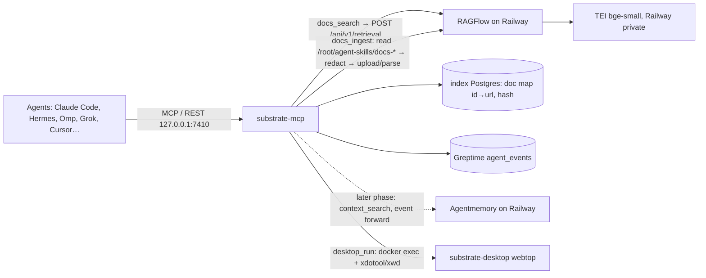

# Phase 5 discovery: RAGFlow, Agentmemory and LLM access without API keys

Research only, done read-only on 2026-09-26. No service, remote system or config was changed.
Anything not directly observed is marked [INFERENCE]. Secrets were never printed: env files were
probed for key names and counts only, and hostnames were extracted with `grep -o`.

Owner decisions already in force for Phase 5:
- Ingest the 27 docs-scraper exports (2,321 pages), cited by their manifest URLs. After Phase 4 the
  source is `/root/agent-skills/docs-*`.
- Any authenticated surface may ingest.
- `desktop_run` drives a new dedicated `substrate-desktop` webtop container through docker exec
  with xdotool and xwd. recruitment-desktop is left alone.
- The proof has three parts: a model answer that cites a `docs_search` result, a GUI smoke test and
  a redaction fixture.

## 0. Recommendations

1. **"Agentmemory" is almost certainly [rohitg00/agentmemory](https://github.com/rohitg00/agentmemory).**
   It is a self-hosted memory server for coding agents that captures what agents do and serves it
   back through a REST API and MCP. It can run with no LLM key at all. It would **complement** the
   substrate memory plane rather than replace it. It is a clean replacement for the two per-agent
   memories on this host, and both of those are currently broken:
   - hindsight in Claude Code: 30 of 30 daemon starts failed.
   - supermemory in Hermes: "not available".

   **Defer it to a later phase.** The owner must also confirm it is not RAGFlow's built-in "Memory"
   tab (§2.4).
2. **`docs_search` should call RAGFlow's HTTP retrieval API, not its MCP server.**
   `ragflow_retrieval` is a thin wrapper around `POST /api/v1/retrieval`. The HTTP API is served on
   the same public domain as the RAGFlow UI. The MCP server needs a second public port, and in its
   default self-host mode it gives any caller the tenant's datasets without checking who is asking.
3. **The coding-plan problem goes away for retrieval-only use.** RAGFlow needs only an *embedding*
   model to parse and to retrieve; a chat model is needed only for optional features. Use a keyless
   embedding sidecar on Railway: TEI serving `BAAI/bge-small-en-v1.5`, registered in RAGFlow as the
   "HuggingFace" provider. Leave RAGFlow's chat model unset. The calling agent (Claude Code, Hermes,
   Grok Build…) is the LLM that writes the answer, and it already runs on its plan inside a tool
   the vendor sanctions.
   - Coding-plan keys are contractually barred from backends like RAGFlow.
   - The VPS's local proxies can't be reached from Railway, and none of them serves embeddings.
4. **Architecture:**

   | Content | Store | Phase |
   |---|---|---|
   | Product and third-party docs | RAGFlow datasets | 5 |
   | Distilled chat and session outputs | Agentmemory, fronted by the substrate | later |
   | Decisions, handoffs and audit | Existing Postgres memory and Greptime events (unchanged) | — |

   Qdrant is not needed; it would duplicate RAGFlow. Postgres FTS is the fallback only if no
   embedding model can be configured in time.
5. **Scope:**
   - **Phase 5 keeps:** SC1 (`docs_search` → RAGFlow retrieval), SC2 (`docs_ingest`, redacted
     first, which adds a redaction rule for `ragflow-` API keys) and SC3 (`desktop_run`).
   - **Deferred:** chat-transcript ingestion, Agentmemory integration, RAGFlow chat, agents, Memory,
     GraphRAG and RAPTOR, Qdrant, and pgvector.

## 1. Evidence table

| # | Probe | Observed result |
|---|---|---|
| E1 | `sudo grep -cE '^(AGENTMEMORY\|RAGFLOW\|QDRANT)' /etc/substrate/substrate.env` | `0`. `.env.example:15-17` has empty `RAGFLOW_URL=` and `RAGFLOW_API_KEY=`. |
| E2 | Railway hostnames (`grep -rhoIE '…(up.railway.app\|railway.app\|railway.internal\|rlwy.net)'`) in `~/.hermes/config.yaml`, `~/.hermes/.env`, `~/.claude.json`, `~/.config/ultrathink`, `~/.omp`, `/root/src/repos/*/.env*`, substrate.env | substrate.env: `greptimedb-production.up.railway.app`, `monorail.proxy.rlwy.net`. `.env.example`: `greptime-xxxx.up.railway.app`. `~/.omp` session logs: `db.railway.app`, `timescaledb.railway.internal`, `proxy.rlwy.net`, and the Greptime hosts. **No hostname mentions ragflow or agentmemory.** |
| E3 | Railway CLI or token on the host | No `railway` binary, no `~/.railway/config.json`, and no `RAILWAY_TOKEN`/`RAILWAY_API_TOKEN` in any env file probed. **The service URLs cannot be discovered from here**, so the owner must supply them. |
| E4 | `~/.claude.json` `.mcpServers` (names and commands only) | `hindsight` (stdio `node /root/.hindsight/coding-agents/dist/mcp-server.js`, env name `HINDSIGHT_MCP_HARNESS`). `notion`, `linear` and `greptile` go through `ultrathink-mcp serve …`. There is no RAGFlow or Agentmemory server. |
| E5 | hindsight package and state | `@vectorize-io/hindsight-coding-agents` 0.7.0 (repo vectorize-io/hindsight), "Reflect-only Hindsight long-term memory for coding agents … automatic background ingestion". `serverMode=daemon`, `HINDSIGHT_API_LLM_PROVIDER=claude-code`, `HINDSIGHT_API_PORT=9077` (not listening). The log shows local embeddings `BAAI/bge-small-en-v1.5` (dim 384, CPU), and since 2026-09-24 13:00:47 there are **30 `Application startup failed` and 0 `startup complete`**. Last error: `initdb: error: cannot be run as root`. Claude Code runs its hooks on SessionStart, UserPromptSubmit and Stop (`~/.claude/settings.json`). |
| E6 | `hermes memory status` and `~/.hermes/config.yaml:170-177` | Provider `supermemory`, **"Status: not available ✗ — SUPERMEMORY_API_KEY not set"**. Installed memory plugins: byterover, hindsight, holographic, honcho, mem0, openviking, retaindb and supermemory. There is no agentmemory plugin. |
| E7 | Local Agentmemory traces | `~/.agentmemory`, `~/.local/share/agentmemory` and `~/.hermes/plugins/agentmemory` do not exist. `pgrep -af 'hindsight\|agentmemory\|iii'` finds nothing. |
| E8 | `ss -ltnp` and `systemctl cat` | **shunt** `127.0.0.1:3001` ("Anthropic-compatible, SuperGrok OAuth"). **aio-grok-proxy** `127.0.0.1:41417` ("Anthropic-compatible router: Haiku-tier → grok-4.6"). **hermes-proxy-xai** `127.0.0.1:8645` ("OpenAI-compatible proxy for xAI SuperGrok OAuth"). substrate-mcp `127.0.0.1:7410`. All four are loopback-only. |
| E9 | `tailscale serve status` / `tailscale funnel status` | Every entry is "(tailnet only)". No Funnel. Public listeners are nginx on `187.77.130.10:443` and `:80`. |
| E10 | `GET 127.0.0.1:8645/v1/models`; `POST …/v1/embeddings` | Models: grok-4.20-*, grok-4.3 through grok-4.7, grok-build-0.1 and grok-imagine-*. **No embedding model. `/v1/embeddings` → HTTP 404.** shunt and aio-grok-proxy speak the Anthropic wire format, which has no embeddings API. |
| E11 | docs corpus `/root/.openclaw/…/docs-scraper/data/exports/skills` | 27 exports, 2,321 `references/*.md`. **2,318 of them carry `Source: <url>` in their first 5 lines.** Manifest shapes: 24 have `pages[{content_hash,file,source,title,url,version}]`; 2 (docs-gitbook, docs-greptile) have `pages[{file,title,url}]`; 1 (docs-agno) has no `pages`, only `root_url`. 47 files are over 100 KB, the largest 2,751,358 bytes. `/root/agent-skills/docs-*` already has 25 dirs. |
| E12 | Chat stores on disk (count and size only) | `~/.claude/projects` 117 jsonl, 200M. `~/.hermes/sessions` 760 files, 240M. `~/.grok` 446 jsonl (whole dir 2.7G). `~/.omp/agent/sessions` 810 jsonl, 641M. `~/.openclaw/agents` 28 jsonl, 7.5M. `~/.cursor/projects` 174 files, 980K. `/var/lib/substrate/transcripts/cursor` **does not exist yet**; Phase 4 plan 04-10 creates it. |
| E13 | `packages/mcp-server/src/redact.ts:18-50` | Credential rules only. **No rule** for RAGFlow `ragflow-…` API keys, MiniMax `sk-cp-…` keys (the `sk-(?!ant-)[A-Za-z0-9]{20,}` rule at :45 stops at the hyphen), emails or phone numbers. The `…SECRET=` assignment rule at :31 already covers `AGENTMEMORY_SECRET=…`. |
| E14 | `packages/mcp-server/src/greptime.ts:92-108` | `agent_events` columns include `summary` and `payload` (redacted on write, per `redact.ts:9-10`). |
| E15 | `packages/mcp-server/src/mcp.ts:63-97`, `types.ts:19-38` | `memory_write {scope, kind, text, trust, ttl, source_event}`, `memory_search {query, scope, limit}` (FTS). No docs event kinds. `tool.call` exists. |
| E16 | RAGFlow MCP source (`mcp/server/server.py` on main) | `ragflow_retrieval` calls `POST {base}/api/{version}/retrieval` with `Bearer <key>` (:79, :96, :333). Tools: `ragflow_retrieval`, `ragflow_list_datasets`, `ragflow_list_chats` (:577, :639, :662). **Self-host mode uses the launch-time `HOST_API_KEY` for every request and reads no client credential; only host mode reads the caller's header (:545-562).** Page size cap 100 (:65); rerank window 512 (:71). |
| E17 | RAGFlow nginx `docker/nginx/ragflow.conf.python:18-19` | `location ~ ^/(v1\|api) { proxy_pass http://127.0.0.1:9380; }`. **The HTTP API shares the UI's public port 80.** |
| E18 | RAGFlow retrieval route `api/apps/restful_apis/chunk_api.py:366-553` | Needs only the dataset's embedding model (:512-513). A chat model is loaded only for `cross_languages` (:521), `keyword=true` (:522-524), `toc_enhance` (:545-547), `use_kg` (:551-553) or an auto `meta_data_filter` (:424-431). |
| E19 | RAGFlow embedding providers `rag/llm/embedding_model.py` | `Builtin` (:224) is active only if `COMPOSE_PROFILES` contains `tei-` (:235). `HuggingFace` (TEI, POSTs `{base_url}/embed`, no key) (:1235-1252). Also `Ollama` (:499), `OpenAI-API-Compatible`/`VLLM` (:957-958), `LocalAI` (:295), Xinference, LM-Studio and others. Builtin token caps: bge-small-en-v1.5 = 500 (:226). |
| E20 | `docker/service_conf.yaml.template:129-133` | The Builtin embedding endpoint is `base_url: 'http://${TEI_HOST}:80'`. |

Web sources for these rows are listed in §9.

## 2. What "Agentmemory" is, and how it fits

### 2.1 The product

[rohitg00/agentmemory](https://github.com/rohitg00/agentmemory), Apache-2.0, TypeScript. Docs:
[agent-memory.dev](https://www.agent-memory.dev/).

- **Runtime.**
  - Node ≥ 20 on the iii engine, with local SQLite state; no external database.
  - Ports: REST and MCP-HTTP on `:3111` under `/agentmemory/*` (132 endpoints), viewer on
    `:3113`, iii streams on `:3112`, worker WebSocket on `:49134`.
  - Railway: the official `deploy/railway` config runs one service with a `/data` volume and a
    public port of 3111.
    - The HMAC bearer secret is printed once in the first-boot deploy log as
      `AGENTMEMORY_SECRET=<64 hex>` and stored in `/data/.hmac`.
    - The viewer stays internal.
    - Cost is about $3–6 a month in Railway usage
      ([deploy/railway/README](https://github.com/rohitg00/agentmemory/blob/main/deploy/railway/README.md)).
- **Interfaces.**
  - REST: `/health`, `/livez`, `/session/start|end`, `/observe`, `/smart-search`, `/context`,
    `/remember`, `/forget`, `/enrich`, `/graph/query`, `/export`, `/import`, `/audit`.
  - MCP: a stdio shim, `@agentmemory/mcp`, proxies to `AGENTMEMORY_URL`. It exposes 54 tools
    (`memory_save`, `memory_recall`, `memory_smart_search`, `memory_sessions`,
    `memory_governance_delete`, …), or only 7 when it cannot reach the server.
  - Native hooks and plugins: Claude Code (12 hooks), Codex (6), Cursor (7), a Hermes memory
    provider (6 hooks: prefetch, turn capture, session end, pre-compress, MEMORY.md mirror, system
    prompt block) and OpenClaw.
- **Memory model.**
  - Hooks capture observations per session. Compression is synthetic by default; LLM-written
    compression is opt-in and needs both a provider and `AGENTMEMORY_AUTO_COMPRESS=true`.
  - Observations go into a BM25 index, plus vectors if an embedding provider is set, plus a
    knowledge graph. Long-term memories are saved through `/remember`.
  - Hybrid recall fuses results with RRF (k=60) and returns at most 3 results per session.
  - Also: lessons, consolidation (only with an LLM), decay and versioning.
  - Stated privacy filter: "API keys, secrets, `<private>` tags stripped before storage".
- **LLM and embedding needs.**
  - **Keyless by default.** Capture and BM25 recall need no key.
  - `EMBEDDING_PROVIDER=local` gives free on-device `Xenova/all-MiniLM-L6-v2` (384-dim). Inside the
    Railway container that costs no key and no VPS disk.
  - LLM providers are optional: Anthropic, OpenAI, Gemini, OpenRouter, MiniMax, or any
    OpenAI-compatible local server.
  - `AGENTMEMORY_ALLOW_AGENT_SDK=true` runs a Claude subscription through the Agent SDK.
    **Anthropic's February 2026 terms forbid this** (§4.3), so it must stay unset.
- **Multi-agent scoping.**
  - Isolation is set with `AGENT_ID` plus `AGENTMEMORY_AGENT_SCOPE=isolated`.
  - Releases before **0.9.27** leaked other agents' memories through plain BM25 recall
    (upstream #817, per the
    [Railway template](https://railway.com/deploy/agentmemory-just-updated-agent-memory-whose-recall-stays-scoped--agentmemory-v0928-or-agent-memory-whose-)).
    The owner's deployment must be on 0.9.28 or later.

### 2.2 Fit with the substrate memory plane

| Concern | Substrate today | Agentmemory | Relation |
|---|---|---|---|
| Curated decisions, warnings, handoffs, todos | `memory_write` / `memory_search` in Postgres FTS (mcp.ts:63-97), Graph-ID-keyed scopes and trust levels, fed into the brief | `/remember` exists but has no Graph ID, trust level or brief | **The substrate stays the source of truth** |
| Audit and event history | Greptime `agent_events`, hash-chained, anchored in Phase 6 | `/audit` for its own store only | **The substrate stays the source of truth** |
| Episodic recall ("what did we try last week on X?") | Only via event summaries in the brief | **Its core purpose**: hybrid BM25, vector and graph recall across sessions and agents | **Complements** |
| Per-agent long-term memory | hindsight in Claude Code (broken, E5); supermemory in Hermes (not available, E6) | Native plugins for both | **Replaces** those two, not the substrate |

**Overlap with hindsight.** Both are auto-capture, long-term memories for coding agents that work
through hooks and MCP. Running both would double-capture every Claude Code turn. Hindsight on this
host has never started (E5). Its LLM provider is `claude-code`, which puts a Claude subscription to
background use. [INFERENCE] That is a grey zone under Anthropic's February 2026 wording. Pick one
recall store. Agentmemory is the stronger candidate because it runs keyless, can be self-hosted on
the owner's own Railway, and has the Hermes plugin.

### 2.3 Integration patterns (for the later phase)

- **A (recommended). Substrate-fronted.**
  - substrate-mcp adds `context_search`, which proxies to `POST /agentmemory/smart-search`.
  - The substrate forwards its *already-redacted* events (session.end summaries, handoffs, notes,
    and Cursor transcript copies once they exist) to `/agentmemory/observe` or `/remember`. It sets
    `project=<repo>` and `agentId=<surface>` and tags each record with `graph_id`.
  - Agents keep a single MCP endpoint, redaction runs once, and results carry the Graph ID.
- **B. Native plugins in every agent.**
  - Richest capture, but more hooks per agent; Claude Code already runs substrate, hindsight, gsd
    and herdr hooks.
  - It bypasses `redact.ts`, and raw tool input and output leave the VPS for Railway.
- **C. Hybrid.** The native Hermes memory provider (Hermes's provider slot is empty in practice)
  plus pattern A for everyone else.

### 2.4 Disambiguation the owner must settle

Since v0.23 RAGFlow has a built-in **Memory** module, with an API at `/api/v1/memories` and
`/api/v1/messages` since v0.24. The owner's "online with something called Agentmemory" may refer
to a separate Railway service (rohitg00/agentmemory) or to RAGFlow's Memory tab.

RAGFlow Memory is a poor fit here. Creating one **requires an `llm_id` chat model**
(`POST /api/v1/memories`, [HTTP API](https://ragflow.io/docs/http_api_reference)), which brings the
coding-plan problem straight back. Writes go through Agent-canvas Message nodes or
`POST /api/v1/messages` as user_input/agent_response pairs. Upstream bugs:
[#18413](https://github.com/infiniflow/ragflow/issues/18413) (custom prompts ignored) and
[#19738](https://github.com/infiniflow/ragflow/issues/19738) (a cross-tenant listing leak in the Go
backend).

## 3. RAGFlow integration contract

**Base and authentication.**
- `RAGFLOW_URL` is the public Railway domain of the RAGFlow web service. The HTTP API is on the
  same host (E17).
- Every call sends `Authorization: Bearer <RAGFLOW_API_KEY>`. The key is created in the UI under
  avatar → API → API KEY, and its format is `ragflow-…`.
- Check the body's business `code` (0 means success) separately from the HTTP status, as the API
  reference says to.

| Step | Call | Notes |
|---|---|---|
| Health | `GET /api/v1/system/healthz` | Checks DB, Redis, doc engine and object storage. |
| Find or create dataset | `GET /api/v1/datasets?name=substrate-docs` then `POST /api/v1/datasets {name, embedding_model:"<model>@<factory>", chunk_method:"naive", parser_config:{chunk_token_num:≤400}, permission:"me"}` | One dataset for the 27 exports. bge-small caps inputs at 500 tokens (E19), so ≤400 leaves margin [INFERENCE]. **The embedding model is fixed per dataset**, and switching it later means re-embedding everything. |
| Upload | `POST /api/v1/datasets/{id}/documents` (multipart `file`, one page per document, name `<skill>/<file>.md`) | Read from `/root/agent-skills/docs-*` server-side. `server.ts:22` caps REST bodies at 1 MB, and 47 pages are bigger than 100 KB (E11), so MCP and REST callers pass a *path* under an allowlisted root, not the content. |
| Tag | `PATCH /api/v1/datasets/{id}/documents/{doc} {meta_fields:{url,title,source,content_hash}}` | `url` comes from the manifest `pages[].url`, falling back to the file's `Source:` line (2,318 of 2,321 pages have one) and then to `root_url` for docs-agno. |
| Parse | `POST /api/v1/datasets/{id}/chunks {document_ids:[…]}`; poll `GET /api/v1/datasets/{id}/documents?id=…` | Parsing is asynchronous. Markdown uses the naive parser with DeepDOC ONNX on CPU, so no LLM is involved. |
| Replace | `DELETE /api/v1/datasets/{id}/documents {ids:[…]}` then upload again | Idempotence key: sha256 of the *redacted* content, kept in a substrate-side map. |
| Search | `POST /api/v1/retrieval {question, dataset_ids:[id], page:1, page_size:limit≤30, similarity_threshold:0.2, vector_similarity_weight:0.3, keyword:false, highlight:false, metadata_condition?}` | The response is `data.chunks[{id, content, document_id, document_keyword, dataset_id, similarity, term_similarity, vector_similarity}]`, `doc_aggs` and `total`. **`page_size` sets how many results come back; `top_k` does not** ([#9114](https://github.com/infiniflow/ragflow/issues/9114)). Leave `keyword`, `use_kg`, `toc_enhance` and `cross_languages` off, because each one needs a chat model (E18). |

**`docs_search` result shape.**
- `{query, limit?, source?}` → `[{title, url, snippet, score, source, document_id, chunk_id}]`.
- `url` is resolved from `document_id` through the substrate-side document map (the index Postgres
  already holds 4 public tables), with `meta_fields` as a second copy.
- The tool description must mark snippets as untrusted third-party text.

**Version drift.**
- The Railway template in question pins v0.26.4 with Infinity
  ([template](https://railway.com/deploy/ragflow-v0264-last-version--ragflow-with-infinity-working)).
- Parameters changed between releases: `top_k` became `knn_top_k`, and `reference_metadata` exists
  only on main. The client must target the version the owner actually deployed.

**Why not the MCP server (SC1's current wording).**
- It is off by default. Turning it on means adding `--enable-mcpserver --mcp-port=9382 …` to the
  ragflow service's start command and giving it its own public domain, because Railway maps one
  port per domain ([Railway docs](https://docs.railway.com/networking/domains/working-with-domains)).
- In default self-host mode anyone who reaches `:9382` gets the tenant's datasets (E16), and the
  RAGFlow docs themselves warn against public exposure
  ([launch_mcp_server](https://ragflow.io/docs/launch_mcp_server)).
- Host mode checks keys but supports only the deprecated SSE transport.
- Known MCP bugs: #13183 and #16369 (scout report).
- The HTTP API gives the same chunks with one fewer hop.

## 4. LLM and embedding options without API keys, ranked (retrieval-only)

### 4.1 Embedding model (required for RAGFlow ingest and search)

| Rank | Option | Key? | Where | Notes |
|---|---|---|---|---|
| **1** | **TEI sidecar serving `BAAI/bge-small-en-v1.5`, registered as provider "HuggingFace"** | None | New Railway service, private network only | About 1.2 GB RAM (RAGFlow `.env` notes). English corpus, 384-dim. RAGFlow's own "Builtin" path also uses TEI, but it needs `COMPOSE_PROFILES=tei-cpu`, `TEI_HOST` and `TEI_MODEL` on the ragflow service and a hard-coded `:80` (E19, E20); the provider entry is more explicit and visible in the UI. [INFERENCE] Image `infiniflow/text-embeddings-inference:cpu-1.8`, as pinned by RAGFlow. Since v0.22 RAGFlow ships only the slim image, with no bundled models ([release notes](https://ragflow.io/docs/release_notes)). The default Qwen3-Embedding-0.6B needs about 25 GB and bge-m3 about 21 GB, so avoid both on Railway. |
| 2 | Ollama sidecar (`nomic-embed-text` or `bge-m3`), provider "Ollama" | None | New Railway service | Heavier image. It could later host a small CPU chat model for RAGFlow features, but that would be slow. |
| 3 | Free-tier hosted embedding (Gemini `gemini-embedding-001`, Jina, Voyage, SiliconFlow bge-m3) | A free API key | Vendor | Rate limits. Content goes to the vendor, and free tiers may train on it [INFERENCE]. |
| 4 | Pay-as-you-go embedding (e.g. OpenAI `text-embedding-3-small`) | A paid key | Vendor | The corpus is about 47 MB ≈ 12M tokens, roughly $0.25 one-off at $0.02 per 1M tokens [INFERENCE]. The owner has ruled out API keys. |
| ✗ | Coding-plan keys | — | — | Contractually barred for backends (§4.3). None offers an embedding model under the plan [INFERENCE: each vendor's plan pages list chat models only]. |
| ✗ | VPS proxies (shunt, aio-grok-proxy, hermes-proxy-xai) | — | — | Loopback-only (E8), tailnet-only serve and no Funnel (E9), and no embeddings (E10). |

### 4.2 Chat model (not needed for Phase 5)

Leave RAGFlow's chat model unset. Retrieval does not need it (E18), and default ingest (naive
chunking, no auto-keywords, auto-questions, RAPTOR or GraphRAG) does not use it [INFERENCE for the
ingest half; default parser_config]. The agent calling `docs_search` writes the answer itself.

If the owner later wants RAGFlow's own chat assistants, agents, Memory, GraphRAG or RAPTOR, those
need a **pay-as-you-go** key, for example Z.ai's general `/api/paas/v4`, DeepSeek or OpenRouter.

### 4.3 Why coding plans and the local proxies are out

- **Z.ai GLM Coding Plan.** It "may only be used within officially supported tools". SDK access
  and third-party integrations are forbidden, and three violations can end in a ban. The coding
  endpoint `/api/coding/paas/v4` does not work as a general API
  ([usage policy](https://docs.z.ai/devpack/usage-policy), [FAQ](https://docs.z.ai/devpack/faq)).
- **Alibaba Model Studio Coding Plan (Qwen).** "Do not use the plan's API key for automated
  scripts, application backends, or other non-interactive scenarios." It blocks curl, Postman and
  Dify ([overview](https://www.alibabacloud.com/help/en/model-studio/coding-plan),
  [FAQ](https://www.alibabacloud.com/help/en/model-studio/coding-plan-faq)).
- **Kimi Code.** The benefits cover "programming scenarios" only, and tampering with the
  User-Agent is a violation ([membership guide](https://www.kimi.com/en/help/kimi-code/membership-guide)).
- **MiniMax Token Plan.** For "individual, interactive developer use"; pay-as-you-go is
  recommended for production, and automated batch traffic is throttled
  ([FAQ](https://platform.minimax.io/docs/token-plan/faq)).
- **Claude Free, Pro and Max OAuth.** Allowed only in Claude Code and Claude.ai. Using it elsewhere
  is not allowed, "including the Agent SDK"
  ([The Register, 2026-02-20](https://www.theregister.com/2026/02/20/anthropic_clarifies_ban_third_party_claude_access/)).
- **xAI SuperGrok OAuth.** Endorsed inside named tools only: Hermes, OpenCode, OpenClaw and Kilo
  Code ([x.ai/news/grok-hermes](https://x.ai/news/grok-hermes)). There is no general backend grant.
- **Reachability.** A Railway-hosted RAGFlow cannot reach `127.0.0.1` proxies on this VPS, and
  Railway containers are not on the tailnet.
  - Making the proxies reachable would mean Tailscale Funnel or a public nginx route, which puts a
    subscription-backed endpoint on the internet.
  - That exposes the plan to anyone who finds the URL, and it lies outside every vendor's
    sanctioned tool list.
  - It would also gain nothing: none of the proxies serves embeddings (E10).

**Simplest compliant setup:**
1. Add a TEI (bge-small) sidecar on Railway.
2. Register it in RAGFlow as the HuggingFace provider and make it the default embedding model.
3. Leave the chat model unset.
4. The substrate calls `/api/v1/retrieval`.
5. Agents answer with their own plan-backed model inside their own tool.

## 5. Recommended architecture

**Storage choice for docs.**

| Criterion | RAGFlow datasets | Qdrant (Railway or Cloud) | Postgres FTS (index PG) |
|---|---|---|---|
| Running today | Owner says yes (unverified from this host, E1-E3) | No | Yes (remote PG 16.1) |
| Embedding dependency | An embedding provider inside RAGFlow (TEI, keyless) | We embed ourselves (FastEmbed on the VPS), or Qdrant Cloud's free MiniLM and BM25 inference ([Qdrant](https://qdrant.tech/cloud-inference/)) | None (lexical only; pgvector available but not installed) |
| Parsing and chunking | Built in | We write it | We write it |
| Hybrid ranking and UI | Yes; UI for browsing and test retrieval | Dense plus sparse; vector dashboard | Lexical only; no UI |
| Load on this VPS | None | None, or about 130 MB of model files if embedding locally | None |
| Code in the substrate | Thin HTTP client and a doc map | Client, chunker and embedder | SQL, chunker and migration |
| Matches ROADMAP SC1 | Yes | No | No |

**Verdict.** Use RAGFlow for docs. Qdrant would duplicate RAGFlow's role at extra build cost.
Postgres FTS is the fallback only if the owner cannot set up an embedding model before Phase 5
executes (Q2).

**Redaction before ingest.**
- `redact()` (redact.ts:53) runs on every page body and title before upload, and redaction counts
  are logged.
- Documentation examples such as `API_KEY=your-key` or `password=…` get redacted, which is
  harmless.
- Add a `ragflow-[A-Za-z0-9]{20,}` rule (and `sk-cp-…`), because the substrate now handles a
  RAGFlow key [INFERENCE on the key length].
- **Do not** add a generic 64-hex rule for Agentmemory secrets. It would destroy sha256 event and
  content hashes. The existing `…SECRET=` assignment rule already covers them (E13).

**Chat outputs that exist, and their privacy risk** (inputs for the later phase, not Phase 5):

| Source | Location, size (E12) | Redacted today? | Risk |
|---|---|---|---|
| Event summaries and payloads | Greptime `agent_events` (greptime.ts:92-108); not counted | Yes, on write | Low: short and Graph-ID keyed. The best first feed for recall. |
| Cursor transcripts | `/var/lib/substrate/transcripts/cursor/*.jsonl` (Phase 4 04-10; absent now) | Credentials only | Medium: full conversations and code |
| Claude Code | `~/.claude/projects`, 117 jsonl, 200M | No | High: raw tool input and output (files, env, command output) |
| Hermes | `~/.hermes/sessions`, 760 files, 240M | No | High: includes remote-control chats [INFERENCE] |
| Grok Build | `~/.grok`, 446 jsonl, 2.7G dir | No | High |
| Omp | `~/.omp/agent/sessions`, 810 jsonl, 641M | No | High |
| OpenClaw | `~/.openclaw/agents`, 28 jsonl, 7.5M | No | High |

`redact.ts` has no rules for personal data (emails, phone numbers, names). Raw transcripts must not
leave the VPS until there are PII rules, a distillation step (summaries, not raw turns), a
forget/retention path and per-surface consent.

## 6. Scope split

**In Phase 5:**
- **SC1:** `docs_search` calls RAGFlow `POST /api/v1/retrieval` (the same call `ragflow_retrieval`
  makes) and returns cited chunks. Suggested rewording of ROADMAP SC1: "proxies RAGFlow retrieval
  (HTTP `/api/v1/retrieval`, the call behind `ragflow_retrieval`)".
- **SC2:**
  - `docs_ingest` as an MCP tool, plus a CLI, `substrate docs ingest`. It takes paths under an
    allowlisted root, runs redact first, is idempotent by the redacted-content hash, and keeps one
    `substrate-docs` dataset and a doc map.
  - The redact.ts rule for `ragflow-` keys.
  - New config keys `RAGFLOW_URL`, `RAGFLOW_API_KEY` and optionally `RAGFLOW_DATASET_ID`.
- **SC3:** `desktop_run` on `substrate-desktop` (already decided).
- **Proof:**
  - Docs: an agent answers a question and cites a docs.python.org or similar `url` taken from
    `docs_search`.
  - GUI: the smoke test.
  - Redaction: a fixture containing a fake `ragflow-…` and a `password=` string is ingested, and
    `docs_search` returns `[REDACTED]` in their place.

**Deferred as new ideas** (suggest a "Recall plane" phase after Phase 6, or v1.1):
1. Chat-output ingestion from any surface: PII rules, distillation, retention, consent.
2. Agentmemory: `context_search`, event forwarding, replacing hindsight and supermemory (pattern A
   or C).
3. RAGFlow chat, agents, Memory, GraphRAG and RAPTOR, which all need a pay-as-you-go chat key.
4. swcstudio's own "product docs" as a second dataset, once the owner names the source; the
   ingest code is reused unchanged.
5. Qdrant, only if RAGFlow proves unreliable.
6. pgvector.

## 7. Owner inputs needed

Append to `/etc/substrate/substrate.env` with `sudoedit` (keeps values out of shell history), then
ask the orchestrator to restart substrate-mcp:

| Key | Value | Where to get it |
|---|---|---|
| `RAGFLOW_URL` | `https://<ragflow-web>.up.railway.app` (no trailing slash) | Railway → RAGFlow web service → Settings → Networking → public domain |
| `RAGFLOW_API_KEY` | `ragflow-…` | RAGFlow UI → avatar (top right) → API → API KEY → Create new key |
| `RAGFLOW_DATASET_ID` (optional) | 32-hex dataset id | Only if you create the `substrate-docs` dataset by hand; otherwise `docs_ingest` creates it |
| `AGENTMEMORY_URL` (later phase) | `https://<agentmemory>.up.railway.app` | Railway → agentmemory service domain |
| `AGENTMEMORY_SECRET` (later phase) | 64 hex | The first-boot deploy log line `AGENTMEMORY_SECRET=…`, or `/data/.hmac` |

**Settings on Railway and in RAGFlow:**
1. **Report, don't change anything yet:**
   - The RAGFlow version (UI) and which Railway template you used.
   - The doc engine: Elasticsearch or Infinity.
   - Whether the MCP server is enabled. It is not needed; if it is on, don't give port 9382 a
     public domain.
2. **Add an embedding sidecar.**
   - New Railway service from image `infiniflow/text-embeddings-inference:cpu-1.8`, model
     `BAAI/bge-small-en-v1.5`, at least 1.5 GB RAM, private networking only.
   - In RAGFlow: Model providers → HuggingFace → base URL `http://<tei>.railway.internal:<port>`,
     model `BAAI/bge-small-en-v1.5`, type embedding.
   - Then System Model Settings → Embedding = that model. Leave Chat empty.
   - [INFERENCE] The TEI start command must pass `--model-id BAAI/bge-small-en-v1.5` and bind to a
     fixed port on `::`.
3. **Lock sign-ups.** After your admin account exists, set `REGISTER_ENABLED=0` on the ragflow
   service and redeploy. Otherwise anyone can sign up on the public URL (Railway template notes).
4. **Agentmemory, if it is the rohitg00 service** (later phase):
   - Confirm it is on version 0.9.28 or later.
   - Set `EMBEDDING_PROVIDER=local`.
   - Confirm `AGENTMEMORY_ALLOW_AGENT_SDK` is **unset** and no LLM key is set.
   - Keep the viewer (3113) private.

**Orchestrator checks after handover** (prints key=value only):
- `sudo grep -c '^RAGFLOW_URL=' /etc/substrate/substrate.env` and the same for `RAGFLOW_API_KEY`.
- A keyed HTTP status probe through
  `sudo systemd-run --quiet --wait --pipe --collect -p EnvironmentFile=/etc/substrate/substrate.env`
  running `curl -s -o /dev/null -w 'healthz=%{http_code}\n' "$RAGFLOW_URL/api/v1/system/healthz"`,
  followed by an authenticated `GET /api/v1/datasets?page_size=1` that prints only the business
  `code`.

## 8. Grey-area questions for the owner

### Q1. How should `docs_search` reach RAGFlow?

- **Recommended:** the HTTP retrieval API (`/api/v1/retrieval`), called server-side with the key
  in substrate.env, and SC1 reworded to match. It is the same backend call `ragflow_retrieval`
  makes (E16), it runs on the UI's domain (E17), it needs no second public port, and it avoids the
  self-host MCP's missing client check.
- **Alternatives:**
  - (a) Enable RAGFlow's MCP in host mode (SSE only, key sent in a header) on a second Railway
    domain, and have the substrate proxy MCP to MCP. This matches SC1's current text literally.
  - (b) Register RAGFlow's MCP directly in each agent. That skips the substrate, so there is no
    redaction, no events and no normalized citations.

### Q2. Which embedding model does RAGFlow use, given coding plans instead of API keys?

- **Recommended:** a keyless TEI sidecar on Railway serving `BAAI/bge-small-en-v1.5` through the
  HuggingFace provider, with no RAGFlow chat model at all. Retrieval only; agents write the
  answers.
- **Alternatives:**
  - (a) An Ollama sidecar with `nomic-embed-text`.
  - (b) A free-tier or pay-as-you-go embedding key; about $0.25 one-off for this corpus
    [INFERENCE].
  - (c) If no embedding is configured before execution, ship `docs_search` on Postgres FTS in the
    index DB first and switch to RAGFlow later behind the same tool contract.

### Q3. Where do our chats' outputs go, and when?

- **Recommended:** not in Phase 5. In a later "Recall plane" phase, send distilled, redacted
  session summaries into Agentmemory, fronted by a substrate `context_search` tool. Sources are the
  substrate's events and the Cursor transcript copies. Raw transcripts (session directories total
  about 3.8 GB, most of it the 2.7 GB `~/.grok` dir, E12) never leave the VPS.
- **Alternatives:**
  - (a) A RAGFlow `substrate-sessions` dataset. RAGFlow is already running, but its model is
    documents rather than sessions, and there is no per-session dedupe or decay.
  - (b) Ingest raw transcripts now. High privacy risk, because redact.ts has no rules for personal
    data.

### Q4. What role does Agentmemory play?

- **Recommended:** it complements the substrate and does not replace it.
  - `memory_write`, the brief and Greptime stay the source of truth: Graph-ID keyed and bound to
    the Phase 6 ledger.
  - Agentmemory becomes the single episodic-recall store, through pattern A.
  - In that later phase, retire hindsight (30 of 30 start failures) and switch Hermes's memory
    provider (supermemory is not available) to Agentmemory, after confirming version 0.9.28 or
    later and `AGENT_ID` scoping.
- **Alternatives:**
  - (a) Install Agentmemory's native plugins in every agent now. It is fast, but it bypasses
    `redact.ts`, adds more hooks and sends raw tool input and output to Railway.
  - (b) Don't adopt it. Fix hindsight instead by running its daemon as a non-root user.

## 9. Sources

- Agentmemory:
  - [GitHub README](https://github.com/rohitg00/agentmemory)
  - [deploy/railway/README](https://github.com/rohitg00/agentmemory/blob/main/deploy/railway/README.md)
  - [agent-memory.dev](https://www.agent-memory.dev/)
  - [Railway template (scoped recall, 0.9.28)](https://railway.com/deploy/agentmemory-just-updated-agent-memory-whose-recall-stays-scoped--agentmemory-v0928-or-agent-memory-whose-)
- RAGFlow:
  - [HTTP API](https://ragflow.io/docs/http_api_reference)
  - [Launch MCP server](https://ragflow.io/docs/launch_mcp_server)
  - [Release notes](https://ragflow.io/docs/release_notes)
  - [Configuration v0.27.2](https://ragflow.io/docs/v0.27.2/configurations)
  - [Memory configuration](https://ragflow.io/docs/configure_memory)
  - Source files on main: `mcp/server/server.py`, `api/apps/restful_apis/chunk_api.py`,
    `rag/llm/embedding_model.py`, `docker/service_conf.yaml.template` and
    `docker/nginx/ragflow.conf.python`
  - Railway templates: [ragflow-with-infinity](https://railway.com/deploy/ragflow-v0264-last-version--ragflow-with-infinity-working),
    [document-rag-stack](https://railway.com/deploy/ragflow-document-rag-stack)
- Coding-plan terms:
  - [Z.ai usage policy](https://docs.z.ai/devpack/usage-policy)
  - [Alibaba Coding Plan](https://www.alibabacloud.com/help/en/model-studio/coding-plan)
  - [Kimi Code](https://www.kimi.com/en/help/kimi-code/membership-guide)
  - [MiniMax Token Plan FAQ](https://platform.minimax.io/docs/token-plan/faq)
  - [Anthropic OAuth clarification](https://www.theregister.com/2026/02/20/anthropic_clarifies_ban_third_party_claude_access/)
  - [xAI Grok in Hermes](https://x.ai/news/grok-hermes)
- Infrastructure:
  - [Railway domains and target ports](https://docs.railway.com/networking/domains/working-with-domains)
  - [Qdrant Cloud Inference](https://qdrant.tech/cloud-inference/)
