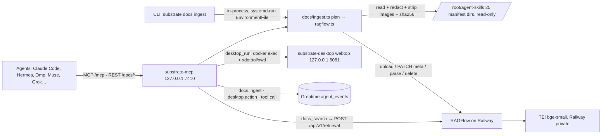

# Phase 5: Docs and desktop - Research

**Researched:** 2026-09-26
**Domain:** a RAGFlow HTTP client and ingest planner (bun/TS, `packages/mcp-server`); a docker-exec GUI driver for a webtop container; owner setup work on Railway
**Confidence:**
- HIGH for the RAGFlow HTTP contract at the two pinned tags (read from tagged source, not only the docs), for the corpus numbers (measured) and for the webtop internals (read from the image's rootfs through `/proc/<pid>/root` and host `ps`, with no exec into any container).
- MEDIUM for the owner's actual RAGFlow version and doc engine (unknown until the checkpoint) and for TEI on Railway private networking.
- LOW for ingest wall time (not measured).

This builds on `05-DISCOVERY.md` (E1-E20) and the Discuss05Scout report. It repeats a fact only when a plan needs it, and corrects them where they were wrong. The locked decisions are in `05-CONTEXT.md` (D-01..D-14).

## Summary

Every locked decision can be built with what is already on the VPS: no npm, PyPI or cargo installs, and no image pulls. The owner adds one Railway service (TEI). The probes turned up **eight facts the planner must act on**. Each one changes a plan and is not visible from CONTEXT.md:

1. **D-07's glob does not match "27 exports, 2,321 pages".**
   - `/root/agent-skills/docs-*` matches 24 export dirs (2,117 pages) plus the `docs-scraper` skill, which is a SKILL.md with no manifest.
   - `parallel-web` (200 pages) is in the library but outside `docs-*`.
   - `httpbin-html-skill` and `python-logging-skill` (2 pages each; httpbin is Moby-Dick test content) are not in the library at all: Phase 4 D-02 vendors 40 entries, and these two are not among them.
   - Recommended scope: every library dir with `manifest.json` and `references/`, which is 25 dirs and 2,317 pages. See Open Question 1.
2. **RAGFlow downloads every remote image a Markdown page links.**
   - At v0.26.4, `rag/app/naive.py:1070-1079` calls the Markdown parser with `return_section_images=True`. For each `` it runs `load_images_from_urls` (`:774-808`: `requests.get`, 30 s timeout, SSRF-guarded).
   - The corpus has **2,407** such links in **385** pages.
   - With no vision model (D-05) the images add nothing to retrieval; they only cost fetch time and object storage.
   - Recommended: rewrite remote image embeds to their alt text before hashing and upload. See Open Question 3.
3. **Retrieval can return the citation URL itself.** 05-DISCOVERY said `reference_metadata` exists only on main; that is wrong.
   - Both tags accept `reference_metadata: {include: true, fields: [...]}` on `POST /api/v1/retrieval` and attach `document_metadata` to each chunk: `chunk_api.py:371,420-422` at v0.26.4, `:471,524-526` at v0.27.2, via `api/utils/reference_metadata_utils.py`.
   - So no substrate-side document map in Postgres is needed. RAGFlow's document list already returns `meta_fields` for every row (`document_service.py:173-181`), so it can serve as the idempotence ledger.
   - The substrate keeps a local-manifest fallback for the URL.
4. **Version drift is real; pin these:**
   - **Update document is `PATCH`** in code at both tags (`document_api.py:170` at v0.26.4). The v0.26.4 *docs* say `PUT`.
   - `top_k` became `knn_top_k` in 0.27; `top_k` still works there with a deprecation warning. 0.27 also adds `rerank_candidates_count` (default 64, and it must be ≥ page × page_size). Send neither `top_k` nor `knn_top_k`, and keep `page_size` ≤ 10.
   - 0.27 caps id lists at 100 (`REST_API_MAX_IDS`). `page_size` ≤ 100 at both tags.
   - The HuggingFace provider stores a model as `<name>___HuggingFace` (`llm_app.py:269-270`), so the dataset's `embedding_model` reads like `BAAI/bge-small-en-v1.5___HuggingFace@HuggingFace` [INFERENCE on the exact string; the spike records it].
   - Create the dataset **without** `embedding_model`, so it takes the tenant default (`dataset_api_service.py:103-104`). Refuse to continue unless the returned value names `bge-small-en-v1.5`, because a dataset's embedding model can never change.
5. **The existing Runner cannot carry a screenshot.** `execFileRunner` (`host/src/hostfns.ts:100-112`, which Phase 4 copies into `skills/propose.ts`) decodes stdout as utf8 with a 4 MB `maxBuffer`. An xwd of 1280×800 is about 4.1 MB of binary. `desktop_run` needs a Buffer-mode runner (`encoding: "buffer"`, `maxBuffer` ≥ 16 MB).
6. **In the webtop image, Xvfb runs with `-ac -nolisten tcp` and the session runs as `abc`.**
   - Evidence: `svc-xorg/run` `exec s6-setuidgid abc /usr/bin/Xvfb …`; host `ps` shows `… -nolisten tcp -ac …`.
   - Root inside `docker exec` can drive `:1` with no xauth.
   - Apps launched from the session, such as the Ctrl+Alt+T terminal, run as `abc` (PUID defaults to 911), not root.
   - The Xvfb framebuffer is 15360×8640 unless `SELKIES_MANUAL_*` is set (`svc-xorg/run`), and `svc-de/run` applies the mode with xrandr. selkies can resize the screen to fit a connecting browser [INFERENCE on when it does]. Pin `SELKIES_MANUAL_WIDTH` and `SELKIES_MANUAL_HEIGHT` to keep coordinates stable.
7. **Claude Code has no substrate MCP registered** (`~/.claude.json` mcpServers are greptile, hindsight, linear and notion). The docs proof therefore uses a session-scoped `claude -p --mcp-config <file> --strict-mcp-config`; both flags are present in the 2.1.278 binary. No agent config is edited.
8. **SC3 still says "drives cua".** D-12/D-13 use xdotool and xwd; cua is not installed and is not needed. SC3 needs the same owner wording decision SC1 got (Open Question 2).

**Primary recommendation:** tracer-first, in two independent halves.
- The desktop tracer goes first, because it has no owner dependency. The owner does the Railway/RAGFlow checkpoint in parallel, followed by a throwaway live contract spike.
- Then the docs tracer runs one export end to end: ingest → parse → `docs_search` over MCP → a cited docs.python.org URL.
- Then the full corpus and the redaction fixture, then the proof.

## Architectural Responsibility Map

| Capability | Primary tier | Secondary tier | Rationale |
|---|---|---|---|
| Docs retrieval | RAGFlow on Railway, `POST /api/v1/retrieval` | substrate-mcp `docs_search`: normalize, redact snippets, resolve the URL | D-01, D-03 |
| Embeddings | TEI sidecar on Railway (private networking) | RAGFlow HuggingFace provider as the tenant default | D-04, D-06 |
| Ingest planning and idempotence | `packages/mcp-server/src/docs/ingest.ts` (pure plan) | RAGFlow's document list and `meta_fields` as the ledger | D-08, D-09 |
| Redaction | `redact.ts` `RULES` / `redact()` (event path) | the same `redact()` on outgoing snippets | D-09, D-11 |
| Full-corpus ingest | CLI in-process: `substrate docs ingest` under `systemd-run -p EnvironmentFile=` | MCP and REST `docs_ingest` for bounded path sets | D-10; 1 MB body cap |
| Desktop control | `packages/mcp-server/src/desktop/` (validate → argv → `docker exec`) | the `substrate-desktop` container | D-13 |
| Desktop lifecycle | `infra/desktop/substrate-desktop.sh` plus Docker's restart policy | — | D-12 |
| Audit | Greptime events via `Substrate.emit` (fail-open) | — | D-13 |

## Standard Stack

No new dependencies.

| Need | Use | Evidence |
|---|---|---|
| HTTP to RAGFlow | global `fetch`, `FormData`, `Blob` (bun 1.4) with an injected `fetchImpl` and an `AbortSignal` timeout | the same seam as `notion.ts:83-150` and `linear.ts:55-78`; `host/src/sync.test.ts:181-184` shows the key-never-in-errors test style |
| Multipart upload | `form.append("file", new Blob([bytes], {type: "text/markdown"}), name)`, repeated | RAGFlow reads `request.files.getlist("file")` (`document_api.py:639`) |
| Content hash | `node:crypto` `createHash("sha256")` | `host/src/tasks.ts:315-317` |
| `docker exec` | `node:child_process.execFile("docker", argv, {encoding: "buffer", maxBuffer: 16 << 20, timeout})` | a new binary runner (Summary 5) |
| xwd → PNG | host `/usr/bin/convert xwd:- png:-` (ImageMagick, present), or a ~100-line TS XWD decoder plus a `node:zlib` PNG encoder | both are available now; see Pattern 3 |
| Screenshot in the MCP result | `{type: "image", data: <base64>, mimeType: "image/png"}` | `@modelcontextprotocol/sdk` 1.30.1 has `ImageContentSchema` |

## Package Legitimacy Audit

No npm, PyPI or cargo packages are added. Two container images are involved, and neither is pulled onto this VPS:
- `linuxserver/webtop:ubuntu-xfce` is already local (`c4ceafc1c48e`, 4.71 GB, build `621de5cf-ls1`, 2026-09-15). `docker run --pull never` enforces no pull.
- TEI runs on the **owner's** Railway, from the official Hugging Face registry: `ghcr.io/huggingface/text-embeddings-inference:cpu-1.9`. The tags `cpu-1.8`, `cpu-1.9` and `cpu-latest` all answer HTTP 200 on ghcr, and the latest release is v1.9.4 (2026-09-15).
- Avoid RAGFlow's own `infiniflow/text-embeddings-inference` image. It expects models baked in under `/data/<model>` (`docker-compose-base.yml:283`), and 05-DISCOVERY puts its bundled variants at 21-25 GB.

## Answers to the research questions

### Q1 — The RAGFlow HTTP contract (HIGH at the pinned tags)

The pinned tags are **v0.26.4** (the Railway template's pin, per 05-DISCOVERY) and **v0.27.2** (the latest release, 2026-09-10). Everything below was read from `api/apps/restful_apis/*.py` and `docs/references/http_api_reference.md` at those tags.

Every call except the unauthenticated three sends `Authorization: Bearer <RAGFLOW_API_KEY>`, and the key is `"ragflow-" + secrets.token_urlsafe(32)` (`api/utils/api_utils.py` `generate_confirmation_token`).

| Step | Call | Request | Success shape | Notes |
|---|---|---|---|---|
| Version | `GET /api/v1/system/version` | no auth | `{code:0, data:"v0.26.4…"}` | `system_api.py:43-62` |
| Sign-up lock | `GET /api/v1/system/config` | no auth | `data.registerEnabled` 0 or 1 | `:204-226`. Verifies D-06 from the VPS without the key |
| Health | `GET /api/v1/system/healthz` | no auth | 200 `{db, redis, doc_engine, storage, status:"ok"}`; 500 with `_meta` | `:229-232` |
| Find dataset | `GET /api/v1/datasets?page=N&page_size=100`, then match `name` case-insensitively on the client | — | `data:[{id, name, embedding_model, chunk_method, …}]`, `total` | **Do not filter with `?name=`.** A missing name is an *error* (`code:102`, "User '<tenant>' lacks permission for dataset '<name>'", `dataset_api_service.py:394-397`), not an empty list. Names are unique and case-insensitive, ≤128 chars |
| Create dataset | `POST /api/v1/datasets` | `{name:"substrate-docs", chunk_method:"naive", permission:"me", parser_config:{chunk_token_num:320, delimiter:"\n", auto_keywords:0, auto_questions:0, raptor:{use_raptor:false}, graphrag:{use_graphrag:false}}}`; no `embedding_model`, no `auto_metadata_config` | `data.id`, `data.embedding_model` | When `embedding_model` is omitted the tenant default is used (`dataset_api_service.py:103-104`). A given value is checked against the tenant (`:105-108`). `auto_metadata_config` would switch on LLM metadata extraction (`:75-91`), which D-05 forbids |
| List documents | `GET /api/v1/datasets/{id}/documents?page=N&page_size=100` (optional `&keywords=<dir>__`) | — | `data:{total, docs:[{id, name, run, progress, progress_msg, chunk_count, meta_fields, …}]}` | `meta_fields` is attached per page (`document_service.py:173-181`). The `run` filter takes `UNSTART/RUNNING/CANCEL/DONE/FAIL` or `0-4` |
| Upload | `POST /api/v1/datasets/{id}/documents`, multipart, repeated `file` | about 20 files and ≤10 MB per request | `data:[{id, name, run:"UNSTART", …}]` | **A name that already exists is renamed** `name(1).md` (`file_service.py:567` `duplicate_name`). Partial success comes back as `code:500` *with* `data` (`document_api.py:694-698`). Filenames must be ≤255 bytes (`api/constants.py:26`) |
| Tag | `PATCH /api/v1/datasets/{id}/documents/{doc}` | `{meta_fields:{url, title, source, content_hash}}` | `data:{…, meta_fields}` | Values must be str, int or float, or lists of those (`validation_utils.py:510-525`) |
| Parse | `POST /api/v1/datasets/{id}/chunks` | `{document_ids:[≤100]}` | `code:0`, or a partial `{success_count, errors}` | A document that is already RUNNING is refused ("Can't parse document that is currently being processed", `chunk_api.py:215-226`). Not for pipeline datasets (`:195-198`) |
| Poll | `GET …/documents?page_size=100&run=UNSTART&run=RUNNING` | — | `data.total` → 0 when finished; `run=FAIL` for failures | |
| Delete | `DELETE /api/v1/datasets/{id}/documents` | `{ids:[1..100]}`; **never empty** | `data:{deleted:n}` | At v0.26.4 empty ids without `delete_all` is an error (`document_api.py:1159-1165`). The client refuses to send an empty list anyway |
| Search | `POST /api/v1/retrieval` | `{question, dataset_ids:[id], page:1, page_size:limit, similarity_threshold:0.2, vector_similarity_weight:0.3, highlight:false, reference_metadata:{include:true, fields:["url","title","source"]}, metadata_condition?:{logic:"and", conditions:[{name:"source", comparison_operator:"=", value}]}}` | `data:{chunks:[{id, content, document_id, document_keyword, dataset_id, similarity, vector_similarity, term_similarity, document_metadata?}], doc_aggs, total}` | **Never send** `keyword`, `use_kg`, `toc_enhance`, `cross_languages`, `meta_data_filter`, `rerank_id`, `top_k` or `knn_top_k` (D-05, Summary 4). An empty question returns `total:0` |

**Error shapes.** Check both the HTTP status and the body `code` (v0.27.2 docs § ERROR CODES):
- A missing or unknown key → **HTTP 401** `{code:401, message}` (`api/apps/__init__.py:397-412`).
- Most failures → **HTTP 200** with `code ≠ 0`: 101 argument, 102 data, 100 exception, 109 auth.
- An embedding failure (TEI down) → `ModelException` → HTTP 200 `code:400` (`:415-418`).
- "No chunk found!" → `code:102`.
- The client maps these to `RagflowError{kind: "auth" | "api" | "unreachable", code, message}`, where the message is `redact()`ed and capped at 400 characters. Headers are never echoed.

**Limits:**
- `page_size` ≤ 100 at both tags (`api/utils/pagination_utils.py`). Id lists are ≤ 100 at 0.27.2; use ≤ 100 everywhere.
- Upload body: `MAX_CONTENT_LENGTH` defaults to 128 MB (`common/settings.py:396`). The largest page is 2.75 MB.
- `EMBEDDING_BATCH_SIZE` is 16 (`common/settings.py:398`), under TEI's `max-client-batch-size` default of 32. The HuggingFace embedder POSTs `{base}/embed` with a 30 s timeout per batch (`embedding_model.py:1052-1071`).
- The "Add model" test encode has a 10 s budget (`LLM_TIMEOUT_SECONDS`, `llm_app.py:188`). A slow or unreachable TEI fails at the owner step, which is a useful early signal.
- bge-small-en-v1.5 accepts at most 512 WordPiece tokens, while RAGFlow counts `chunk_token_num` in tiktoken tokens. Code- and URL-heavy text produces more WordPiece tokens than tiktoken tokens [INFERENCE, about 1.2-1.5×]. So use `chunk_token_num: 320` and keep TEI truncation on.
- TEI's `--auto-truncate` defaulted to false up to 1.8; RAGFlow's own compose passes the flag (`docker-compose-base.yml:283`). It defaults to true from v1.9.0 (release notes, #829). Set `AUTO_TRUNCATE=true` explicitly either way.
- No request rate limiter exists in the routes read. Railway's edge limits are unknown [INFERENCE]. Keep ≤ 4 concurrent requests.

**Live contract spike (plan 05-02, after the owner inputs).** A throwaway `/tmp/05-02-spike.ts` runs through `sudo systemd-run --quiet --wait --pipe --collect -p EnvironmentFile=/etc/substrate/substrate.env` and prints key=value only. It uses a dataset named `substrate-docs-spike`, which it deletes at the end. It records:
- `ragflow_version`, `register_enabled`, `healthz`, `datasets_code`
- `embedding_model` (the model string, which is not secret) and `embedding_model_is_bge_small`
- The upload of 2 real pages plus a fixture → `upload_code`, `dup_name_behaviour` (uploading one name twice shows `(1)`)
- `update_method` (PATCH; if it fails, PUT is tried and recorded)
- `parse_ms`, `final_run`, and whether image-stripped pages parse faster (`parse_ms_images` vs `parse_ms_stripped` on one image-heavy page)
- `ref_metadata_url=present|absent`, `filter_operator_ok`
- `bad_key_http=401`, `bad_dataset_code=102`, `empty_ids_rejected`
- `cleanup=ok`

Plan 05-04 branches on `update_method`, `ref_metadata_url`, `embedding_model` and `filter_operator_ok`.

### Q2 — Where the code goes, and how it meets Phase 4 (HIGH)

New files, all under `packages/mcp-server/src/` unless noted:

| File | Contents |
|---|---|
| `docs/ragflow.ts` | `RagflowClient`: pure request builders plus an executor with injected `fetchImpl` and a timeout. Methods: `version`, `config`, `health`, `findDataset`, `createDataset`, `listDocuments` (paged), `upload` (batched), `patchMeta`, `parse` (≤100), `deleteDocuments` (1..100, never empty), `retrieve`. Also `RagflowError` |
| `docs/source.ts` | Allowlisted roots `["/root/agent-skills", "/var/lib/substrate/docs/fixtures"]`. `realpath` containment (refuses `..`, absolute escapes and symlinks leaving a root). Enumerates `<dir>/references/*.md` in dirs that have `manifest.json`, plus fixture `*.md`. Per page it builds the uploaded bytes (`redact()`, then image stripping if Open Question 3 says yes), `content_hash` (sha256 hex of exactly those bytes), `name = <dir>__<file>`, and the url/title/source resolution chain (Q4) |
| `docs/ingest.ts` | The pure planner `plan(pages, existingDocs) → {skip, reparse, remove, upload, tag, parse, prune}`: ≤100-id batches, never empty; duplicate names from a crash are removed. The executor takes a budget: MCP and REST ≤200 pages and ≤50 s; the CLI is unbounded with `--wait` |
| `docs/search.ts` | Normalizes a retrieval reply to `[{title, url, snippet, score, source, document_id, chunk_id}]`. `snippet = redact(content)` capped at about 1,200 characters. The URL comes from `document_metadata.url`, falling back to a manifest lookup by `document_keyword`. The reply is framed by an `UNTRUSTED THIRD-PARTY DOCS` notice (as `ISSUE_TEXT_NOTICE`, `service.ts:28`) |
| `desktop/actions.ts` | zod action schema and validation, plus argv builders (Q3) |
| `desktop/driver.ts` | Binary runner; a **process-wide** mutex (the MCP server object is rebuilt per request, `server.ts:131-135`); a per-action 10 s timeout and a run deadline; an active-window title after every action; xwd → PNG → `/var/lib/substrate/desktop/<run>/<n>.png` (0600); retention; one event per action |
| `infra/desktop/substrate-desktop.sh` | `up` and `status` (Q3) |

Edits to existing files:

| File | Edit | Phase 4 interaction |
|---|---|---|
| `config.ts` | `ragflow: {url, apiKey, datasetId} \| null` from `RAGFLOW_URL`/`RAGFLOW_API_KEY`/`RAGFLOW_DATASET_ID`, following the `greptime` block pattern (`:60-67`). Nothing for the desktop: its values are constants | not touched by Phase 4 |
| `types.ts` | `EVENT_KINDS` gains `docs.ingest` and `desktop.action`, after Phase 4's `skill.propose` | 04-03 appends `docs-scraper` and `skill.propose`; Phase 5 appends after them |
| `service.ts` | The stores seam gains `docs?` and `desktop?`. New methods `searchDocs`, `ingestDocs` and `runDesktop`; events fail-open | 04-03 adds `skills?` and `proposeSkill`; Phase 5 mirrors that shape |
| `mcp.ts` | `docs_search` (`readOnlyHint`, `openWorldHint`), `docs_ingest` (`destructiveHint:false`, `idempotentHint:true`), `desktop_run` (`openWorldHint:true`). The tools are always registered; a missing backend returns `isError` text | 04-03 adds `skills_propose`; the new tools go after it |
| `server.ts` | `POST /docs/search` and `POST /docs/ingest` (paths only), reusing Phase 4's `BodyTooLargeError` → 413. No desktop REST route: hooks never need it, and that keeps the surface smaller | 04-03 adds `/skills/propose` and `BodyTooLargeError` |
| `redact.ts` | Two `RULES` entries before the generic `sk-` rule: `/\bragflow-[A-Za-z0-9_-]{32,}/g` and `/\bsk-cp-[A-Za-z0-9_-]{20,}/g` | 04-02 keeps `RULES` byte-identical *within Phase 4* and adds a separate skill table. Phase 5 deliberately extends `RULES`. Also add both shapes to the skill table's high-confidence set (0 corpus hits, so no regression on 04-09's docs publishing) — Claude's discretion, recommended |
| `packages/cli/src/index.ts` | `docs ingest --path <p>… [--wait] [--dry-run] [--prune] [--surface]` and `docs search <query> [--limit] [--source]`, in-process with `loadConfig(process.env)`. After a run it posts one `docs.ingest` event to `/events`. It never calls the REST ingest route, whose client `post()` has a 1.5 s timeout (`:20,73-84`) | 04-03 adds `skills propose`; append the new cases to the same switch |
| `.env.example` | Add `RAGFLOW_DATASET_ID=` under the existing RAGFlow block (`:15-17`) | — |

- Anchor edits **by symbol**. Every line number above shifts once Phase 4 lands.
- Phase 6's research anchors (`service.ts:1-163,480-534`, `types.ts:1-63`) will also be stale after Phases 4 and 5; see the Risk register.
- Nothing in Phase 5 changes the shapes of `/events`, `/brief` or `/verify`.
- New `docs.*` and `desktop.*` events carry no `repo`, so they never enter the brief's per-repo "recent actions" (`brief.ts:121-123`).

### Q3 — The substrate-desktop lifecycle (HIGH for the image; MEDIUM for timings)

**Container spec** (created once by `infra/desktop/substrate-desktop.sh up`):

```
docker run -d --pull never --name substrate-desktop \
  --restart unless-stopped --shm-size 1g \
  --label org.swcstudio.substrate.role=desktop \
  -p 127.0.0.1:6081:3000 \
  -v substrate-desktop-config:/config \
  --env-file /etc/substrate/substrate-desktop.env \
  -e TZ=Etc/UTC -e TITLE="Substrate desktop" -e START_DOCKER=false \
  -e SELKIES_MANUAL_WIDTH=1280 -e SELKIES_MANUAL_HEIGHT=800 \
  linuxserver/webtop:ubuntu-xfce
```

**Users and privileges:**
- The s6 init runs as root and the desktop session as `abc`, uid 911 (`init-adduser` defaults `PUID`/`PGID` to 911). Do not copy recruitment-desktop's `PUID=0`.
- `docker exec` runs as root inside the container, and X access works because of `-ac`.
- The container is not privileged, has no host mounts and no docker socket, and sits on the default bridge network. Egress stays on, because chromium tasks need it.
- `START_DOCKER` only acts in a privileged container (`svc-docker/run` checks `/dev/cpu_dma_latency`), so `false` just quiets it.

**Web view:**
- The nginx on :3000 adds basic auth only when `PASSWORD` is set (`init-nginx/run`).
- `/etc/substrate/substrate-desktop.env` (0600, root) holds `CUSTOM_USER` and `PASSWORD`, generated once by the script with `openssl rand` and never printed.
- 6081 is free; recruitment-desktop holds 6080.

**Owner and restart:**
- `infra/desktop/substrate-desktop.sh` is run as root by the plan, not by substrate-mcp.
- It is not the service because `ProtectSystem=full` makes `/etc` read-only to substrate-mcp, and creation is a one-time operator step.
- `up` is idempotent: it creates the container if absent (never `docker rm`), starts it if stopped, and waits up to 60 s for `docker exec … xdotool getdisplaygeometry` to print `1280 800`.
- `status` prints key=value: `exists`, `running`, `restart`, `ports`, `geometry` and `image`.
- Docker's `unless-stopped` policy covers reboots. Use no systemd unit: a unit would fight the restart policy.

**RESTORE route:** `docker rm -f substrate-desktop; docker volume rm substrate-desktop-config; rm -f /etc/substrate/substrate-desktop.env; rm -rf /var/lib/substrate/desktop`.

**Disk and memory:**
- No image pull.
- The writable layer should be about 10 MB and the volume 60-150 MB. For comparison, recruitment-desktop measures 7.5 MB and 58 MB after 4 days.
- PNG screenshots should be 50-300 KB each [INFERENCE]; keep the last 200 runs or 7 days.
- Idle RAM is about 50 MB (recruitment measures 46-57 MiB), plus 300-500 MB while chromium runs [INFERENCE].
- Reuse Phase 3's disk gate (`df --output=avail -B1 / >= 10737418240`) before `up`. `/` has 19 GB free.

**xdotool and xwd behaviour.** Every argv is prefixed with `["docker","exec","-e","DISPLAY=:1","substrate-desktop"]` and built only from validated fields:

| Action | Validation | argv tail |
|---|---|---|
| `click {x, y, button?=1, double?}` | integers with 0 ≤ x < width and 0 ≤ y < height, from `xdotool getdisplaygeometry` once per run; button in 1..3 | `xdotool mousemove --sync X Y click [--repeat 2] B` |
| `type {text}` | 1..2,000 chars; printable characters plus `\n` and `\t` | `xdotool type --delay 12 -- TEXT` (the `--` stops option parsing; `\n` types Return) |
| `key {keys}` | `^[A-Za-z0-9_]+(\+[A-Za-z0-9_]+)*$`, ≤ 8 space-separated chords | `xdotool key --clearmodifiers -- K1 [K2…]` |
| `screenshot {}` | — | `xwd -root -silent` → stdout (1280×800×4 bytes plus header ≈ 4.1 MB) → PNG |
| after every action (server-issued, read-only) | — | `xdotool getactivewindow getwindowname` → `log[i].active_window` |

- Ctrl+Alt+T runs `exo-open --launch TerminalEmulator` (the image's `xfce4-keyboard-shortcuts.xml`), which opens `xfce4-terminal` as `abc`.
- The image also has `chromium`, `mousepad`, `xprop`, `xwininfo` and `xclip`. It has no `scrot`, `import` or `ffmpeg` (Discuss05Scout).

**Contract.**
- Input: `{actions: [...≤50], timeout?: seconds (default 30, max 120)}`.
- Output: `{run_id, screenshots:[{path, width, height, sha256}], log:[{i, type, ok, ms, active_window, error?}]}`.
- The MCP reply also carries each screenshot as an image content block.
- Each action emits one `desktop.action` event: `{run_id, i, type, ok, ms, active_window}`, plus `x,y` or `keys` or `text_chars` and `text_sha256` (never the typed text), or the screenshot path and sha256.

**GUI smoke design:**
1. `key ctrl+alt+t`.
2. The driver waits a fixed 1.5 s settle after a `key` that opens a window.
3. `type "PS1='$ '; printf '\033]0;substrate-smoke-<nonce>\007'"`.
4. `key Return`.
5. `screenshot`.

Pass criteria: the last `active_window` equals `substrate-smoke-<nonce>`, the PNG is 1280×800, and `desktop.action` events exist for all 5 actions.
- This proves the terminal opened, the typing reached it, the command ran as `abc`, and xdotool reads titles.
- PS1 is reset first because Ubuntu's default `.bashrc` re-sets the title at each prompt [INFERENCE].

### Q4 — Corpus, URL resolution and redaction (HIGH, measured 2026-09-26 over the exports dir the library links to)

| Measure | Value |
|---|---|
| Exports, pages, bytes | 27, 2,321, 42,543,624 |
| Library dirs with `manifest.json` (`/root/agent-skills/*/manifest.json`) | 25 dirs, 2,317 pages (all but `httpbin-html-skill` and `python-logging-skill`) |
| `/root/agent-skills/docs-*` | 25 entries: 24 exports (2,117 pages) plus `docs-scraper` (SKILL.md only) |
| URL source across the 25 dirs | manifest `pages[].url`: 2,117; `Source:` line: 200 (docs-agno, whose manifest has no `pages`); `root_url`: 0 |
| Pages with a `^Source: https?://` line | 2,321 of 2,321 (3 have it after line 5, so search the first 20 lines) |
| Manifest shapes | 22 of the 25 have `{content_hash, file, source, title, url, version}`; docs-gitbook and docs-greptile have `{file, title, url}`; docs-agno has none |
| Largest pages | 2,751,358 bytes (docs-openai "full documentation"), 1,482,799 bytes (docs-python index). 52 pages over 100 KB, 2 over 1 MB |
| Pages the event `redact()` changes | 295: docs-agno 98, docs-vercel 46, parallel-web 30, docs-openai 28, docs-gitbook 13, docs-supabase 12, others ≤ 9 |
| `ragflow-[A-Za-z0-9_-]{32,}` / `sk-cp-[A-Za-z0-9_-]{20,}` | 0 / 0; `ragflow-` followed by 20-31 characters: 0 |
| Remote Markdown image links | 2,407 in 385 pages; `` in 26 pages |
| Longest `<dir>__<file>` name | 84 characters, all ASCII |

- **Title:** manifest `title`, else the first `# ` heading, else the file name.
- **Source:** manifest `source`, else the dir name.
- **Chunk estimate:** at 320 tokens the corpus is about 25-30k chunks [INFERENCE]. TEI CPU throughput on Railway is unknown, so a full ingest will likely take 30-120 min [LOW]. Hence the CLI path with `--wait` and progress lines, and bounded MCP calls.

### Q5 — Proof mechanics (MEDIUM; the CLI flags were confirmed in the binary, not run)

- **Docs citation:** a real Claude Code session with a session-scoped MCP config.
  - `claude -p --mcp-config /var/lib/substrate/proof/substrate-mcp.json --strict-mcp-config --allowedTools mcp__substrate__docs_search "<question>"`, where the file holds `{"mcpServers":{"substrate":{"type":"http","url":"http://127.0.0.1:7410/mcp"}}}`.
  - Ask a question answered by one docs-python page, for example what `cmath.phase` returns. Require the reply to contain `https://docs.python.org/3/library/cmath.html`.
  - Server-side evidence is the `tool.call` event `docs_search` emits (Claude's discretion; recommended) listing the returned URLs.
  - Using the owner's Claude plan inside Claude Code is sanctioned (05-DISCOVERY §4.3).
- **GUI:** the Q3 smoke through a real MCP call: the same session with `mcp__substrate__desktop_run`, or JSON-RPC `tools/call` to `/mcp`.
- **Redaction fixture.** It is built at run time and never committed (Phase 4 practice: token shapes are constructed in the shell).
  - Path: `/var/lib/substrate/docs/fixtures/redaction-fixture.md` (0600).
  - Contents: a `Source: https://substrate.invalid/fixtures/redaction` line; a unique phrase `substrate redaction fixture <nonce>`; `password=<16 random>`; `ragflow-` followed by 43 random url-safe characters; `sk-cp-` followed by 40 random characters.
  - Run `docs_ingest` on it, then `docs_search "<nonce>"`.
  - Pass: the saved reply contains `[REDACTED]` at least 3 times and none of the three generated values. The check compares against the fixture file with `grep -F -f` and prints only counts.
  - The fixture document stays in the dataset, holding only redacted text.

### Q6 — The owner checkpoint (checkpoint:human-action, plan 05-02)

The owner steps, in order:
1. **Report; change nothing yet:**
   - The RAGFlow version (UI footer, or it is read later from `/api/v1/system/version`) and which Railway template was used.
   - The doc engine: Infinity or Elasticsearch.
   - Whether RAGFlow's MCP server is enabled. It is not needed; if it is on, port 9382 must have no public domain.
2. **Add TEI.**
   - In the RAGFlow Railway project: New → Docker Image → `ghcr.io/huggingface/text-embeddings-inference:cpu-1.9`.
   - Variables: `MODEL_ID=BAAI/bge-small-en-v1.5`, `PORT=8080`, `HOSTNAME=::`, `AUTO_TRUNCATE=true`. These are TEI's documented env names (v1.9.4 `cli_arguments.md`). The Dockerfile's default `PORT` is 80, and `HOSTNAME=::` binds dual-stack for Railway private networking [INFERENCE].
   - Optionally attach a volume at `/data` (the HF cache) so redeploys skip the ~130 MB download.
   - Give it **no public domain**, and at least 1.5 GB of memory.
   - The deploy log should show the model loaded and the server listening on `[::]:8080`.
3. **Register it in RAGFlow.**
   - Avatar → Model providers → **HuggingFace** → Add model: type `embedding`, name `BAAI/bge-small-en-v1.5`, base URL `http://<tei-service>.railway.internal:8080`, max tokens 512, no API key.
   - The save runs a 10 s test embed; an error means TEI is unreachable.
   - Then open System Model Settings, set **Embedding** to that model, and leave Chat, Img2txt, Rerank, TTS and ASR **empty**.
4. **API key:** avatar → API → API KEY → Create new key (`ragflow-…`).
5. **Lock sign-ups:** once your admin account exists, set `REGISTER_ENABLED=0` on the ragflow service and redeploy.
6. **On the VPS:** `sudoedit /etc/substrate/substrate.env` and append `RAGFLOW_URL=https://<ragflow-domain>` (no trailing slash) and `RAGFLOW_API_KEY=ragflow-…`. Leave `RAGFLOW_DATASET_ID` out; `docs_ingest` creates `substrate-docs`. Reply `done`, along with the step 1 report.

Then the agent verifies, printing key=value only:
- `sudo grep -c '^RAGFLOW_URL=https://' /etc/substrate/substrate.env` = 1.
- `sudo grep -c '^RAGFLOW_API_KEY=ragflow-' /etc/substrate/substrate.env` = 1.
- Through `sudo systemd-run --quiet --wait --pipe --collect -p EnvironmentFile=/etc/substrate/substrate.env`: a bun one-liner prints `healthz=<status>`, `register_enabled=<0|1>`, `ragflow_version=<v>` (the three unauthenticated calls) and `datasets_code=<code>` (authenticated `GET /api/v1/datasets?page_size=1`, business code only).
- Pass: healthz 200, register_enabled 0, datasets_code 0.
- The TEI wiring is proven by the spike's `embedding_model_is_bge_small=true`, plus one parsed page reaching `run=DONE`.

## Architecture Patterns

### System architecture diagram



### Recommended structure (new files)
```
packages/mcp-server/src/docs/ragflow.ts        # RagflowClient: builders + fetch executor, RagflowError
packages/mcp-server/src/docs/ragflow.test.ts
packages/mcp-server/src/docs/source.ts         # roots, containment, page → {name, bytes, hash, meta}
packages/mcp-server/src/docs/source.test.ts
packages/mcp-server/src/docs/ingest.ts         # pure plan + budgeted executor
packages/mcp-server/src/docs/ingest.test.ts
packages/mcp-server/src/docs/search.ts         # retrieval → cited results
packages/mcp-server/src/desktop/actions.ts     # schema, validation, argv builders
packages/mcp-server/src/desktop/actions.test.ts
packages/mcp-server/src/desktop/driver.ts      # binary runner, mutex, deadline, xwd→png, events
packages/mcp-server/src/desktop/driver.test.ts
infra/desktop/substrate-desktop.sh             # up | status (idempotent, never rm)
```

### Pattern 1: remote API = pure request builders + an injected fetch
Copy `notion.ts`/`linear.ts`: the constructor takes `{fetchImpl, timeoutMs}` and has a `fromConfig` that returns null when unconfigured. Errors never contain the key; test that the way `host/src/sync.test.ts:181-184` does. Unit tests assert method, path and body per call and never touch a live RAGFlow.

### Pattern 2: ingest = plan/apply with RAGFlow as the ledger
1. List the dataset (paged at 100).
2. Plan against the pages on disk:
   - Same `content_hash` and `run=DONE` → skip.
   - Same hash but `FAIL`/`CANCEL`/`UNSTART` → reparse.
   - Different hash or no meta → delete, then upload, tag and parse.
   - Absent → upload, tag and parse.
   - Extra documents with the same base name → delete.
   - With `--prune`, a document under a scanned `<dir>__` prefix whose file is gone → delete.
3. A second run with nothing new performs zero writes.
4. Delete **before** upload, because RAGFlow renames duplicate names.

### Pattern 3: desktop = a closed action vocabulary → fixed argv
The caller never supplies a program name or a flag, only validated fields. The runner is Buffer-mode. One mutex per process, because two agents interleaving input on one display corrupts both runs.

For PNG conversion, either:
- (a) `convert xwd:- png:-` via execFile. It is present and boring, but couples to host ImageMagick. Or:
- (b) a TS XWD (ZPixmap, 32 bpp TrueColor, header fields big-endian) decoder plus a PNG writer (IHDR, IDAT via `node:zlib` `deflateSync`, IEND, CRC32). About 100 lines, no host coupling, unit-testable against a synthetic XWD.

Planner's choice. The spike output shows (a) works on a real xwd if chosen.

### Pattern 4: tools always registered; no fake fallback
With `ragflow` unset, `docs_search` and `docs_ingest` return `isError` text: "docs backend not configured (RAGFLOW_URL/RAGFLOW_API_KEY)". With the container absent, `desktop_run` returns "substrate-desktop is not running". There is no Postgres-FTS stand-in (D-01).

### Anti-patterns
- Passing page content through MCP or REST: D-10 says paths only, and bodies are capped at 1 MB.
- Uploading a name that already exists (it creates `name(1).md`), or sending an empty id list.
- Setting `embedding_model` from a guess, or creating the dataset before the owner has set the tenant default.
- Enabling `auto_keywords`, `auto_questions`, RAPTOR, GraphRAG, `auto_metadata_config`, `hyperlink_urls`, `keyword:true` or `meta_data_filter` (D-05).
- Keeping state inside `createMcpServer`, which is rebuilt per request: the mutex and the dataset-id cache live on the module or the `Substrate` instance.
- Writing screenshots to `/tmp`: substrate-mcp has `PrivateTmp=true`.
- Putting typed text into events, or echoing `Authorization` in errors.
- `docker rm` in the desktop script; touching `recruitment-desktop`.

## Don't Hand-Roll

| Problem | Don't build | Use |
|---|---|---|
| Chunking, embedding, hybrid ranking | a local chunker, embedder or pgvector | RAGFlow's naive parser plus TEI |
| Idempotence store | a new Postgres table | RAGFlow's document list with `meta_fields` |
| Screenshot tool in the container | installing scrot or ImageMagick into the image | `xwd` (already in the image) |
| Container supervision | a systemd unit | `--restart unless-stopped` |
| Agent-side MCP client for the proof | a custom client | `claude -p --mcp-config … --strict-mcp-config` |

## Runtime State Inventory

| Category | Items | Action |
|---|---|---|
| Remote (Railway) | TEI service; RAGFlow HuggingFace provider and default embedding; API key; `REGISTER_ENABLED=0` | owner, at the 05-02 checkpoint |
| Remote (RAGFlow data) | dataset `substrate-docs` (~2,317 documents plus the fixture); spike dataset `substrate-docs-spike` (deleted by the spike) | plans 05-02, 05-04, 05-05 |
| Secrets | `substrate.env` gains 2 or 3 `RAGFLOW_*` lines (owner). New `/etc/substrate/substrate-desktop.env` (0600) | RESTORE: remove the lines with sudoedit; delete the file |
| Docker | container `substrate-desktop`, volume `substrate-desktop-config`, port `127.0.0.1:6081` | RESTORE route (Q3) |
| Files | `/var/lib/substrate/desktop/` (screenshots, retention), `/var/lib/substrate/docs/fixtures/`, `/var/lib/substrate/proof/`, `/var/lib/substrate/phase5-baseline/RESTORE.md` | RESTORE route |
| Services | `substrate-mcp` restarted after 05-03 and after 05-04 (new kinds and tools) | `/healthz` 200 and `ss` shows 127.0.0.1:7410 only |
| Unchanged | recruitment-desktop; every agent's MCP config; `/root/agent-skills` (read only); docs-scraper; the Phase 3 host | — |

## Common Pitfalls

1. **Duplicate names.** An upload whose name exists becomes `name(1).md`. Delete first, and have the plan remove leftovers from an interrupted run.
2. **Empty or oversized id lists.** Guard against 0 and chunk at 100.
3. **PUT vs PATCH.** The code at both tags is PATCH; the 0.26.4 docs are stale.
4. **Re-parsing a RUNNING document** is refused. Skip RUNNING documents in `reparse`.
5. **A dataset created on the wrong embedding** can never be fixed in place. Guard on the returned `embedding_model`.
6. **Image fetch storm** (Summary 2).
7. **Token-count mismatch:** `chunk_token_num` 320 and `AUTO_TRUNCATE=true`.
8. **Stateless MCP:** per-process state lives outside `createMcpServer`.
9. **`PrivateTmp` and `ProtectSystem=full`:** the service writes only under `/var/lib/substrate/`. The desktop env file is created by the script, not the service.
10. **A utf8 runner corrupts xwd** (Summary 5).
11. **selkies resize** changes coordinates. Pin the manual width and height, and validate against the geometry read at the start of each run.
12. **`xdotool type` text starting with `-`** is parsed as an option; always pass `--`.
13. **The CLI `post()` 1.5 s timeout.** The corpus ingest runs in-process, not through REST.
14. **Partial upload success** arrives as `code:500` with `data`. Handle per file; never retry the whole batch blindly.
15. **Snippets are third-party text.** Frame them as untrusted and redact them on the way out (a page uploaded through the RAGFlow UI bypasses the substrate).
16. **MCP client timeouts** on a long ingest: bound MCP calls, and use the CLI for the corpus.
17. **Phase 4 not landed.** If `/root/agent-skills` is not yet a git checkout (it is not today), 05-01's precondition fails and nothing proceeds.
18. **`?name=` on the dataset list errors when the name is absent.** Page through the list and match on the client, as in the Q1 table.

## Code Examples

The retrieval body (the only fields sent):
```ts
{
  question, dataset_ids: [datasetId], page: 1, page_size: Math.min(limit ?? 5, 10),
  similarity_threshold: 0.2, vector_similarity_weight: 0.3, highlight: false,
  reference_metadata: { include: true, fields: ["url", "title", "source"] },
  ...(source ? { metadata_condition: { logic: "and", conditions: [{ name: "source", comparison_operator: "=", value: source }] } } : {}),
}
```

Desktop argv builders (pure):
```ts
const EXEC = ["docker", "exec", "-e", "DISPLAY=:1", "substrate-desktop"] as const;
export const clickArgv = (a: Click) => [...EXEC, "xdotool", "mousemove", "--sync", String(a.x), String(a.y), "click", ...(a.double ? ["--repeat", "2"] : []), String(a.button ?? 1)];
export const typeArgv = (a: TypeAction) => [...EXEC, "xdotool", "type", "--delay", "12", "--", a.text];
export const keyArgv = (a: Key) => [...EXEC, "xdotool", "key", "--clearmodifiers", "--", ...a.keys.split(" ")];
export const shotArgv = () => [...EXEC, "xwd", "-root", "-silent"];
export const titleArgv = () => [...EXEC, "xdotool", "getactivewindow", "getwindowname"];
```

## State of the Art
- RAGFlow 0.26 → 0.27: `knn_top_k`, `knn_num_candidates`, `rerank_candidates_count` and `include_knowledge_compilation` were added to retrieval, and `/datasets/{id}/search` became an alias of `/retrieval`. Update document has been PATCH since at least 0.26.4. Markdown parsing fetches linked images at both tags.
- TEI 1.9.0 made `--auto-truncate` default to true; 1.9.4 was released 2026-09-15.

## Assumptions Log

| # | Claim | Risk if wrong |
|---|---|---|
| A1 | The owner's RAGFlow is 0.26.x–0.27.x | The spike records the version. On < 0.24, v1 aliases differ and 05-04 adapts through route keys |
| A2 | TEI is reachable at `<svc>.railway.internal:8080` with `HOSTNAME=::` | The RAGFlow "Add model" test fails at the checkpoint; the owner switches to `0.0.0.0` or another port |
| A3 | `document_metadata` enrichment works on the owner's doc engine | Fall back to a manifest lookup by `document_keyword`, already in the design |
| A4 | The `metadata_condition` operator `=` matches strings | Recorded as `filter_operator_ok`; fall back to `contains` or drop the `source` filter |
| A5 | Ubuntu's `.bashrc` resets the title at each prompt | The smoke resets PS1 either way |
| A6 | PNG sizes, chunk counts and ingest time | Retention and timeouts are tuned after 05-05 |
| A7 | Claude Code's `--mcp-config` accepts an HTTP server entry | Fall back to a Muse session: its plugin already points at 7410 (`projector/src/muse.ts:75`) |

## Open Questions (decisions for the owner or planner)

1. **Corpus dir set (D-07).**
   - (a) **Recommended:** every library dir with `manifest.json` and `references/`, which is 25 dirs and 2,317 pages (the 24 `docs-*` exports plus `parallel-web`).
   - (b) The literal glob: 24 dirs, 2,117 pages.
   - (c) All 27 exports: (a) plus the 2 test exports read from the docs-scraper exports dir (4 pages, httpbin Moby-Dick and a logging stub). This needs a third allowlisted root outside the library.
2. **SC3 wording.** SC3 says "drives cua". **Recommended:** the owner approves "desktop.run drives a dedicated webtop container on the Docker path (docker exec with xdotool/xwd); no QEMU path". The alternative is to install cua-driver into `substrate-desktop` with its own bounded manifest. That is a package install into the container and a second control layer D-13 does not need.
3. **Strip remote image embeds before upload.** **Recommended yes:** rewrite `` to `alt` in the uploaded bytes and hash exactly what is uploaded. This avoids about 2,407 fetches from Railway during parse. No: RAGFlow fetches and stores the images and no model reads them.
4. **Web view.** **Recommended:** publish `127.0.0.1:6081→3000` with basic auth from `/etc/substrate/substrate-desktop.env`, so the owner can watch over an SSH tunnel. The alternative is no published port at all (`desktop_run` does not need one).
5. **Anonymous mode.** With 0 `SUBSTRATE_TOKEN_*` set, "any authenticated surface" (D-10) currently means any local process on 127.0.0.1, and the same holds for `desktop_run`. **Recommended:** accept, as Phase 4 did for propose (loopback only). Configuring tokens is out of scope.
6. **Other hyphenated `sk-` keys.** OpenAI project keys (`sk-proj-…`) slip past the event redactor for the same reason `sk-cp-` did (`redact.ts:45` stops at the hyphen). D-11 names only `ragflow-` and `sk-cp-`. Extend only if the owner says so.

## Environment Availability

| Dependency | Available | Version | Note |
|---|---|---|---|
| bun | ✓ | 1.4 | `/root/.local/share/reflex/bun/bin/bun` |
| `@modelcontextprotocol/sdk` | ✓ | 1.30.1 | image content blocks supported |
| docker | ✓ | 29.6.2 (containerd snapshotter) | socket `root:docker 660`; substrate-mcp runs as root |
| webtop image | ✓ | `c4ceafc1c48e` / `621de5cf-ls1` | local; `--pull never` |
| host ImageMagick `convert`, `xwdtopnm` | ✓ | IM6 | only if Pattern 3 (a) is chosen |
| Claude Code | ✓ | 2.1.278 | `--mcp-config`, `--strict-mcp-config`, `--allowedTools` present in the binary |
| RAGFlow endpoint and key | ✗ | — | owner, at the 05-02 checkpoint (RAGFLOW count 0) |
| TEI | ✗ | — | owner, on Railway |
| `/root/agent-skills` as a git checkout | ✗ today | — | lands with Phase 4 (04-02) |
| Disk | 19 GB free (96%) | | Phase 5 adds about 150 MB plus screenshots; gate ≥ 10 GiB |

## Validation Architecture

### Test framework

| Property | Value |
|---|---|
| TS | `bun test`; `*.test.ts` next to the source; no bunfig |
| Python | dispatcher pytest only (Phase 5 adds no Python) |
| Quick run | `SUBSTRATE_DISABLED=1 /root/.local/share/reflex/bun/bin/bun test packages/mcp-server/src/docs packages/mcp-server/src/desktop packages/mcp-server/src/redact.test.ts` |
| Full gate (two-sided against `05-BASELINE.md`, re-measured at the post-Phase-4 HEAD) | `SUBSTRATE_DISABLED=1 bun test` · normalized `bunx tsc --noEmit` (the 05-BASELINE pipeline) · `cd packages/dispatcher && python3 -m pytest -q` |

### Behaviours → tests

| Behaviour | Type | Where |
|---|---|---|
| Request builders: exact method, path and body for find/create/list/upload/PATCH/parse/delete/retrieve; retrieval never contains `keyword`, `use_kg`, `toc_enhance`, `cross_languages`, `meta_data_filter`, `top_k` or `knn_top_k`; `page_size` ≤ 10 | unit (fake fetch) | `docs/ragflow.test.ts` |
| Error mapping: 401 → auth; 200 with `code≠0` → api, message redacted and ≤400 characters; network error or timeout → unreachable; the key never appears in any thrown message; partial upload (`code:500` with data) is handled per file | unit | `docs/ragflow.test.ts` |
| Delete and parse refuse an empty list and chunk at 100 | unit | `docs/ragflow.test.ts` |
| Roots: `..`, an absolute path outside the roots, and a symlink escaping a root are refused; only `references/*.md` in manifest dirs plus fixture `.md` files are accepted | unit (tmp dirs) | `docs/source.test.ts` |
| URL chain: manifest url → `Source:` line (within the first 20 lines) → `root_url`; title chain; source chain; name `<dir>__<file>` | unit | `docs/source.test.ts` |
| Uploaded bytes are `redact()`ed (and image-stripped if Open Question 3 says yes); `content_hash` = sha256 of exactly those bytes; the same input gives the same hash | unit | `docs/source.test.ts` |
| Planner: unchanged → skip; failed with the same hash → reparse only; changed → delete then upload, tag and parse; leftover `name(1)` → delete; prune only inside the scanned prefix; second run → 0 writes; budget stops at 200 pages with `remaining` > 0 | unit | `docs/ingest.test.ts` |
| Dataset guard: find by paging the list, not `?name=`; create with no `embedding_model`; refuse when the returned model lacks `bge-small-en-v1.5`; `RAGFLOW_DATASET_ID` bypasses find/create | unit | `docs/ingest.test.ts` |
| Search normalization: URL from `document_metadata`, else the manifest fallback; snippets redacted and capped; untrusted notice present | unit | `docs/ragflow.test.ts` or `search.test.ts` |
| `redact()` masks `ragflow-` + 43 characters and `sk-cp-` + 40 characters; leaves `ragflow-with-infinity-working`, a 64-hex sha256 and the existing cases unchanged | unit | `redact.test.ts` (extend) |
| Action validation: out-of-geometry click, bad key grammar, >2,000 characters, >50 actions, unknown type → refused before any exec | unit | `desktop/actions.test.ts` |
| argv builders are exact; text starting with `-` stays after `--` | unit | `desktop/actions.test.ts` |
| Driver (fake Buffer runner): one `desktop.action` event per action; typed text never appears in events; active window logged; screenshot bytes decoded to PNG at the right size; per-action timeout; run deadline; the mutex serializes two concurrent runs; a failing emit does not change the result | unit | `desktop/driver.test.ts` |
| `docs_search`, `docs_ingest` and `desktop_run` appear in `listTools` with their annotations; a missing backend gives `isError` text | integration (in-process) | `mcp.test.ts` |
| `POST /docs/search` and `POST /docs/ingest`: 200, 400 (no paths), 413 (over 1 MB), 401 with tokens configured; no `/desktop` route | integration | `server.test.ts` |
| `loadConfig`: `ragflow` is null unless both URL and key are set; the trailing slash is trimmed | unit | `service.test.ts` or a new `config.test.ts` |

### Live smoke checks (evidence lines into `05-NN-SMOKE.md`)

- **Owner inputs (05-02):** `ragflow_url_present=1`, `ragflow_key_present=1`, `healthz=200`, `register_enabled=0`, `datasets_code=0`, `ragflow_version`, plus the spike keys (Q1).
- **Desktop (05-03):**
  - `status` shows `running=true`, `restart=unless-stopped`, `ports=127.0.0.1:6081->3000` and `geometry=1280x800`.
  - `ss -ltnH '( sport = :6081 )'` shows only 127.0.0.1.
  - `docker inspect recruitment-desktop` gives the same `StartedAt` before and after.
  - The GUI smoke over MCP: `smoke_title=substrate-smoke-<nonce>`, `smoke_png=1280x800`, `smoke_events=5`.
- **Docs tracer (05-04):**
  - `docs ingest --path /root/agent-skills/docs-python --wait` → `uploaded=80`, `parsed_done=80`, `failed=0`.
  - Re-run → `unchanged=80` and 0 writes.
  - MCP `docs_search` "cmath phase" → the first result's URL is on `docs.python.org`.
  - `tools/list` lists all three tools.
- **Full corpus and fixture (05-05):** totals per dir; re-run gives 0 writes; `fixture_redacted_count>=3`; `fixture_value_leaks=0`.
- **Proof (05-06):**
  - The Claude session reply contains the URL.
  - A `tool.call` event shows `docs_search` with that URL.
  - The GUI smoke is re-run from the agent.
  - The final two-sided gate.

### Sampling rate
- Per task: the targeted test files.
- Per plan: the full two-sided gate.
- Phase gate: the full gate plus every live smoke line.

### Wave 0 gaps
- The `05-BASELINE.md` re-measure at the post-Phase-4 HEAD, appended as a new section; the file says to do exactly this.
- `/var/lib/substrate/phase5-baseline/RESTORE.md`.
- An inventory of the library dirs with manifests, recorded in `05-01-INVENTORY.md`, so Open Question 1's answer is checked against the real checkout rather than the exports dir.

## Security Domain

| ASVS | Applies | Control |
|---|---|---|
| V5 input validation | yes | zod on every tool and route. Path containment (`realpath` within the roots). A closed desktop action vocabulary with geometry, grammar and length checks. argv only; no shell |
| V7/V8 data protection | yes | `redact()` before upload and again on outgoing snippets. The key only in `substrate.env` and process memory; never logged; errors capped and redacted. Typed text stored only as a length and a hash. Screenshots 0600 |
| V4 access control | partial | Loopback-only substrate-mcp in anonymous mode (Open Question 5). The desktop container is unprivileged with no host mounts. RAGFlow `permission:"me"`. RAGFlow sign-ups locked (D-06) |
| V2 authentication | partial | A bearer key to RAGFlow over HTTPS. No `SUBSTRATE_TOKEN_*` exist today |

Threats:
- **Prompt injection through retrieved third-party docs.** Mitigation: untrusted framing, and the agent writes the answer. RAGFlow never generates text (D-05).
- **Key exfiltration through error text or events.** Mitigation: the redaction rule (D-11) plus the never-echo rule, with a test.
- **An agent using the desktop as an unrestricted shell.** The terminal runs as `abc` inside an unprivileged container with no host mounts. This is accepted by design (D-13 forbids only a free-form shell *API*). Every action is audited.
- **An SSRF-like fetch by RAGFlow of links inside documents.** Mitigation: image stripping (Open Question 3). `hyperlink_urls` is never enabled. RAGFlow's own SSRF guard (`naive.py:791-797`) stays in place.
- **Public sign-up on the RAGFlow domain.** Mitigation: `REGISTER_ENABLED=0`, verified through `/api/v1/system/config`.

## Recommended plan decomposition (tracer-first)

| Wave | Plan | Scope | Checkpoint |
|---|---|---|---|
| 0 | 05-01 Baseline and inventory | Precondition: Phase 4 landed (`/root/agent-skills` is a clean git checkout on `main`). Re-measure bun/tsc/pytest at HEAD and append to `05-BASELINE.md`. Create `phase5-baseline/RESTORE.md`. A throwaway inventory script over `/root/agent-skills` → `05-01-INVENTORY.md`: manifest dirs, pages, URL-source counts, redact-changed pages, image links, largest pages. Disk gate | — |
| 1 | 05-02 Owner RAGFlow/TEI setup and live contract spike | Owner steps (Q6); presence-only and keyed verification; the throwaway spike (Q1) → `05-02-SPIKE.md` with route keys; spike dataset deleted. No source edits | **human-action**: Railway TEI, RAGFlow provider and default model, API key, `REGISTER_ENABLED=0`, env lines |
| 1 (parallel) | 05-03 Desktop tracer | `infra/desktop/substrate-desktop.sh`; `substrate-desktop.env`; container `up`; `desktop/actions.ts` and `driver.ts` with tests; `types.ts` `desktop.action`; `service.ts` `runDesktop` and the `desktop?` seam; `mcp.ts` `desktop_run`; restart substrate-mcp; GUI smoke over MCP → `05-03-SMOKE.md` | — |
| 2 | 05-04 Docs tracer | `config.ts` `ragflow`; `redact.ts` rules and tests; `docs/ragflow.ts`, `source.ts`, `ingest.ts`, `search.ts` with tests; `types.ts` `docs.ingest`; `service.ts` `searchDocs`/`ingestDocs`; `mcp.ts` `docs_search`/`docs_ingest`; `server.ts` `/docs/*`; CLI `docs ingest|search`; `.env.example`; restart substrate-mcp. Tracer: ingest docs-python, wait, search over MCP, cited URL, re-run gives 0 writes → `05-04-TRACER.md` | — |
| 3 | 05-05 Full corpus and redaction fixture | CLI ingest of the Open Question 1 scope with `--wait`; a re-run gives 0 writes; the run-time fixture → `[REDACTED]`; per-dir totals → `05-05-SMOKE.md`. Code fixes only inside `docs/` | — |
| 4 | 05-06 Proof | A Claude session with a session `--mcp-config` answers and cites; `tool.call` event evidence; the GUI smoke from the agent; the fixture result referenced; final two-sided gate → `05-PROOF.md` | human-verify of the proof transcript (optional) |

**File ownership:**
- `types.ts`, `service.ts`, `service.test.ts`, `mcp.ts` and `mcp.test.ts` belong to 05-03, then 05-04, in sequential waves.
- `config.ts`, `server.ts`, `server.test.ts`, `redact.ts`, `redact.test.ts`, `packages/cli/src/index.ts` and `.env.example` belong to 05-04 only.
- `desktop/*` and `infra/desktop/*` belong to 05-03.
- `docs/*` belongs to 05-04; 05-05 may fix inside `docs/` only.
- 05-02 edits no source files, so it runs beside 05-03.
- No Phase 5 plan edits a Phase 4 file other than those shared with 04-03, and those are appended to after Phase 4's additions.

## Risk register

| Risk | L | I | Mitigation |
|---|---|---|---|
| The owner's RAGFlow version differs from the pinned tags | M | M | The spike records the version and route keys; the client omits every version-sensitive parameter |
| The dataset is created on the wrong embedding model (it is permanent) | L | H | Create only after the checkpoint; guard on the returned `embedding_model`; the spike dataset goes first |
| Image fetch storm during parse | H (fact) | M | Strip images (Open Question 3) |
| Chunk truncation (tiktoken vs WordPiece) | M | L | `chunk_token_num` 320; `AUTO_TRUNCATE=true` |
| Full ingest is slow on CPU TEI | H | L | CLI `--wait` with progress; MCP ingest bounded; parse queued in batches of 100 |
| TEI unreachable on Railway private networking | M | H (docs half) | `HOSTNAME=::`; the RAGFlow add-model test fails early at the checkpoint |
| RAGFlow key leaks through logs or events | L | H | D-11 rule, never-echo, test |
| Screenshot corruption through the utf8 runner | H (fact) | M | Buffer runner |
| Coordinates shift when the owner views the desktop | M | L | Pinned `SELKIES_MANUAL_*` size; per-run geometry check |
| recruitment-desktop disturbed | L | H | Separate name, port, volume and image flags; `StartedAt` before and after in the smoke |
| Disk at 96% | L | M | About 150 MB added; screenshot retention; ≥ 10 GiB gate |
| Phase 4 has not landed or has drifted | M | H | 05-01 precondition; anchor by symbol |
| Phase 6 research line anchors go stale after Phases 4 and 5 | H | L | Phase 6's planner re-anchors by symbol (note for the orchestrator) |
| SC3 read literally ("cua") at verification | M | M | Owner wording (Open Question 2) before 05-06 |
| Anonymous substrate-mcp lets any local process ingest or drive the desktop | M | M | Loopback only; every action audited (Open Question 5) |

## Sources

### Primary (HIGH)
- RAGFlow v0.26.4 and v0.27.2 tagged source (raw.githubusercontent.com/infiniflow/ragflow/<tag>/…):
  - `api/apps/restful_apis/{chunk_api.py, document_api.py, dataset_api.py, system_api.py}`
  - `api/apps/services/dataset_api_service.py`, `api/apps/__init__.py`, `api/apps/llm_app.py`
  - `api/db/services/{document_service.py, file_service.py}`
  - `api/utils/{validation_utils.py, reference_metadata_utils.py, pagination_utils.py, api_utils.py}`, `api/constants.py`, `common/settings.py`
  - `rag/app/naive.py`, `rag/llm/embedding_model.py`
  - `docker/docker-compose-base.yml`, `docker/.env`
  - `docs/references/http_api_reference.md`
  - GitHub releases API
- TEI v1.9.4 `docs/source/en/cli_arguments.md` and `Dockerfile`; the ghcr manifest probes for `cpu-1.8`, `cpu-1.9` and `cpu-latest`; TEI releases (v1.9.0 #829).
- Local: `packages/mcp-server/src/{mcp.ts, server.ts, service.ts, config.ts, types.ts, redact.ts, brief.ts, notion.ts, linear.ts}`, `packages/host/src/{hostfns.ts, tasks.ts, sync.test.ts}`, `packages/cli/src/index.ts`, `infra/vps/substrate-mcp.service`.
- Phase 4 plans 04-02 and 04-03 (frontmatter, interfaces, file lists) and `04-RESEARCH.md`.
- Webtop image internals, read through `/proc/<recruitment-desktop pid>/root/etc/s6-overlay/s6-rc.d/{svc-xorg, svc-de, svc-docker, init-adduser, init-nginx}/run` and `/etc/xdg/xfce4/xfconf/xfce-perchannel-xml/xfce4-keyboard-shortcuts.xml`; host `ps` for the Xvfb argv; `docker diff` confirming the X tools come from the image; `docker image inspect`; `docker ps -s`; `du` of the recruitment volume.
- A corpus measurement script (throwaway `/tmp/r05-scan.ts`) importing `redact.ts` over all 2,321 pages; manifest parsing with python3.

### Secondary (MEDIUM)
- 05-DISCOVERY.md (E1-E20) and the Discuss05Scout report, corrected here on `reference_metadata` availability and the update method.
- Railway private networking behaviour (IPv6 in legacy environments) [INFERENCE].

## Metadata
- **Valid until:** 2026-10-10. The RAGFlow and TEI releases move fast; re-check if the owner upgrades RAGFlow before 05-02.
- **Side effects of this research:**
  - Throwaway `/tmp/r05-scan.ts` and `/tmp/r05/*` (downloaded docs); both deleted.
  - Read-only `docker image inspect`, `docker inspect`, `docker diff`, `docker ps -s` and `docker stats`, and host reads under `/proc/<pid>/root`. No `docker exec`, no container or volume created, nothing pulled.
  - `sudo grep -c` probes only.
  - No live config, service, remote system or repo source was modified.
