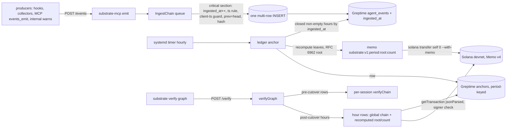

# Phase 6: Ledger - Research

**Researched:** 2026-09-26
**Domain:** event hash chain, Merkle anchoring to Solana devnet, and verification. The stack is a bun/TS monorepo, GreptimeDB 1.1.4 over HTTP SQL, and solana-cli 4.2.2.
**Confidence:**
- HIGH: the Merkle definition (checked against the reference vectors), the CLI memo instruction layout, the devnet read paths, the Greptime latency and data shape, and the code seams.
- MEDIUM: Greptime 1.1.4 `ALTER` behaviour. The docs describe the latest release; the Wave-0 spike confirms it on this server.
- LOW: devnet history retention over months, and `requestAirdrop` limits (undocumented).

Builds on the scout report `agent://Discuss06Scout/report`. This file repeats a scout fact only when a plan needs it, and corrects it where the scout was wrong. All probes were read-only apart from these throwaway, local-only items: a keypair and scripts under `/tmp/p6probe` (deleted), and a sign-only transaction that was never broadcast.

<user_constraints>
## User Constraints (from CONTEXT.md)

### Locked Decisions
- **D-01:** Hashing stays on ingest. `substrate-mcp` is the only writer of `agent_events` (`greptime.ts:144`, called from `service.ts:136`), and the hash is computed after redaction (`event.ts:52-91`). No producer changes. ROADMAP SC1 is re-worded to "every event is hashed on ingest" as an owner-approved re-scope, the same way as Phase 1 D-01.
- **D-02:** **One global ingest chain.**
  - `emit` is serialized in-process with a promise mutex.
  - Every new event's `prev` is the hash of the event ingested just before it, across all surfaces.
  - The chain head is kept in memory and seeded from Greptime on boot.
  - `session_id` stays as metadata only. The per-session `lastHash` lookup (`greptime.ts:148-155`) stops being used.
- **D-03:** The historical rows are **not** re-chained: 3,681 when this was decided, 3,796 when research ran. The global chain starts at a **recorded cutover event**, the first event written by the new code. Its id, hash and ingest time go into the phase evidence. The existing per-session verify stays valid for pre-cutover rows.
- **D-04:** A **new dedicated devnet keypair** at `/etc/substrate/ledger-devnet.json`, mode 0600, owner root, generated by the agent with `solana-keygen`. Its path goes into `/etc/substrate/substrate.env` as `SOLANA_ANCHOR_KEYPAIR`, alongside an explicit `SOLANA_RPC_URL=https://api.devnet.solana.com`. `~/.config/solana/id.json` (5pSW…) and the Solana CLI's default config are not used and not changed.
- **D-05:** The agent funds the key with `solana airdrop`. If the faucet refuses, a **checkpoint:human-action** asks the owner to fund it.
- **D-06:** The memo is written by the Solana CLI alone, with no new npm dependencies: `solana transfer <self> 0 --with-memo … --url devnet --output json`. A spike confirms that devnet accepts a 0-lamport self-transfer carrying a memo. If it does not, fall back to a 1-lamport self-transfer.
- **D-07:** An **hourly systemd timer** (`OnCalendar=hourly`, `Persistent=true`) runs `ledger anchor`. It anchors every closed, not-yet-anchored hour older than a lag, skips empty hours, is idempotent via the `anchors` rows, and exits non-zero on an RPC failure so the next tick retries.
- **D-08:** Anchors live in Greptime. The currently empty `anchors` table (0 rows, `PRIMARY KEY ("root")`, `greptime.ts:112-121`) is re-created **keyed by period**, not by root.
- **D-09:** Add an `ingested_at` column to `agent_events` (an additive `ALTER`). Hours are bucketed by **ingest time**, not by the client-supplied `ts`.
- **D-10:** An **RFC 6962-style Merkle tree**: `0x00` leaf prefix, `0x01` node prefix, no duplicate-last. It covers event hashes ordered by `(ingested_at, id)`. Memo format: `substrate:v1:<period_start_iso>:<root_hex>:<count>`.
- **D-11:** `substrate verify <graph_id>` is the existing chain check **plus** a per-hour anchor check. For every hour that contains an event of the graph, it recomputes that hour's root and count from Greptime, fetches the memo by `tx_sig` (server-side in `verifyGraph`, with an RPC timeout), and compares them. It reports the first mismatching hour. Recent unanchored hours report `pending`, not failure. The CLI stays a thin POST and keeps exit codes 0 and 1.
- **D-12:** Proof procedure:
  1. Create a throwaway graph `ut-ledger-proof-<stamp>` with 3 events in one session.
  2. Wait until its hour is anchored.
  3. Overwrite the middle event with the same `(surface, repo, graph_id, kind, ts)`: (a) keeping the stale hash, which breaks the chain; (b) with recomputed hashes, which the anchor check catches. `verify` must flag both.
  4. **Restore** the original rows so the hour verifies again. The original rows are captured before any overwrite.
- Standing rules:
  - two-sided gates against `06-BASELINE.md`;
  - snapshots and `RESTORE.md` routes under `/var/lib/substrate/phase6-baseline/` before any live edit outside the repo;
  - explicit-path staging; commit messages carry `Refs SPE-3576`;
  - never print secrets (the keypair contents and seed phrase included);
  - fail open for collectors.

### Claude's Discretion
Module layout within `packages/ledger` and `packages/mcp-server`, the lag value, the extra `anchors` columns, the verify response shape beyond `ok`/`events`/`brokenAt`/`reason`, and how the mutex is built. The research recommends the following; the planner may adopt them without the owner:
- `ts := ingested_at` for events with no client `ts`, and a strictly increasing `ingested_at`;
- a pre-insert duplicate guard for events that carry a client-supplied `ts`;
- batching queued emits into one INSERT;
- Merkle leaves are **recomputed** content hashes;
- a non-secret `SOLANA_ANCHOR_PUBKEY` for the server, with a signer check;
- matching every Memo program ID.

### Deferred Ideas (OUT OF SCOPE)
- A one-time genesis anchor over the pre-cutover hashes.
- A global `substrate verify --all` and per-event Merkle inclusion proofs.
- Rebuilding the `anchors` index from the anchor address's on-chain history (`ledger anchor --reindex`).
- A paid or dedicated devnet RPC, or mainnet anchoring.
- Client-side hashing, or an optional client hash field, in producers.
</user_constraints>

## Summary

Every locked decision can be built with what is already installed: bun's SHA-256, solana-cli 4.2.2, `fetch` for JSON-RPC, and the existing `GreptimeClient`. **No npm, pip or cargo package is added.** The probes turned up **seven facts the planner must act on**. None of them is visible from CONTEXT.md:

1. **The CLI's `--with-memo` writes to Memo v4, not the classic SPL Memo address.** A throwaway keypair built an offline `solana transfer <self> 0 --with-memo … --sign-only --dump-transaction-message`. Decoded, the message has exactly two instructions:
   - a System transfer of **0 lamports, self to self** (accounts `[0,0]`, data `02000000` followed by eight zero bytes);
   - a memo instruction to **`Memo4c2pN8afCj432Lb7RMVKi9PbQnnW7ewFFaV3oAH`**, with no accounts and the 105-byte memo as its data.

   Devnet has that program: executable, owner `BPFLoaderUpgradeab1e…`. Devnet 4.3.0 returns it in `jsonParsed` as `{"program":"spl-memo","programId":"Memo4c2p…","parsed":"<text>"}` (observed on a real devnet v4 memo transaction). Readers must match on **program ID** across all three memo addresses and must not assume `MemoSq4…`. The CLI accepts the 0-lamport self-transfer; whether the cluster accepts it is still for the spike (A2).
2. **The existing per-session verify cannot check post-cutover rows.** Under D-02, `prev` is the previous event *globally*. `verifyGraph` groups rows by `session_id` (`service.ts:512-524`), so it would report "prev does not match" for any session whose events interleave with other surfaces' events, which is nearly all of them. Verify must split rows: those with `ingested_at` NULL go through the old per-session path, and those with it set go through a **global-chain check over each whole hour**. That check needs the whole hour's rows, which D-11 already fetches to recompute the root.
3. **Merkle leaves must be recomputed content hashes, not the stored `hash` column.** D-12(a) overwrites a row's content and keeps the stale `hash`. A root built from stored hashes is unchanged by that edit, so the anchor would be blind to it. Recomputing `eventHash(row)` for each leaf, both when anchoring and when verifying, makes the anchor catch (a) as well as (b). The anchor job should also flag any row whose stored hash differs from its recomputed hash.
4. **Serializing emit costs a full Greptime round trip per event, and bursts exist.**
   - Five `SELECT 1` calls to the Railway Greptime took 180-194 ms each.
   - Peak load: **7 events in one second** and **38 in one minute**.
   - Hooks post with a **1.5 s** client timeout (`cli/src/index.ts:20`).

   A plain one-insert-per-event mutex makes the 7th event of a burst wait about 1.3 s. **Drain the queue into one multi-row INSERT per turn of the critical section.** Worst-case latency then stays near two round trips.
5. **`last_row` collapses are real, and D-02/D-09 alone do not stop them.**
   - The storage key is `(surface, repo, graph_id, kind)` plus `ts` at millisecond precision. `id` is a field, so adding `ingested_at` does not change the key.
   - 2 herdr pairs sit **1 ms apart**, and 4 pairs sit within 10 ms. Same-millisecond pairs would have collapsed invisibly [INFERENCE].
   - Grok replays history with its source `ts` (`grok-map.ts:84`, `grok.ts:124-128`), so a replay overwrites the original row.

   After cutover, each collapse becomes a false "tamper": a chain break, and an anchor mismatch if the hour was already anchored. Fix: `ts := ingested_at` for server-timed events, a strictly increasing `ingested_at`, and a NULL-safe existence check for events that carry a client `ts` (Q1). The Greptime-level fixes are one-way doors and are rejected: `SET 'append_mode'='true'` is irreversible per the docs and breaks D-12's overwrite and restore, and adding a tag column is permanent.
6. **The `anchors` table is as mutable as the events.** Someone who deletes the `anchors` row for hour H after tampering with H could get the timer to **re-anchor the tampered data**. Someone who points `tx_sig` at their own memo transaction could get verify to "confirm" a forged root. Mitigations:
   - verify checks the memo transaction's **signer** against a non-secret `SOLANA_ANCHOR_PUBKEY`, and checks `meta.err == null`;
   - (Open Question 3) the job consults the anchor address's on-chain history before anchoring any hour that has no row.
7. **Two Greptime DDL details the migration must handle:**
   - `ALTER TABLE … ADD COLUMN IF NOT EXISTS` is **not** in the documented syntax, so `migrate()` must check `information_schema.columns` first. That view answers on this server (probe).
   - `CREATE TABLE IF NOT EXISTS "anchors"` silently keeps the old `PRIMARY KEY ("root")`. Re-creating it needs an explicit guarded `DROP` that runs only while `count(*) = 0`.

**Primary recommendation: tracer first.**
- (a) Wave 0: baseline, key and funding, the memo spike, and a Greptime scratch-table spike.
- (b) The global ingest chain and schema go live with a recorded cutover. At the same time, the pure `packages/ledger` core (Merkle, memo, period, Solana CLI and RPC) is built.
- (c) Tracer: `ledger anchor` anchors the first closed post-cutover hour on devnet and reads the memo back.
- (d) Verify and the timer are built in parallel.
- (e) The D-12 proof, including restore.

## Architectural Responsibility Map

| Capability | Primary tier | Secondary tier | Rationale |
|---|---|---|---|
| Hash plus global `prev` on ingest | `substrate-mcp` (`packages/mcp-server/src/chain.ts`, new) | Greptime `agent_events` (storage only) | D-01, D-02: the only writer, serialized in-process |
| Hour bucketing, Merkle root, memo format | `packages/ledger` (pure modules) | — | shared by the anchor job and verify, so the two cannot drift |
| Signing and sending the memo | the `ledger anchor` job (systemd timer) → `solana` CLI | devnet RPC | D-06, D-07. Only a root oneshot reads the keypair; the long-lived server never holds it |
| Anchor index | Greptime `anchors` (period-keyed) | the anchor address's on-chain history | D-08. The chain is authoritative; the table is a pointer |
| Verification | `substrate-mcp` `verifyGraph` (Greptime reads plus JSON-RPC `getTransaction`) | the CLI `substrate verify` (thin POST) | D-11 |
| Proof tamper and restore | a throwaway script under `systemd-run EnvironmentFile=` | — | D-12. Not production code |

## Standard Stack

No new dependencies.

| Need | Use | Evidence |
|---|---|---|
| SHA-256 | `Bun.CryptoHasher("sha256")` (already `sha256Hex`, `event.ts:25-27`); `update()` accepts bytes | [VERIFIED: probe `bun_leaf_empty=6e340b9c…` equals SHA256(0x00)] |
| RFC 6962 tree | ~20 lines of TS (below) | [VERIFIED: 8/8 Trillian/CT reference roots matched in `/tmp` probe] |
| Signing and sending the memo | `solana transfer` (solana-cli 4.2.2, Agave) at `/root/.local/share/solana/install/active_release/bin/solana` | [VERIFIED: `solana --version`, `command -v solana`] |
| Reading memos and balances | `fetch` JSON-RPC `getTransaction` (`jsonParsed`), `getSignaturesForAddress`, `getBalance` | [VERIFIED: devnet probes] |
| Shelling out | Runner/execFile pattern (`packages/host/src/hostfns.ts:93-100`). Copy the ~15 lines into ledger; do not import `hostfns.ts`, which pulls host's `options.ts`/`seed.ts` | [VERIFIED: read hostfns.ts:10-14, 93-103] |
| Greptime | `GreptimeClient` (`greptime.ts:34-165`), imported by relative path, as host and collectors already do | [VERIFIED: `hostfns.ts:11`, `grok.ts:21`] |
| Keygen | `solana-keygen new --no-bip39-passphrase --silent -o <path>` | [VERIFIED: throwaway run prints only "Wrote new keypair to <path>", file mode 600] |
| Base58 decode (only the fallback when `jsonParsed` has no `parsed`) | ~15-line BigInt helper in `rpc.ts`; no dependency | [VERIFIED: the `/tmp` decoder used the same alphabet to produce `Memo4c2p…` from the message bytes] |

### Alternatives considered
| Instead of | Could use | Tradeoff |
|---|---|---|
| the `solana` CLI for signing | `@solana/web3.js` 1.99 (in the bun cache) | a package install in the shared checkout, which the owner has gated; D-06 chose the CLI |
| the CLI | `node:crypto` ed25519 plus hand-built transactions | custom wire code; no gain over the CLI |
| server-side reads via `fetch` | spawning `solana confirm -v` inside `verifyGraph` | a process per hour inside a request; `fetch` is lighter and needs no binary on the server's PATH |

## Package Legitimacy Audit

No packages are installed, so the gate does not apply.

## Answers to the research questions

### Q1 — Global chain design

**In-memory head across restarts** (recommended design, within D-02):
- State: `head = { hash, ingestedAtMs } | "genesis" | "unknown"`.
- **Boot:** after `migrate()` (`index.ts:15`), seed the head with `SELECT "hash", "ingested_at" FROM "agent_events" WHERE "ingested_at" IS NOT NULL ORDER BY "ingested_at" DESC LIMIT 1`.
  - A row: that row is the head.
  - An empty result: `genesis`. The next event is the cutover event, with `prev: null`.
  - A query error: `unknown`. The server still boots, as today (`index.ts:5-6`).
- **Critical section** (one at a time; takes every queued input):
  1. If the head is `unknown`, re-seed it. If the re-seed fails, reject the whole batch. Producers already fail open, and the HTTP answer is 500, as when Greptime is down today.
  2. For each input, in arrival order: `ingestedAtMs = max(Date.now(), head.ingestedAtMs + 1)`; `ts = input.ts ?? ingestedAt`; `prev = head.hash` (or null at genesis); normalize and hash; the head moves to this event.
  3. Send one `INSERT … VALUES (…),(…)`.
  4. Success: commit the new head. Failure, including a timeout: head becomes `unknown`, because the write may have landed. The next turn re-seeds from Greptime and so chains onto whatever actually persisted.
- **Residual race** [INFERENCE]: an insert that times out client-side (5 s, `greptime.ts:12`) but reaches Greptime *after* the re-seed query produces two rows with the same `prev`. Verify shows it as `prev does not match` at the later row. Name it `fork` in the reason text so it reads as benign. It is rare: it needs a write delayed by more than 5 s.
- **Single writer:** only `substrate-mcp.service` runs `emit` with production credentials. A developer running `bun run mcp` with the production env would fork the chain. The server cannot enforce this; verify detects it. Document it in the unit's comment.

**Collision hazard (same storage key and millisecond under `last_row`):**
- Facts:
  - `SHOW CREATE TABLE` shows no `WITH` options (scout), so the table uses the default `last_row` merge mode.
  - The docs: "The `PRIMARY KEY` columns and `TIME INDEX` together form the storage key … this storage key does not enforce uniqueness", and `last_row` "keeps the last row for the same primary key and timestamp". The docs example also shows that a later insert's NULL fields replace earlier values [CITED: docs.greptime.com/reference/sql/create].
  - `information_schema.columns` shows `id` as a FIELD and the tags as surface, repo, graph_id and kind [VERIFIED: probe].
- Measured near-collisions under the same tags (window `LAG`):
  - ≤1 ms: 2 pairs (herdr);
  - ≤10 ms: 4 pairs (herdr);
  - ≤100 ms: 83 pairs;
  - minimum gap per surface: herdr 1 ms, grok-build 19 ms, muse 59 ms.

  An exact collision (gap 0) cannot be observed, because dedup already removed it.
- Paths that produce equal keys:
  1. Server-timed events (herdr, muse, claude-code, …) handled concurrently within one millisecond.
  2. Client-timed events: grok forwards the source `ts` (`grok-map.ts:84`), and `--backfill` or a truncated log replays history (`grok.ts:10, 124-128`). A replay overwrites the original row.
- **Does the global chain or `ingested_at` prevent it?** No. The chain only *detects* it, as a break at the successor. `ingested_at` is a field, not part of the key.
- **Recommended prevention (A), code only and reversible:**
  1. `ts := ingested_at` whenever the input has no `ts`. `ingested_at` is strictly increasing, so server-timed events can never share a millisecond. That covers every surface except grok-build.
  2. For inputs that carry a client `ts`: inside the critical section, run one existence query for the batch on the exact key. It must be NULL-safe: write `("repo" = 'x' OR ("repo" IS NULL AND … ))`, because `= NULL` never matches, and repo and graph_id are NULL on 3,592 rows.
     - Same content (surface, session, graph, node, kind, summary, canonical payload): a replay. Skip the insert and return the stored event (idempotent).
     - Different content: `ts += 1 ms`, bounded, then check again.

     It costs one round trip (~182 ms) only in batches that contain client-timed events. grok-build had 86 of the 3,681 rows at scout time.
- **Rejected:**
  - (B) `ALTER TABLE … ADD COLUMN "event_id" STRING PRIMARY KEY`. It is documented ("Adds a new column as a tag(primary key)"), but tags cannot be modified afterwards ("The modified column cannot be a tag"), every event becomes its own series, and it adds nothing over (A) for new rows. [CITED: docs.greptime.com/reference/sql/alter]
  - (C) `ALTER TABLE "agent_events" SET 'append_mode'='true'`. Documented as "You can change it from `false` to `true`, but not from `true` to `false`", so it is irreversible. Replays would become duplicate leaves, and D-12's overwrite would append a second row instead of replacing, which breaks both the proof and its restore. [CITED: same page]
  - (D) A new append-mode table. It contradicts D-09's additive ALTER and splits history for `brief.ts:121` and verify.
- **ALTER in 1.1.4:**
  - Documented (latest docs): `ADD COLUMN name type [options]`, several ADD COLUMNs in one statement, FIRST/AFTER, `PRIMARY KEY` on a new column, `DROP COLUMN`, `MODIFY COLUMN` (not for tags or the time index), and `SET`/`UNSET` table options.
  - **`IF NOT EXISTS` is not in the ALTER syntax block.**
  - DDL to use: `ALTER TABLE "agent_events" ADD COLUMN "ingested_at" TIMESTAMP`. It adds a nullable field, and existing rows read NULL.
  - Whether 1.1.4 behaves as the latest docs say is [ASSUMED] until the Wave-0 scratch-table spike runs.

**Cutover bookkeeping:**
- The marker is the column itself: `ingested_at IS NULL` means a pre-cutover row, and `ingested_at IS NOT NULL` means a post-cutover row. There is no extra table.
- Genesis is the first post-cutover row, and its `prev` is null. Exactly one post-cutover row may have a null `prev`; a second one means a reset, and verify reports it.
- **Hash compatibility (critical):**
  - Add an optional `ingested_at?: string` (ISO format) to `SubstrateEvent`, and have `eventHash` cover it.
  - `rowToEvent` (`service.ts:46-73`; move it to `event.ts` and export it for the ledger) must set `ingested_at` **only when the column is non-null**. `canonicalJson` drops `undefined` (`event.ts:20`), so every historical hash recomputes unchanged. Mapping NULL to `null` would add `"ingested_at":null` to every historical digest and break all 18 graphs.
- Record `06-02-CUTOVER` evidence:
  - `cutover_event_id`, `cutover_hash`, `cutover_ingested_at` and `cutover_prev=null`;
  - `historical_rows_at_cutover`;
  - `pre_cutover_graphs_verified=<n>/<n>`;
  - the deployed commit.

### Q2 — Leaf order, exact bucketing, and late events
- **Bucket:** `period_start = floor(ingested_at_ms / 3_600_000) * 3_600_000`, in UTC, over the half-open interval `[start, start + 1 h)`. `new Date(start).toISOString()` always produces `YYYY-MM-DDTHH:00:00.000Z`. An event at exactly `HH:00:00.000` belongs to hour HH.
- **Leaf query:** `SELECT <all 17 columns> FROM "agent_events" WHERE "ingested_at" >= <startMs> AND "ingested_at" < <endMs> ORDER BY "ingested_at", "id"`.
  - Greptime accepts epoch-ms literals against a TIMESTAMP column: the ISO form and the epoch form both returned 236 on `ts` [VERIFIED].
  - A full hour of 63 rows came back in 191 ms [VERIFIED].
  - `ingested_at` is not the time index, so the query scans. That is fine at 79 events per hour on average (p95 212, max 368, over 48 hours).
- **Leaves:** 32 raw bytes of `eventHash(rowToEvent(row))`, recomputed (Summary item 3).
  - `leaf = SHA256(0x00 ‖ h)`, `node = SHA256(0x01 ‖ L ‖ R)`, and n is split at the largest power of two below n.
  - The Trillian/CT vectors give the expected roots for n = 1…8.
  - Empty hours are never anchored (D-07).
  - With a strictly increasing `ingested_at`, `id` never breaks a tie after cutover. Keep it in `ORDER BY` anyway, per D-10.
- **Chain continuity across hours:** the first event of hour H must carry `prev` equal to the hash of the latest event before H, found with `… WHERE "ingested_at" < <startMs> ORDER BY "ingested_at" DESC LIMIT 1`. If no such event exists, `prev` must be null (genesis).
- **Closed hour:** an hour is closed when `now ≥ period_end + lag`. The lag must exceed the insert timeout (5 s) plus clock margin (`NTPSynchronized=yes` [VERIFIED: timedatectl]). **Recommend 5 min.**
- **Can a late event land in an already-anchored hour?** Not through ingest. `ingested_at` is assigned inside the critical section at write time (monotonic). A write in flight at `HH:00` lands within 5 s, far inside the lag. Backfill and replay change only `ts`, never the bucket. A retried emit gets a new `ingested_at`. The only ways an anchored hour changes:
  - a direct Greptime write, which is a tamper and is caught;
  - a `last_row` overwrite through ingest, which Q1(A) closes.
- **Pending window:** `OnCalendar=hourly` fires at `HH:00`. With any positive lag, hour H is anchored at `H+2:00`, so an hour stays `pending` for up to about 2 h. See Open Question 1.

### Q3 — Solana CLI memo mechanics
- **Write** (the job; every flag explicit, because the default config URL is the dead `http://127.0.0.1:8899` and `~/.config/solana` is shared and must not change):
  ```
  /root/.local/share/solana/install/active_release/bin/solana transfer <PUBKEY> 0 \
    --with-memo "substrate:v1:<period_start_iso>:<root_hex>:<count>" \
    --url "$SOLANA_RPC_URL" --keypair "$SOLANA_ANCHOR_KEYPAIR" --fee-payer "$SOLANA_ANCHOR_KEYPAIR" \
    --commitment confirmed --allow-unfunded-recipient --output json
  ```
  - All of these flags exist in 4.2.2 [VERIFIED: `solana transfer --help`].
  - The success JSON is `{"signature":"<base58>"}` [ASSUMED: from the CLI's `CliSignature` output; the spike records the real shape].
  - The fallback amount is `0.000000001`: the CLI's amount is in SOL, and 1 lamport is 1e-9 SOL.
  - Wrap each call in a 120 s timeout.
- **Instruction layout:**
  - A System transfer of 0 lamports from self to self, plus Memo v4 `Memo4c2p…`, with no ComputeBudget instruction.
  - Header `[1,0,2]`.
  - The message is 258 bytes (the transaction size limit is 1,232), and the memo is 105 bytes [VERIFIED: offline decode].
  - Memo v4 is "p-memo", wire-compatible with v3 `MemoSq4…`; the official clients moved to it in solana-program/memo PR #418 [CITED: github.com/solana-program/memo].
- **Read back, option 1 — CLI:** `solana confirm -v <sig> --url devnet --output json`, observed on a devnet v4 memo transaction in 496 ms.
  - Fields: `confirmationStatus`, `transaction.signatures[]`, `transaction.message.{header, accountKeys[] (strings), instructions[{programIdIndex, accounts, data(base58)}]}`, `meta.{err, status, fee, logMessages[]}`, `blockTime`, `slot`.
  - The memo text appears in `logMessages` as the line after `Program log: Memo (len N)`.
- **Read back, option 2 — JSON-RPC** (recommended for the server): `getTransaction(sig, {encoding:"jsonParsed", maxSupportedTransactionVersion:0, commitment:"confirmed"})`.
  - The memo instruction comes back as `{"program":"spl-memo","programId":"Memo4c2p…","parsed":"<memo>"}`.
  - `accountKeys[0]` is `{"pubkey","signer":true,"writable":true}`.
  - `meta.err` is null, `meta.fee` is 5000, and `version` is 0 [VERIFIED].
  - Parse defensively. Accept `programId` in {`Memo4c2pN8afCj432Lb7RMVKi9PbQnnW7ewFFaV3oAH`, `MemoSq4gqABAXKb96qnH8TysNcWxMyWCqXgDLGmfcHr`, `Memo1UhkJRfHyvLMcVucJwxXeuD728EqVDDwQDxFMNo`}. If `parsed` is absent, base58-decode `data`. Web reports say older nodes do not label v4 memos [CITED: quicknode memo guide].
- **Listing by address:** `getSignaturesForAddress(pubkey)` returns `memo: "[<len>] <text>"`, and does so for v4 memos too (observed `"[133] coattails:v1|…"`). Always confirm the signer with `getTransaction` before trusting a listed memo, because anyone can send a transaction that mentions our address.
- **Verify must check** all of the following:
  - `accountKeys[0].pubkey === SOLANA_ANCHOR_PUBKEY`, and `signer` is true;
  - `meta.err === null`;
  - the memo regex matches;
  - the memo's period equals the hour and its count equals the recomputed count.
- **Devnet flakiness** (observed; it varies by method):

  | Call | Result |
  |---|---|
  | `getAccountInfo` on `MemoSq4…` and `Memo1…` | 3/3 timed out at 15 s |
  | `getFirstAvailableBlock` | 3/3 timed out |
  | `getAccountInfo(Memo4c2p…)` | timed out, then 528 ms |
  | `getTransaction` jsonParsed | 20 s timeout, then 304 ms |
  | `getSignaturesForAddress` | 185-204 ms |
  | `getVersion` | 166 ms |

  The documented limits are 100 requests per 10 s per IP and 40 per 10 s per method, and "public RPC endpoints are … not intended for production"; "Devnet may be subject to ledger resets" [CITED: solana.com/docs/references/clusters]. Mitigations:
  - an 8-10 s timeout per call, with 3 attempts and a 2 s backoff;
  - the job exits non-zero, and the next tick retries (`Persistent=true` catches ticks missed while the host was down);
  - at most 24 hours anchored per run;
  - the server caches confirmed memos by `tx_sig` in memory, since a finalized memo cannot change.
- **Airdrop:** `solana airdrop 1 <PUBKEY> --url "$SOLANA_RPC_URL"`.
  - The limits on RPC `requestAirdrop` are undocumented beyond "subject to rate limits"; community guides cite a 2 SOL cap per request [CITED: solana.com cookbook airdrops; secondary guides].
  - faucet.solana.com allows 2 requests per 8 h without login, and says **"AI agents should not use this faucet"**. It is therefore the owner's route for the D-05 checkpoint.
- **Budget:**
  - 5,000 lamports per anchor × 24 per day = 120,000 lamports per day, so 1 SOL lasts about 22 years.
  - Keep the balance above the rent-exempt minimum of 650,240 lamports (devnet `getMinimumBalanceForRentExemption(0)`) plus fees. Warn below 0.01 SOL.
- **Keygen:** `solana-keygen new --no-bip39-passphrase --silent -o /etc/substrate/ledger-devnet.json`, then `solana-keygen pubkey <path>`, which prints a public key.
  - Never drop `--silent`: the seed phrase is a secret.
  - Never use `--force` over an existing file.
  - The probe confirmed that `--silent` prints only the "Wrote new keypair" line and creates the file at mode 600.

### Q4 — Where the code goes, units, CLI, tests, baseline
**Placement:**
- `packages/ledger`: the anchor job plus the pure cryptography shared with verify. PROJECT.md:42 lists "Greptime writer" under ledger, but D-01 keeps the writer in mcp-server.
- The job must not run inside `substrate-mcp`. It holds the signing key, spawns the CLI, and must work while the server is down.

```
packages/ledger/src/merkle.ts        # merkleRoot(leaves: Uint8Array[]) RFC 6962; hexToBytes
packages/ledger/src/memo.ts          # formatMemo, parseMemo (regex), MEMO_PROGRAM_IDS
packages/ledger/src/period.ts        # hourStart(ms), closedHours(fromMs, nowMs, lagMs)
packages/ledger/src/solana.ts        # Runner + execFile runner; transferMemoArgv, parseSignature
packages/ledger/src/rpc.ts           # fetch JSON-RPC: transactionMemo(sig), addressMemos(pubkey), balance(pubkey); timeouts + retries
packages/ledger/src/anchor.ts        # planAnchors(...) pure; runAnchor(deps) executor
packages/ledger/src/cli.ts           # `anchor [--dry-run] [--max-hours N]`, `status`  ← "ledger anchor" (D-07)
packages/ledger/src/*.test.ts
packages/mcp-server/src/chain.ts     # IngestChain: queue, head seed, ingested_at, ts rule, client-ts guard, batch insert
packages/mcp-server/src/chain.test.ts
packages/mcp-server/src/ledger-verify.ts (+ .test.ts)  # pure hour checks used by verifyGraph
packages/mcp-server/src/{greptime,event,types,service,config,index}.ts  # edits (below)
packages/cli/src/index.ts            # verify: own timeout + per-hour lines
infra/vps/substrate-ledger-anchor.{service,timer}
```

**Edits:**
- `greptime.ts`:
  - `insertEvents(events[])`, a multi-row INSERT that includes `ingested_at`;
  - `chainHead()`;
  - `columns(table)`;
  - `migrate()` runs a guarded `ALTER`, then a guarded `anchors` re-create (`DROP` only if `PRIMARY KEY ("root")` is present and `count(*) = 0`), then the new `CREATE`;
  - remove `lastHash` (clean cutover).
- `event.ts`: `normalizeEvent(input, prev, ingestedAt)`; `ingested_at` is hashed; `rowToEvent` moves here.
- `types.ts`: `ingested_at?: string` on `SubstrateEvent`.
- `service.ts`: `emit` delegates to `IngestChain`; `verifyGraph` is rewritten (plan 06-05).
- `config.ts`: `ledger: { rpcUrl, anchorPubkey, verifyRpcTimeoutMs }` from `SOLANA_RPC_URL` and `SOLANA_ANCHOR_PUBKEY`.
- `index.ts`: seed the head after migrate.

**Recommended `anchors` DDL** (no PRIMARY KEY, so dedup is on `period_start` alone and each hour gets at most one row; a table with only a time index and fields is valid per the CREATE docs):
```sql
CREATE TABLE IF NOT EXISTS "anchors" (
  "period_start" TIMESTAMP TIME INDEX,
  "period_end"   TIMESTAMP,
  "root"         STRING,
  "event_count"  BIGINT,
  "memo"         STRING,
  "tx_sig"       STRING,
  "signer"       STRING,
  "cluster"      STRING,
  "slot"         BIGINT,
  "anchored_at"  TIMESTAMP,
  "stale_hashes" BIGINT
)
```
`stale_hashes` counts rows whose stored hash differed from the recomputed one when the hour was anchored.

**systemd template.** No `.timer` exists in `infra/vps` yet. Phase 4 plans one but has not executed. Note that the `solana` binary is **not on systemd's default PATH**, so the job resolves it from an absolute path: a `SOLANA_CLI` env var defaulting to `/root/.local/share/solana/install/active_release/bin/solana`.
```ini
# infra/vps/substrate-ledger-anchor.service
[Unit]
Description=Agent Substrate ledger: anchor closed event hours to Solana devnet
After=network-online.target
Wants=network-online.target

[Service]
Type=oneshot
EnvironmentFile=/etc/substrate/substrate.env
Environment=HOME=/root
WorkingDirectory=/root/src/repos/agent-substrate
ExecStart=/root/.local/share/reflex/bun/bin/bun packages/ledger/src/cli.ts anchor
TimeoutStartSec=15min
StandardOutput=journal
StandardError=journal
SyslogIdentifier=substrate-ledger-anchor
NoNewPrivileges=true
PrivateTmp=true
ProtectSystem=full
# the solana binary and bun live under /root
ProtectHome=false
RestrictAddressFamilies=AF_INET AF_INET6 AF_UNIX

# infra/vps/substrate-ledger-anchor.timer
[Unit]
Description=Hourly Solana devnet anchor of closed event hours

[Timer]
OnCalendar=hourly
Persistent=true
AccuracySec=1min
Unit=substrate-ledger-anchor.service

[Install]
WantedBy=timers.target
```
- Install: `sudo cp` both files to `/etc/systemd/system/`, run `sudo systemctl daemon-reload`, then `sudo systemctl enable --now substrate-ledger-anchor.timer`.
- Static check: `systemd-analyze verify` on the repo copies (`/usr/bin/systemd-analyze` is present).

**CLI subcommands:**
- `bun packages/ledger/src/cli.ts anchor` prints `[ledger] anchored <period> root=<hex> count=<n> sig=<sig>` for each hour, or `[ledger] nothing to anchor (watermark <period>)`. Exit 0 means all done; exit 1 means an RPC, Greptime or unfunded failure.
- `status` prints `pubkey=`, `balance_lamports=`, `last_anchored=` and `pending_hours=` as key=value lines, never the key path contents.
- `substrate verify <graph_id>` (`packages/cli`):
  - reads `SUBSTRATE_VERIFY_TIMEOUT_MS`, default 60,000. The shared 1.5 s timeout would turn a slow devnet read into "unreachable";
  - prints the chain line plus one `anchor <period_start> <status>` line per hour;
  - keeps exit codes 0 and 1.

**Tests:** `bun test`, with `*.test.ts` next to the source and stores faked through the constructor seam. The two Greptime stubs in `service.test.ts:27-32` and `:382-387` implement `lastHash`/`insertEvent`; they must move to the new `insertEvents`/`chainHead` contract. That is a contract update, not new scope. No `verifyGraph` test exists today (grep).

**What `06-BASELINE.md` must measure** (two-sided; re-measure, do not copy):
1. `git rev-parse HEAD`.
2. `SUBSTRATE_DISABLED=1 bun test`: pass, fail and file counts, plus the ids of any failing tests. The last recorded figure is 338/0/22 at `9eef1ee` (04-CONTEXT:149).
3. `bunx tsc --noEmit`: exit code and a normalized error set.
4. `cd packages/dispatcher && python3 -m pytest -q`: the count (149 recorded).
5. Live Greptime, through `systemd-run EnvironmentFile=`:
   - `SHOW CREATE TABLE` for `agent_events` and `anchors`, saved verbatim to `phase6-baseline/` as the restore DDL;
   - `count(*)`, `max(ts)` and `count(prev IS NULL)` on `agent_events`;
   - `anchors` count = 0;
   - the `information_schema.columns` list;
   - Greptime RTT from 5 × `SELECT 1`.
6. `POST /verify` for every distinct `graph_id`: expect N/N `ok` (18 at scout time).
7. `sudo grep -c '^SOLANA_' /etc/substrate/substrate.env` = 0.
8. `systemctl list-timers --all | grep -c ledger` = 0.
9. `solana --version` and `solana config get` (the RPC URL is localhost). It must be unchanged at phase end.

## Architecture Patterns

### System architecture diagram


### Pattern 1 — Credential-spending code: pure argv builders plus an injected Runner
The same shape as 03-07 and 04-03 (`hostfns.ts:93-100`). `transferMemoArgv({cli, pubkey, memo, rpcUrl, keypairPath})` returns a string array, and tests assert it exactly. The keypair *path* may appear in argv and logs; its *contents* never do. Unit tests never touch the network.

### Pattern 2 — Planner and executor for the anchor job
- `planAnchors({hourCounts, anchorRows, chainMemos, nowMs, lagMs, maxHours, cutoverMs})` returns `{anchor: hour[], adopt: hour[], skip: hour[]}`. It is pure and fully unit-tested.
- The executor processes hours in ascending order, and on the first failure it stops and exits 1. The result is a watermark: every non-empty hour at or before the last anchored period is anchored.

### Pattern 3 — Verify reports every signal; it does not stop at the first failure
Compute both the chain result and every hour's anchor status, then derive `ok`. D-12(b) is detected by both the global chain (at the successor row) and the anchor. The report must show the anchor mismatch on its own terms, so it cannot hide behind the chain result.

Response shape (back-compatible superset of today's `{ok, events, brokenAt?, reason?}`):
```ts
{ ok: boolean; events: number; brokenAt?: string; reason?: string;
  chain: { pre: ChainResult; post: ChainResult };
  hours: Array<{ period_start: string; status: "anchored" | "pending" | "unanchored" | "mismatch" | "unverified";
                 count: number; root: string; tx_sig?: string; reason?: string }>;
  firstBadHour?: string }
```

### Anti-patterns
- Running `solana config set …`. `~/.config/solana` predates this project and is shared.
- Letting `substrate-mcp` read the keypair file. The server gets only the pubkey.
- Splitting the memo on `:`. The ISO period contains colons; use the anchored regex (Code Examples).
- `ORDER BY "ts"` for anything post-cutover. `ts` is the client's clock; order by `ingested_at`.
- Anchoring leaves from the stored `hash` column (Summary item 3).
- Checking on-chain memos without a signer check.

## Don't Hand-Roll

| Problem | Don't build | Use |
|---|---|---|
| Transaction signing and serialization | ed25519 plus message encoding | `solana transfer` |
| Memo read-back | a log-line scraper | `getTransaction` `jsonParsed` → `parsed`; base58 `data` as the fallback |
| Merkle correctness | ad-hoc pair hashing | RFC 6962 MTH, pinned by the 8 reference roots |
| JSON canonicalization for leaves | a new encoder | `eventHash` / `canonicalJson` (`event.ts:16-36`) |
| Shell-free exec | `Bun.$` strings | an argv `execFile` Runner (the `hostfns.ts` pattern) |

## Runtime State Inventory

| Category | Items | Action |
|---|---|---|
| Stored data | Greptime `agent_events` gets the `ingested_at` field; Greptime `anchors` is dropped and re-created (0 rows); the proof tamper and restore rows | Snapshot both `SHOW CREATE TABLE` outputs first. The restore route before cutover is `ALTER … DROP COLUMN` plus the old `CREATE`. After cutover, rolling back also means rolling back the code, and post-cutover rows then verify only in their own terms. |
| Live service config | `/etc/substrate/substrate.env`: add `SOLANA_RPC_URL`, `SOLANA_ANCHOR_KEYPAIR`, `SOLANA_ANCHOR_PUBKEY` (and optionally `SOLANA_CLI`) | Snapshot (0600) to `phase6-baseline/`. Append with a guard (`grep -c '^NAME=' = 0`). Restart `substrate-mcp`. |
| OS-registered state | `substrate-ledger-anchor.{service,timer}` (new) | Install per `infra/vps`. RESTORE: `systemctl disable --now` the timer, then `rm` both units and run `daemon-reload`. |
| Secrets | `/etc/substrate/ledger-devnet.json` (new, 0600 root, devnet only) | Never printed. RESTORE: `rm`. The devnet SOL is worthless. |
| Live process | `substrate-mcp` restarts twice: at cutover (06-02) and for verify (06-05) | Coordinate with any Phase 4 restart (04-03). |

## Common Pitfalls

1. **Per-session verify over global `prev`** (Summary item 2). Split rows by `ingested_at` NULL versus set.
2. **`ingested_at: null` in historical digests** breaks every pre-cutover graph. For NULL columns, `rowToEvent` must leave the key *absent*.
3. **The tamper or restore re-insert must include every column, `ingested_at` included.** Under `last_row` the latest row replaces the whole row, and omitted fields become NULL (docs example). A restore without `ingested_at` would turn the row into a "pre-cutover" row.
4. **The memo's ISO period contains colons.** Parse it with `^substrate:v1:(\d{4}-\d\d-\d\dT\d\d:00:00\.000Z):([0-9a-f]{64}):(\d+)$`.
5. **Memo v4 program ID** (Summary item 1). Match all three memo IDs.
6. **The default Solana config points at a dead localhost.** Always pass `--url`, `--keypair`, `--fee-payer` and `--commitment`; never set the config.
7. **`solana` is not on systemd's PATH.** Use the absolute path from `SOLANA_CLI` with the default above.
8. **The CLI verify timeout is 1.5 s** (`cli/src/index.ts:20,31-34,159`). Verify needs its own, longer timeout.
9. **No `ADD COLUMN IF NOT EXISTS`** in the documented syntax, and **`CREATE TABLE IF NOT EXISTS` keeps the old `anchors` PK**. Guard both.
10. **Stored-hash leaves blind the anchor to stale-hash tampering** (Summary item 3).
11. **Mutex latency.** 182 ms per insert, bursts of 7 per second, and a 1.5 s hook timeout. Batch the queue.
12. **An ambiguous insert timeout.** Reset the head to `unknown` and re-seed; label a residual fork as such.
13. **NULL tags in the duplicate guard.** Use `IS NULL` branches.
14. **Re-anchoring after an `anchors` row is deleted** would freeze tampered data. Adopt an existing on-chain memo instead (Open Question 3).
15. **Keygen without `--silent`** prints the seed phrase. Never `--force`.
16. **The faucet UI forbids agents.** An airdrop refusal goes to the owner's checkpoint (D-05).
17. **Rent minimum.** The fee payer must stay above 650,240 lamports.
18. **The hour boundary is half-open.** `HH:00:00.000` belongs to HH, in both SQL and the bucketing code.
19. **Compaction bugs #9146/#9157** (scout) can in principle reorder or resurrect overwrites. Read the row back after every tamper and every restore, and compare it byte for byte before running verify.
20. **Cross-phase file overlap.** Phase 4's 04-03 edits `service.ts`, `service.test.ts`, `types.ts`, `server.ts` and `cli/src/index.ts`. Do not run 06-02 or 06-05 at the same time as it.

## Code Examples

RFC 6962 root (verified against the Trillian/CT vectors in the `/tmp` probe; `h()` is `Bun.CryptoHasher` in the repo):
```ts
export function merkleRoot(leaves: readonly Uint8Array[]): Uint8Array {
	if (leaves.length === 0) throw new Error("empty hour is never anchored");
	if (leaves.length === 1) return sha256(Uint8Array.of(0x00), leaves[0]!);
	let k = 1;
	while (k * 2 < leaves.length) k *= 2; // largest power of two < n
	return sha256(Uint8Array.of(0x01), merkleRoot(leaves.slice(0, k)), merkleRoot(leaves.slice(k)));
}
// Vectors: leaves "", 00, 10, 2021, 3031, 40414243, 5051525354555657, 606162636465666768696a6b6c6d6e6f
// n=1 6e340b9cffb37a989ca544e6bb780a2c78901d3fb33738768511a30617afa01d
// n=2 fac54203e7cc696cf0dfcb42c92a1d9dbaf70ad9e621f4bd8d98662f00e3c125
// n=3 aeb6bcfe274b70a14fb067a5e5578264db0fa9b51af5e0ba159158f329e06e77
// n=4 d37ee418976dd95753c1c73862b9398fa2a2cf9b4ff0fdfe8b30cd95209614b7
// n=5 4e3bbb1f7b478dcfe71fb631631519a3bca12c9aefca1612bfce4c13a86264d4
// n=6 76e67dadbcdf1e10e1b74ddc608abd2f98dfb16fbce75277b5232a127f2087ef
// n=7 ddb89be403809e325750d3d263cd78929c2942b7942a34b77e122c9594a74c8c
// n=8 5dc9da79a70659a9ad559cb701ded9a2ab9d823aad2f4960cfe370eff4604328
```

Memo read-back (shape observed on devnet 4.3.0):
```ts
const tx = (await rpc("getTransaction", [sig, { encoding: "jsonParsed", maxSupportedTransactionVersion: 0, commitment: "confirmed" }])).result;
const payer = tx.transaction.message.accountKeys[0];
const ix = tx.transaction.message.instructions.find((i: { programId: string }) => MEMO_PROGRAM_IDS.has(i.programId));
const memo = typeof ix?.parsed === "string" ? ix.parsed : ix ? new TextDecoder().decode(bs58decode(ix.data)) : null;
const trusted = tx.meta.err === null && payer.signer === true && payer.pubkey === anchorPubkey;
```

The critical section, simplified:
```ts
const batch = queue.splice(0);
if (head === "unknown") head = await seed(); // throws → every waiter rejects, head stays unknown
const events = batch.map(({ input }) => {
	const ingested = Math.max(Date.now(), lastMs + 1); lastMs = ingested;
	const ev = normalizeEvent({ ...input, ts: input.ts ?? new Date(ingested).toISOString() }, prevHash(head), new Date(ingested).toISOString());
	head = ev; return ev;
});
try { await greptime.insertEvents(events); } catch (e) { head = "unknown"; throw e; }
```

## State of the Art
| Old | Current | When | Impact |
|---|---|---|---|
| SPL Memo `MemoSq4…` (v3, called "v2" by some libraries) | Memo v4 "p-memo" `Memo4c2p…`, used by solana-cli 4.2.2 `--with-memo` and the official clients | 2026 (PR #418; Dart kit 2026-09-21) | readers must accept every memo ID |
| Greptime tables append or dedup fixed at creation | `ALTER … SET 'append_mode'='true'` allowed (one-way) | latest docs | considered and rejected (irreversible) |

## Assumptions Log
| # | Claim | Risk if wrong |
|---|---|---|
| A1 | `solana transfer --output json` prints `{"signature":…}` | the parser changes; the spike records the real output |
| A2 | Devnet accepts a 0-lamport self-transfer with a memo | fall back to 1 lamport (D-06) |
| A3 | Greptime 1.1.4 supports `ADD COLUMN` and a table with no PK, as the latest docs describe | the scratch-table spike catches it; there is no fallback for D-09 short of a new table (owner) |
| A4 | A multi-row INSERT is all-or-nothing | a partial batch leaves the head `unknown` → re-seed chains onto what persisted; verify stays correct |
| A5 | Public devnet keeps `getTransaction` history long enough to verify months-old anchors | old hours become `unverified`; devnet "may be subject to ledger resets" |
| A6 | `--allow-unfunded-recipient` skips a recipient lookup | cosmetic |
| A7 | Same-millisecond collapses have already happened (herdr pairs 1 ms apart) | none; the design prevents them either way |

## Open Questions (the owner decides; everything else is for the planner)
1. **Timer offset.** With `OnCalendar=hourly` literally, hour H is anchored at H+2:00, a pending window of up to about 2 h. Recommended: `OnCalendar=*-*-* *:10:00` (still hourly, `Persistent=true`) with a 5-min lag, which gives at most about 70 min pending. Otherwise keep `hourly` and accept about 2 h.
2. **When does `pending` become a failure?** Recommended: an hour more than 3 h past its end with no anchor is `unanchored`, which counts as a failure. Without this threshold, deleting `anchors` rows downgrades tamper evidence to a permanent `pending`.
3. **On-chain-first idempotency.** Recommended: before anchoring an hour that has no row, the job lists the anchor address's recent memos (`getSignaturesForAddress`, then a `getTransaction` signer check). If a memo for that period exists, it adopts it by re-inserting the row, and raises an alarm if the roots differ. It never re-anchors. This extends D-07's "idempotent via the anchors rows" and does not replace it.
4. **Verify when devnet is unreachable.** Recommended: fail closed. The status is `unverified`, and the exit code is 1 with a distinct message. The alternative is exit 0 with a warning.

## Environment Availability
| Dependency | Required by | Available | Version | Fallback |
|---|---|---|---|---|
| solana-cli | anchor job | ✓ (not on systemd PATH) | 4.2.2 Agave | the absolute path |
| solana-keygen | 06-01 | ✓ | 4.2.2 | — |
| devnet RPC | job, verify | ✓ but flaky | 4.3.0 | retries plus the next tick |
| devnet faucet | 06-01 | not probed (a state change) | — | owner checkpoint (D-05) |
| Greptime | everything | ✓ ~182 ms RTT | 1.1.4 | fail open (existing) |
| bun | everything | ✓ | ≥1.4 | — |
| systemd-analyze | 06-06 | ✓ | — | — |
| NTP | ingest timestamps | ✓ `NTPSynchronized=yes` | — | — |

## Validation Architecture

### Test framework
| Property | Value |
|---|---|
| TS | `bun test`; `*.test.ts` next to the source; no bunfig |
| Python | `packages/dispatcher` pytest (untouched; gate only) |
| Quick run | `SUBSTRATE_DISABLED=1 /root/.local/share/reflex/bun/bin/bun test packages/ledger packages/mcp-server/src/chain.test.ts packages/mcp-server/src/event.test.ts packages/mcp-server/src/ledger-verify.test.ts` |
| Full gate (two-sided vs `06-BASELINE.md`) | `SUBSTRATE_DISABLED=1 bun test` (no baseline failure vanishes; no new failure) · normalized `bunx tsc --noEmit` · `cd packages/dispatcher && python3 -m pytest -q` |

### Behaviours → tests
| Behaviour | Type | Where |
|---|---|---|
| RFC 6962 roots equal the 8 reference vectors; odd n has no duplicate-last; an empty input throws; a leaf is the 32 raw bytes of a hex hash | unit | `packages/ledger/src/merkle.test.ts` |
| `formatMemo`/`parseMemo` round-trip; colons in the period; reject a non-hour-aligned period, uppercase hex, a negative or non-integer count, trailing junk | unit | `memo.test.ts` |
| `hourStart` is half-open (`HH:00:00.000` belongs to HH, `HH:59:59.999` too); `closedHours` respects the lag and the cutover start | unit | `period.test.ts` |
| Exact `transferMemoArgv` (absolute CLI, every flag, amount `0`; the fallback `0.000000001`); `parseSignature` accepts `{"signature"}` and rejects others; no keypair contents in argv or logs | unit (fake Runner) | `solana.test.ts` |
| RPC memo extraction: `jsonParsed` `parsed`; base58 fallback; all 3 memo IDs; signer mismatch, `meta.err` set or a missing memo is rejected; `[len] text` stripped from address listings; timeout then retry | unit (fake fetch) | `rpc.test.ts` |
| `planAnchors`: range from cutover to the last closed hour; empty hours skipped; hours with rows skipped; an on-chain memo without a row is adopted (if OQ3); at most `maxHours`; ascending order | unit | `anchor.test.ts` |
| Executor: stops at the first failure, exit 1, no row written for the failed hour; `stale_hashes` counted; an unfunded balance exits 1 before sending | unit (fakes) | `anchor.test.ts` |
| IngestChain: 50 concurrent emits form one chain in `ingested_at` order; `ingested_at` strictly increasing; `ts = ingested_at` when `ts` is absent; genesis `prev` null; a seed error rejects and keeps `unknown`; an insert failure resets to `unknown` and re-seeds onto the persisted head; queued inputs go out in one INSERT | unit (fake greptime) | `packages/mcp-server/src/chain.test.ts` |
| Client-`ts` guard: identical content returns the stored event with no insert; different content nudges `ts` by 1 ms; a NULL repo or graph_id matches through `IS NULL` | unit | `chain.test.ts` |
| Pre-cutover hash stability: a real historical row fixture (captured in 06-01, no secrets) recomputes to its stored hash with `ingested_at` absent; `ingested_at` present changes the hash | unit | `event.test.ts` |
| `migrate`: `ALTER` only when `ingested_at` is absent; `anchors` dropped only when the old PK is present **and** `count(*) = 0`, otherwise refused with a degraded message | unit (recording sql fake) | `packages/mcp-server/src/greptime.test.ts` |
| verify: the pre-cutover per-session path is unchanged; post-cutover whole-hour global chain plus boundary link; statuses anchored/pending/unanchored/mismatch/unverified; first bad hour reported; the anchor is checked even when the chain fails | unit | `ledger-verify.test.ts` |
| **A consistent full-tail rewrite passes the chain check but fails the anchor check** (the ledger's reason to exist) | unit | `ledger-verify.test.ts` |
| CLI verify: uses `SUBSTRATE_VERIFY_TIMEOUT_MS`; per-hour lines; exit 1 on mismatch, unanchored or unverified | unit (fake fetch) or smoke | `packages/cli` smoke |
| The units are valid | static | `systemd-analyze verify infra/vps/substrate-ledger-anchor.{service,timer}` |

### Live smoke checks (evidence lines in `06-NN-SMOKE.md`, key=value)
- **06-01:**
  - key: `stat -c '%a %U' /etc/substrate/ledger-devnet.json` = `600 root`; `pubkey=`;
  - `sudo grep -c '^SOLANA_' substrate.env` = 3;
  - `balance_lamports>0`;
  - spike: `spike_sig=`, `spike_amount=0|1`, `spike_memo_program=Memo4c2p…`, `spike_fee=5000`, `spike_err=null`, `spike_parsed_memo=` equal to the sent text, `spike_output_json_keys=`;
  - the scratch-table spike: `alter_add_column=ok`, `epoch_literal_on_new_col=ok`, `nopk_dedup_on_time_index=ok`, `last_row_full_replace=ok`, `scratch_dropped=true`.
- **06-02:**
  - `information_schema` shows `ingested_at timestamp(3) FIELD`; the `anchors` schema is new with count 0;
  - `cutover_event_id=`, `cutover_prev=null`;
  - 20 concurrent `substrate emit` calls to `ut-ledger-smoke-<stamp>` → the last 20 rows by `ingested_at` chain with 0 breaks;
  - `pre_cutover_graphs_verified=N/N`.
- **06-04 tracer:** `bun packages/ledger/src/cli.ts anchor`, run under `systemd-run EnvironmentFile=` → `anchored_period=`, `root=`, `count=`, `tx_sig=`; `solana confirm -v <sig> --url devnet` shows the memo; a second run prints nothing to anchor.
- **06-05:** `substrate verify ut-ledger-smoke-<stamp>` → exit 0 with `anchor <period> anchored`; a graph in the current hour shows `pending`; `SOLANA_RPC_URL=http://127.0.0.1:9` in a test instance gives `unverified` and exit 1 (per OQ4).
- **06-06:** `systemctl list-timers substrate-ledger-anchor.timer` shows the next run; two ticks appear in `journalctl -u substrate-ledger-anchor`; the failure path (a bad RPC URL through `systemd-run -p Environment=`) exits 1 and writes no row.
- **06-07 proof:**
  - capture the originals (0600) → (a) → read-back → `verify` exit 1 (`hash does not match contents` at the middle id, and `mismatch` for hour H);
  - restore → read-back byte-equal → `verify` exit 0;
  - (b) → `verify` exit 1 (`prev does not match`/fork at the global successor, and `mismatch` for hour H);
  - restore → `verify` exit 0.

### Sampling rate
- Per task: the targeted test files.
- Per plan: the full two-sided gate.
- Phase gate: the full gate plus every live smoke line.

### Wave 0 gaps
- `06-BASELINE.md` (measure; do not copy).
- A pre-cutover row fixture for the hash-stability test, captured read-only.
- The memo spike and the Greptime scratch-table spike (A1-A3).
- The `phase6-baseline/` snapshots plus `RESTORE.md`.

## Security Domain
| ASVS | Applies | Control |
|---|---|---|
| V6 cryptography | yes | SHA-256; RFC 6962 domain separation (the 0x00/0x01 prefixes block second-preimage splicing); the memo is signed by a dedicated key |
| V8 data protection | yes | key file 0600 root; `--silent` keygen; key contents never in argv, logs or evidence; the server holds only the pubkey |
| V4 access control | yes | only the root oneshot reads the key; the anchors table is untrusted, since verify trusts only signer-checked on-chain memos |
| V5 input validation | yes | on-chain memo text is untrusted input: anchored regex, bounded length; the duplicate guard's SQL is built only with `quote()` |

Threats:
- A forged memo from another key: blocked by the signer check.
- An `anchors` row swap or deletion: blocked by the signer check and by OQ3.
- A consistent tail rewrite in Greptime: caught by the anchor.
- Tampering inside the pending window (up to 2 h): **not** detectable until anchored. By design; the window is stated.
- RPC denial of service: `unverified` status, fail closed.
- IN-01 carry-over: other root processes can read the devnet key. Accepted, because devnet SOL has no value.

## Recommended plan decomposition (tracer-first)

| Wave | Plan | Scope | Files owned | Checkpoint |
|---|---|---|---|---|
| 0 | **06-01 Baseline, key, spikes** | `06-BASELINE.md`; `phase6-baseline/` (substrate.env snapshot, both DDLs, `RESTORE.md`); keygen and pubkey; guarded substrate.env append; airdrop; memo spike (0 then 1 lamport); Greptime scratch-table spike; capture a pre-cutover row fixture | `06-BASELINE.md`, `06-01-SPIKE.md` | human-action **only if** the airdrop is refused (D-05) |
| 1 | **06-02 Global ingest chain + schema + cutover** | `IngestChain` (queue, head, `ingested_at`, ts rule, client-ts guard, batch insert); guarded `ALTER` and `anchors` re-create; `lastHash` removed; `rowToEvent` moved; restart `substrate-mcp`; record the cutover; concurrency smoke; pre-cutover graphs still verify | mcp-server `chain.ts`, `chain.test.ts`, `greptime.ts`, `greptime.test.ts`, `event.ts`, `event.test.ts`, `types.ts`, `service.ts` (emit and rowToEvent only), `service.test.ts` (stubs), `index.ts`; `06-02-CUTOVER.md` | — |
| 1 (parallel) | **06-03 Ledger core** | `merkle.ts`, `memo.ts`, `period.ts`, `solana.ts`, `rpc.ts` plus tests (pure, no live change) | `packages/ledger/src/{merkle,memo,period,solana,rpc}{,.test}.ts` | — |
| 2 | **06-04 Anchor job + tracer** | `anchor.ts` (plan and execute), `cli.ts` (`anchor`, `status`); a manual run anchors the first closed post-cutover hour on devnet; read-back; re-run idempotent | `packages/ledger/src/{anchor,anchor.test,cli}.ts`; `06-04-TRACER.md` | — |
| 3 | **06-05 Verify** | `ledger-verify.ts`; `verifyGraph` rewrite (pre/post split, hour roots, signer-checked memos, statuses, memo cache); `config.ts` ledger block; CLI verify timeout and output; restart `substrate-mcp`; live verify on the tracer graph and the historical graphs | mcp-server `ledger-verify{,.test}.ts`, `service.ts` (verifyGraph), `config.ts`; `packages/cli/src/index.ts`; `06-05-SMOKE.md` | — |
| 3 (parallel) | **06-06 Timer** | unit files; `systemd-analyze verify`; install and enable; 2 ticks observed; failure path | `infra/vps/substrate-ledger-anchor.{service,timer}`, `/etc/systemd/system/` copies; `06-06-SMOKE.md` | — |
| 4 | **06-07 Proof** | throwaway `ut-ledger-proof-<stamp>` (3 CLI emits, one session); wait for the anchor (or start the service after close plus lag); capture the originals; (a) → verify → restore → verify; (b) → verify → restore → verify; read-back after every write; the ROADMAP SC1 re-wording is handed to the orchestrator | `06-PROOF.md` (the tamper script stays in `/tmp`, its source quoted in the proof file) | — |

File ownership and sequencing:
- `service.ts` belongs to 06-02 for `emit`/`rowToEvent`, then to 06-05 for `verifyGraph`. Different waves, so this is safe.
- 06-03 and 06-04 share only `packages/ledger`, and run in sequence.
- 06-06 touches only `infra/vps` and `/etc/systemd`.
- None of the Wave-1 or Wave-3 plans may run concurrently with Phase 4's 04-03 (the shared mcp-server and cli files).
- 06-06 is only *enabled* once 06-04's tracer has proven the job end to end.

## Risk register
| Risk | L | I | Mitigation |
|---|---|---|---|
| Devnet RPC flaky (observed 15-20 s timeouts, varying by method) | H (fact) | M | per-call timeouts plus retries; the next tick retries; `Persistent=true`; memo cache; `unverified` status |
| The faucet refuses the airdrop | M | M | D-05 owner checkpoint; 1 SOL lasts about 22 years |
| Readers assume `MemoSq4…` | H (fact) | H | a set of memo IDs; the spike asserts `Memo4c2p…` |
| Per-session verify breaks on the global chain | H (fact) | H | pre/post split (Pitfall 1) |
| `last_row` collapses cause false tamper reports | M | H | `ts := ingested_at`, the client-ts guard, the global chain as backstop |
| Serialized emit latency drops hook events | M | M | batched INSERT; hooks already fail open |
| An ambiguous insert timeout forks the chain | L | M | head `unknown` then re-seed; fork labelled |
| `anchors` row deleted or swapped to launder tampering | L | H | signer check; OQ3 adopt-not-re-anchor; OQ2 threshold |
| Greptime 1.1.4 ALTER differs from the docs | L | H | Wave-0 scratch spike before touching `agent_events` |
| `ingested_at: null` changes the historical hashes | M | H | absent-not-null rule, pinned by a fixture test |
| Devnet ledger reset or history pruning | L | M | slot and blockTime stored in `anchors`; old hours report `unverified` |
| The proof leaves production rows tampered | L | M | originals captured first; byte-equal read-back; RESTORE route |
| Pending window up to about 2 h | H (by design) | L | OQ1 timer offset |
| Concurrent edits with Phase 4's 04-03 | M | M | sequence the plans; explicit-path staging |

## Sources
### Primary (HIGH)
- Repo files read this session:
  - `packages/mcp-server/src/{event.ts:1-111, greptime.ts:1-165, service.ts:1-163,480-534, server.ts:1-129, config.ts, index.ts, types.ts:1-63}`;
  - `packages/cli/src/index.ts:26-34,73-84,154-195`;
  - `packages/host/src/hostfns.ts:10-14,93-103`;
  - `infra/vps/substrate-mcp.service`;
  - `packages/collectors/src/{grok.ts, grok-map.ts}` (grep).
- Greptime read-only probe (`/tmp/p6probe/probe.ts` under `systemd-run EnvironmentFile=`): version, tables, counts, peaks, near-collisions, hourly stats, literal forms, `information_schema`, RTT.
- solana-cli 4.2.2: `--help` output, an offline sign-only build decoded, `solana confirm -v` on a devnet v4 memo transaction.
- Devnet JSON-RPC: `getAccountInfo`, `getSignaturesForAddress`, `getTransaction` (`json` and `jsonParsed`), `getVersion`, `getMinimumBalanceForRentExemption`.
- https://docs.greptime.com/reference/sql/alter/ and https://docs.greptime.com/reference/sql/create.md.
- https://github.com/solana-foundation/solana-com/blob/main/apps/docs/content/docs/en/references/clusters.mdx (rate limits; "Devnet may be subject to ledger resets").
### Secondary (MEDIUM)
- https://github.com/solana-program/memo (Memo v4 ID; PR #418).
- The Quicknode memo guide (v4 parsing caveats).
- The Solana cookbook (airdrops); faucet.solana.com (2 per 8 h; "AI agents should not use this faucet").
### Tertiary (LOW)
- Community guides on the 2 SOL-per-airdrop cap.

## Metadata
- Valid until 2026-10-10. Re-check if solana-cli or Greptime is upgraded, or if devnet resets.
- Side effects of this research:
  - throwaway `/tmp/p6probe` (two keypairs, probe scripts), deleted;
  - one offline sign-only transaction built and never broadcast;
  - read-only Greptime SQL;
  - read-only devnet RPC.

  No service, env file, table, systemd unit or remote state was changed.
